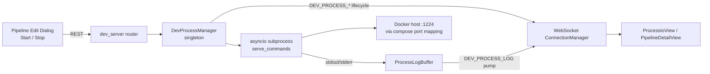
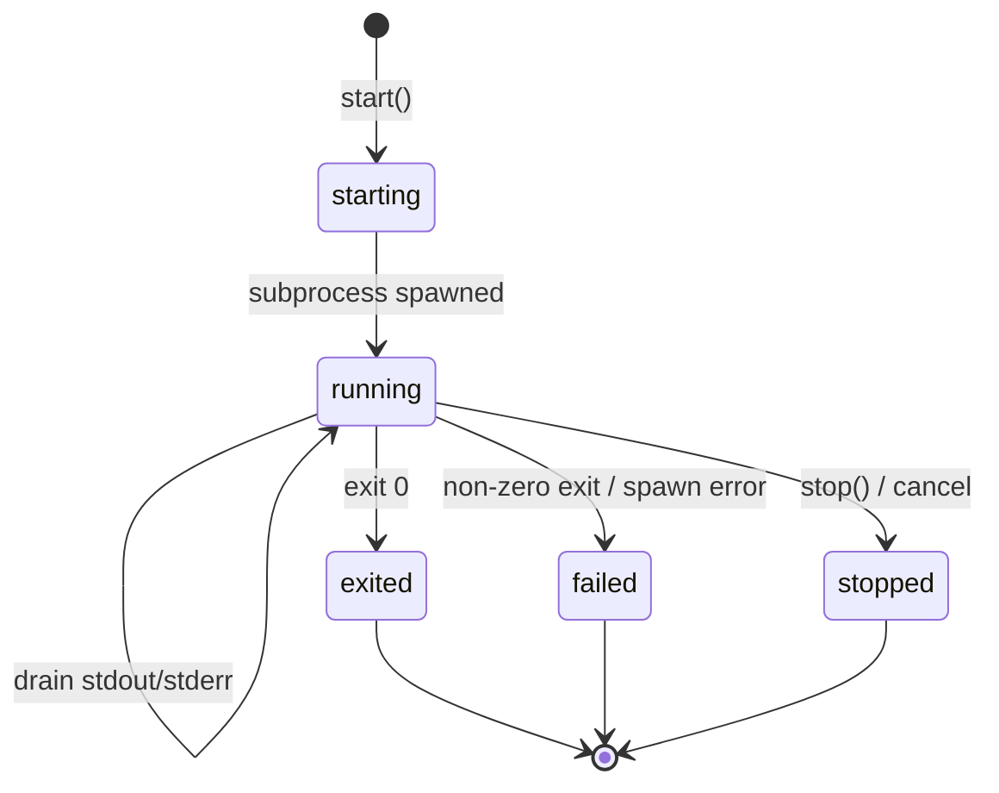
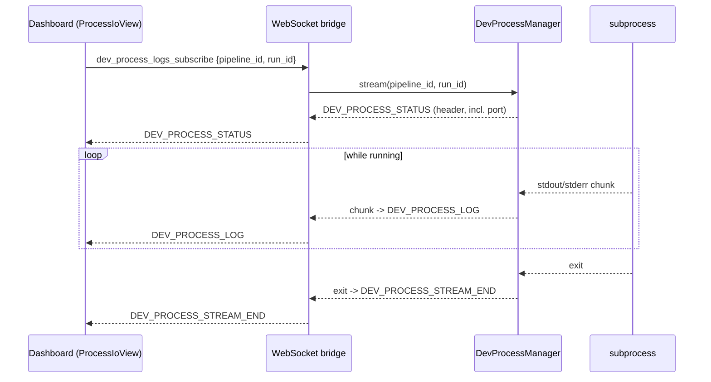

# Dev Server: Run One Background Serve Process per Pipeline

> **Reference document.** This describes the dev-server feature *as implemented
> today*, for anyone navigating the code. It is not a change proposal. For the
> original design/rollout rationale of the port plumbing, see
> [dd_dev_server_port.md](dd_dev_server_port.md).

## 1. Overview

A pipeline can declare **serve commands** (`Pipeline.serve_commands`). From the
dashboard the user presses *Start*; the request is handled by the `dev_server`
REST router, which delegates to the process-wide singleton
`DevProcessManager`. The manager spawns the configured command lists as
long-running background subprocesses in the pipeline's workspace, captures their
stdout/stderr, and enforces **single-instance** semantics per pipeline (only one
dev process may run at a time).

The running process is reachable from the Docker host on a single well-known
port (`DEV_SERVER_PORT`, default `1224`), which is injected into the child
environment as both `DEV_SERVER_PORT` and `PORT`.



## 2. Configuration

| Where | Key | Default | Meaning |
|-------|-----|---------|---------|
| `core/config.py` | `DEV_SERVER_PORT` | `1224` | Container port the dev server is expected to listen on. Parsed with `int()`; a non-integer raises `RuntimeError`. |
| `Dockerfile` | `DEV_SERVER_PORT` (`ENV`) | `1224` | Baked-in default; `EXPOSE 8000 1224`. |
| `docker-compose.yml` | `DEV_SERVER_PORT` (`${...}`) | `1224` | Published on loopback: `127.0.0.1:${DEV_SERVER_PORT:-1224}:${DEV_SERVER_PORT:-1224}`. |
| `deploy/*.env.example` | `DEV_SERVER_PORT` | prod `1224`, staging `1225` | Seeded into the per-instance env file; forwarded into the container via `env_file`. |

The port is a **single global value per container instance** (not per pipeline):
Docker port publishing is fixed at container start and cannot be re-mapped when
a pipeline is started. Staging uses a distinct value (`1225`) so both instances
can run on one host.

## 3. Data Model

`Pipeline.serve_commands` is an optional list of **argv lists**
(`Optional[List[List[str]]]`), e.g.:

```json
[["sh", "-c", "uv run uvicorn api.main:app --reload"],
 ["sh", "-c", "cd frontend && npm run dev"]]
```

- Each inner list is one command executed **sequentially**.
- `None`/empty means "not configured" (the start endpoint rejects it with
  `400`).
- Validated by a command-list validator on the `Pipeline` model (same shape as
  `test_commands` / `lint_commands`).

## 4. Core Service: `DevProcessManager`

`core/services/dev_process_manager.py` owns the whole lifecycle and is a
process-wide singleton (class-level `_processes`, `_locks`, `_event_sink` maps),
so every caller — REST router, agent tool, WebSocket bridge — observes the same
process state.

### 4.1 Public API

| Method | Purpose |
|--------|---------|
| `start(pipeline_id, commands, user)` | Spawns the command sequence; raises `DevProcessAlreadyRunningError` if one is running. |
| `status(pipeline_id)` | Snapshot of the current process (or `not_started`). |
| `stop(pipeline_id)` | Terminates the process group and clears state; raises `DevProcessNotFoundError`. |
| `stop_all()` | Stops every tracked process (app shutdown). |
| `stream(pipeline_id, run_id?)` | Async generator replaying then tailing the log. |
| `reset()` | Clears all state (tests). |

### 4.2 Process state (`ProcessInfo`)

Each pipeline's tracked process is a `ProcessInfo` holding the `run_id`, the
command lists, the live `asyncio.subprocess.Process`, its background `Task`, the
bounded `ProcessLogBuffer`, the final `stdout`/`stderr`/`exit_code`, the
`user`, `started_at`, a `status` string, and a `started_event` used to unblock
the spawning caller.

### 4.3 Environment contract

`_run_commands` builds an explicit child environment that copies `os.environ`
and overrides two keys **only in the child**:

```python
env = {
    **os.environ,
    "DEV_SERVER_PORT": str(config.DEV_SERVER_PORT),
    "PORT": str(config.DEV_SERVER_PORT),
}
```

This lets zero-config serve commands (`npm run dev`, `uvicorn --port $PORT`)
bind to the published port. The API process's own `PORT` is unaffected.

### 4.4 Process execution

For each entry in the command sequence, the manager:

1. Spawns with `asyncio.create_subprocess_exec(..., cwd=workspace, env=env,
   start_new_session=True)` — its own session/process group so descendants die
   with it.
2. Drains stdout/stderr concurrently via `asyncio.gather`, appending decoded
   chunks to the `ProcessLogBuffer`.
3. Records `exit_code`; a non-zero exit stops the sequence.

The workspace is resolved via `pipeline_queries.get_pipeline_by_id` +
`git_utils.ensure_repo_cloned` (clones remote repos on first use).

### 4.5 Output capture: `ProcessLogBuffer`

A bounded (`maxlen=5000`), append-only log of `LogChunk {seq, stream, text}`.
Evicting the oldest chunk advances `base_seq` so tailers can detect dropped
history. An `asyncio.Event` wakes streaming consumers without busy-polling.

### 4.6 Termination

`_terminate_proc_tree` sends `SIGTERM` to the process **group**, waits up to 5 s,
then escalates to `SIGKILL`. `stop()` cancels the background task and pops the
state.

### 4.7 Lifecycle events

The manager emits `DEV_PROCESS_STARTED` / `DEV_PROCESS_EXITED` through an
optional **event sink** (`set_event_sink`). The API layer wires this to
`ConnectionManager.broadcast`, keeping `core` from importing `api`.



## 5. REST API

`api/routes/dev_server.py` is a thin pass-through over the manager (prefix
`/pipelines/{pipeline_id}/dev`). All responses include the published `port`.

| Endpoint | Method | Behavior | Errors |
|----------|--------|----------|--------|
| `/status` | GET | Returns `status()` snapshot. | — |
| `/start` | POST | Reads `serve_commands`, calls `start()`. | `400` no commands / spawn error; `409` already running. |
| `/restart` | POST | `stop()` (ignore not-found) then `start()`. | as `start`. |
| `/stop` | POST | Calls `stop()`. | `404` not found. |

`start()` response shape:

```json
{"status": "started", "pipeline_id": "...", "run_id": "...",
 "pid": 1234, "port": 1224, "user": "alice", "started_at": 1720000000.0}
```

`status()` additionally carries `running`, `exit_code`, and (when idle)
`"status": "not_started"`.

## 6. WebSocket Streaming

`api/dev_server_ws.py` multiplexes the `dev_process_*` message family over the
shared `/ws/{client_id}` `ConnectionManager`. `register_dev_process_ws()` (called
from `api/main.py`) wires the lifecycle sink and the subscribe handlers.

| Direction | Message | Scope |
|-----------|---------|-------|
| server → all | `DEV_PROCESS_STARTED` | low-frequency lifecycle broadcast |
| server → all | `DEV_PROCESS_EXITED` | low-frequency lifecycle broadcast |
| server → subscriber | `DEV_PROCESS_STATUS` | stream header (from `_info_public`) |
| server → subscriber | `DEV_PROCESS_LOG` | one buffered chunk |
| server → subscriber | `DEV_PROCESS_STREAM_END` | terminal `exit` event |
| client → server | `dev_process_logs_subscribe` | starts a per-socket log pump |
| client → server | `dev_process_logs_unsubscribe` | cancels the pump |

Each subscription runs a **pump** bound to the requesting WebSocket that replays
buffered history then tails, self-terminating on disconnect or the terminal
`exit`. A `run_id` mismatch (process restarted mid-stream) yields only the
terminal `exit` so the client detaches cleanly.



## 7. Frontend

| Component | Role |
|-----------|------|
| `PipelineClient` (`core/clients/PipelineClient.ts`) | REST calls `getDevServerStatus`, `startDevServer`, `stopDevServer`; `DevServerStatus` typed as `{running, status, pid, exit_code, run_id, port}`. |
| `DevProcessService` (`core/DevProcessService.ts`) | Typed bridge over `WebSocketClient` for `dev_process_logs_subscribe`; filters co-tenant messages by `pipeline_id`/`run_id`. |
| `ProcessIoView` (`ui/components/session/ProcessIoView.ts`) | Renders the live log; subscribes/unsubscribes on mount/unmount. |
| `PipelineEditDialog` | *Serve Commands* editor plus a Start/Stop control showing the running port. |
| `PipelineRealtimeController` | Reacts to `DEV_PROCESS_STARTED` / `DEV_PROCESS_EXITED` to update the header indicator. |

## 8. Deployment / Port Publishing

- `Dockerfile`: `ENV DEV_SERVER_PORT=1224`, `EXPOSE 8000 1224`.
- `docker-compose.yml` publishes both ports on loopback only, so the host nginx
  reverse proxy is the single entry point and Docker's IPv6 publishing cannot
  expose the app:
  ```yaml
  ports:
    - "127.0.0.1:${PORT:-8081}:${PORT:-8081}"
    - "127.0.0.1:${DEV_SERVER_PORT:-1224}:${DEV_SERVER_PORT:-1224}"
  ```
- `deploy/prod.env.example` (`1224`) and `deploy/staging.env.example` (`1225`)
  seed the value; `deploy-local.sh` copies the template to the env file, which is
  forwarded into the container by `env_file` and used for `${...}` interpolation.

For the full rationale (why a single global port, why loopback binding, the
alternatives rejected) and the test strategy, see
[dd_dev_server_port.md](dd_dev_server_port.md).

## 9. Guarantees & Invariants

- **Single instance per pipeline** — a second `start` while running raises
  `DevProcessAlreadyRunningError` (guarded by a per-pipeline `asyncio.Lock`).
- **Process-tree teardown** — `start_new_session=True` + `killpg` means
  descendants (reload watchers, shells) die with the parent.
- **Bounded memory** — log history is capped; old chunks are evicted.
- **No cross-layer import** — `core` never imports `api`; the event sink is a
  dependency-inversion hook.
- **Port isolation** — `PORT` is overridden only in the child, never the API
  process.
- **Per-subscriber streaming** — log pumps are scoped to a socket + pipeline, so
  multiple processes can be tailed concurrently without cross-talk.
