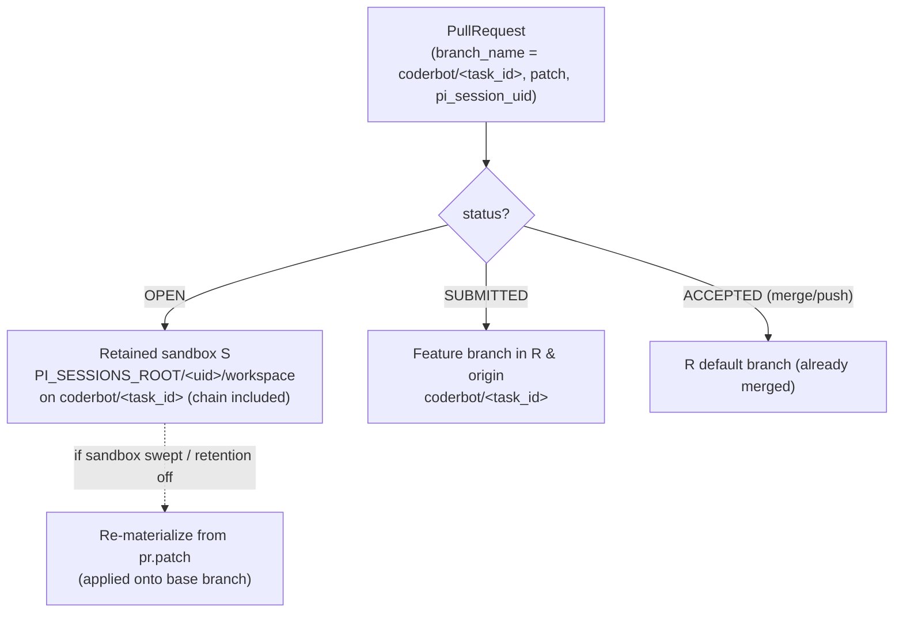
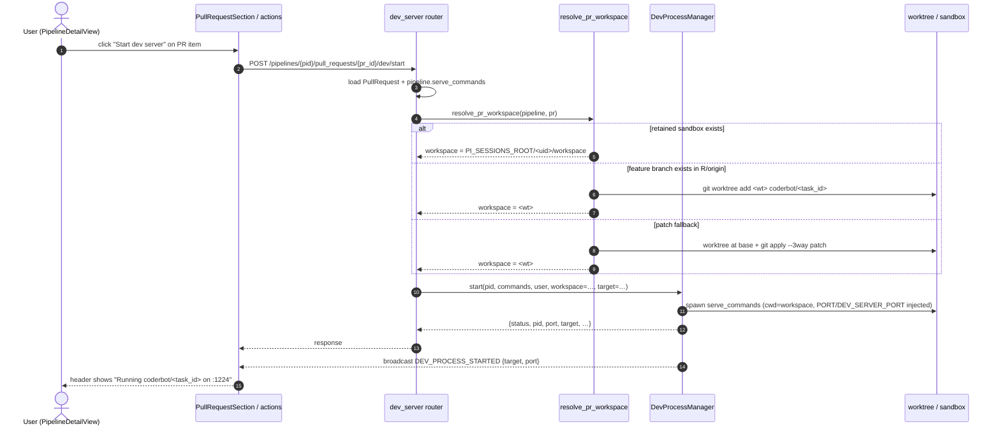

# Design Document: Run the Dev Server on a Pull Request's Branch

**Related design documents:**
[`design/backend/dd_dev_server.md`](dd_dev_server.md),
[`design/git/dd_batch_coderbot_git_process.md`](../git/dd_batch_coderbot_git_process.md),
[`design/git/dd_git_hosting.md`](../git/dd_git_hosting.md)

## 1. Purpose & Motivation

Today the dev server is **pipeline-scoped**: `DevProcessManager` runs
`Pipeline.serve_commands` in the pipeline's durable working repository `R`, on
whatever branch is currently checked out (normally the clean default branch).
This is fine for "run my app" but useless for reviewing work.

A batched CoderBot session produces a **stack of pull requests** — one
`PullRequest` document per task, each carrying a `branch_name`
(`coderbot/<task_id>`) and a `patch`, with the branches physically chained so
PR2 sits on top of PR1, PR3 on top of PR2, and so on. The repositories and
feature branches for that chain are **retained** (the per-session sandbox `S`,
and — in `gitea_pr` mode — the feature branches left in the durable clone `R`
and pushed to `origin`).

This document describes how to exploit that retained state so a user can
**start the dev server on top of any pull request in the stack** — i.e. run the
serve commands against the code that PR would introduce, on top of every
predecessor commit it transitively contains — and thereby test a change *before*
accepting or submitting it.

Concretely: on each pull-request item in `PipelineDetailView` we add a
**"Start dev server"** action. Clicking it starts the dev server with the
pipeline's serve commands, but in the checkout that represents that PR's head
(its branch tip, including the chained predecessors), instead of in `R`'s default
branch.

## 2. Background

Two existing subsystems are combined here. Both are described elsewhere in
detail; only the facts that matter for this feature are restated.

### 2.1 The dev server (reference)

See [`dd_dev_server.md`](dd_dev_server.md). Key facts:

- `DevProcessManager` is a process-wide singleton that spawns
  `Pipeline.serve_commands` as a long-running subprocess and enforces
  **single-instance per pipeline**.
- The working directory is resolved by `_resolve_workspace()` to
  `pipeline.workspace_abs_path` (the durable clone `R`); it calls
  `git_utils.ensure_repo_cloned()` to clone/fetch on first use.
- The child environment gets `DEV_SERVER_PORT` and `PORT` injected, so serve
  commands bind to the single published port (default `1224`).
- The port is **global** (one value per container), so at most one dev server is
  reachable from the host at a time in practice.

The manager is deliberately decoupled from git concerns beyond "run here": it
takes a resolved working directory and runs commands in it. This is the seam we
extend.

### 2.2 The batched CoderBot git process (reference)

See [`dd_batch_coderbot_git_process.md`](../git/dd_batch_coderbot_git_process.md).
Key facts:

- Each task runs in a **sandbox** `S` — a full clone of `R`. For a batch run `S`
  is either ephemeral (`SANDBOX_ROOT/coderbot/<task_id>`, deleted after the run)
  or **retained** at `PI_SESSIONS_ROOT/<session_uid>/workspace` when the run has
  a `session_uid` and `PI_SESSION_RETAIN_BATCH_WORKSPACE` is enabled (default).
- Pi commits `c` on branch `coderbot/<task_id>` **inside `S`**. A `patch` (the
  diff) is captured and stored on a new `PullRequest` document together with
  `branch_name`, `status=OPEN`, and `pi_session_uid`.
- Chained runs branch their sandbox off the predecessor's `coderbot/<task_id>`
  tip, so **PR<i>n</i>'s sandbox already contains commits c1…c<i>n</i>**.
- On **accept** the change leaves the sandbox: the stored `patch` is re-applied
  (`git apply --3way`) in `R`. Depending on `apply_mode`:
  - `merge` (local pipeline) → committed onto `R`'s default branch.
  - `push` (remote + `REMOTE_PR_MODE=direct`) → committed onto `R`'s default
    branch and pushed.
  - `submit` (remote + `REMOTE_PR_MODE=gitea_pr`) → committed onto a **feature
    branch** `coderbot/<task_id>` in `R`, pushed to `origin`, and a Gitea PR is
    created. `R`'s default branch stays clean; the feature branch is **left in
    place** both locally and on `origin`.

So the code of a PR lives in up to three places depending on its status, which
is exactly what this feature must reconcile.

## 3. Where a PR's code lives

| PR status | Mode | Canonical code location |
|-----------|------|-------------------------|
| `OPEN` (not yet accepted) | any | Retained sandbox `S` = `PI_SESSIONS_ROOT/<session_uid>/workspace`, branch `coderbot/<task_id>`, commit `c` (chain included). Recoverable from the `patch` if `S` is gone. |
| `SUBMITTED` (gitea_pr) | `submit` | Feature branch `coderbot/<task_id>` in `R` (clone) **and** `origin` (Gitea PR head). |
| `ACCEPTED` | `merge`/`push` | `R` default branch (already contains the change; no feature branch). |



The unifying invariant: **the PR's `patch` is always available** on the
`PullRequest` document, and `branch_name` tells us which branch it belongs to.
That makes the `patch` the fallback source of truth when the more convenient
retained checkout is unavailable.

## 4. Core Idea

Extend the dev server to accept an optional **target** describing *where* (which
checkout) to run the serve commands, in addition to the existing pipeline-scoped
behaviour. A PR-scoped "start" resolves that PR's code into a working directory
and runs the pipeline's `serve_commands` there.

The resolution is layered, cheapest/most-convenient first:

1. **Retained sandbox** — if the PR's `pi_session_uid` resolves to a live
   retained workspace on `coderbot/<task_id>`, run directly there. This is the
   common case for the "stack awaiting review" and costs nothing.
2. **Existing feature branch** — if `R` (or `origin`) already has the branch
   `coderbot/<task_id>` (a `SUBMITTED` PR), check it out into a **git worktree**
   so we do not disturb `R`'s clean default branch.
3. **Patch fallback** — otherwise materialize the branch in a worktree by
   applying `pr.patch` (`git apply --3way`) onto the correct base (the
   predecessor branch for a chained PR, else the default branch).

In all three cases the resulting directory is a full checkout at that PR's head,
so `serve_commands` run there see exactly the code the PR would introduce,
including every predecessor commit beneath it.

### Why a worktree (not checkout in `R`)

`R`'s default branch must stay clean and checked out for the accept/reject flow
(`validate_workspace_clean`, `ensure_feature_branch`, `checkout default branch`).
Checking out a PR branch directly in `R` would race with and corrupt those
operations. A linked worktree is an independent working directory sharing `R`'s
object database, so it is cheap, isolated, and does not touch `R`'s `HEAD` or
index. The retained sandbox `S` is already such an isolated checkout, which is
why it is the preferred source.

## 5. Proposed Changes

### 5.1 `DevProcessManager` — accept an explicit working directory + label

`backend/core/src/core/services/dev_process_manager.py`

`start()` currently resolves the workspace itself via `_resolve_workspace()`.
Add an optional override so a PR-scoped caller can supply the directory it has
prepared, plus a human-readable `target` (e.g. the branch name) recorded on the
process for the UI:

```python
async def start(
    self,
    pipeline_id: str,
    commands: List[List[str]],
    user: str = "",
    *,
    workspace: Optional[str] = None,   # override; else _resolve_workspace()
    target: Optional[str] = None,      # e.g. "coderbot/<task_id>" or "default"
) -> Dict:
```

- When `workspace` is `None`, behaviour is unchanged (resolve `R`).
- `target` is stored on `ProcessInfo` and surfaced in `_info_public()`,
  `start()`, and `status()` responses (alongside the existing `port`) so the
  header can render *"Running on coderbot/t123"* instead of just a port.
- Single-instance semantics stay **per pipeline**: starting a PR's dev server
  while another dev process for the same pipeline is running raises
  `DevProcessAlreadyRunningError` (the caller stops the previous one first, or
  the UI surfaces "stop before switching branch"). No change to locking,
  output capture, or process-group termination.

### 5.2 Resolve the PR's working directory

New helper in the `core` git utilities (or a small service next to the router),
`backend/core/src/core/utils/git_utils.py`:

```
async def resolve_pr_workspace(pipeline, pr) -> (workspace_path, target_label)
```

Implements the layered resolution from §4:

1. If `pr.pi_session_uid` maps to an existing retained workspace
   (`PI_SESSIONS_ROOT/<uid>/workspace`) whose `HEAD` is on
   `coderbot/<task_id>`, return it.
2. Else, ensure `R` is present (`ensure_repo_cloned`). If branch
   `coderbot/<task_id>` exists locally or on `origin`, create a worktree
   `git worktree add <wt_path> coderbot/<task_id>` and return it.
3. Else create a worktree at the resolved base branch (predecessor branch for a
   chained PR, else default) and `git apply --3way` the `patch`, leaving the
   changes in the worktree (committing is optional and only needed if we want a
   stable ref to keep; see §8).

Worktree location: a sibling of `R` on the **same filesystem** (worktrees share
`R`'s object store), e.g. `REMOTE_WORKSPACES_ROOT/<repo_name>.dev/<task_id>`
(or `WORKSPACES_ROOT/<workspace_path>.dev/<task_id>` for local pipelines).
Because the dev server runs with `cwd=<wt_path>`, no change to the subprocess
spawn path is required.

### 5.3 REST endpoint

`backend/api/src/api/routes/dev_server.py`

Add a PR-scoped start endpoint (stop/status reuse the existing pipeline-scoped
ones, since the manager is single-instance per pipeline):

```
POST /pipelines/{pipeline_id}/pull_requests/{pr_id}/dev/start
```

Flow:

1. Load the `PullRequest` (must be `OPEN` or `SUBMITTED` — see §9).
2. Load the pipeline's `serve_commands` (reject with `400` if empty, as today).
3. `workspace, target = resolve_pr_workspace(pipeline, pr)`.
4. `DevProcessManager.instance().start(pipeline_id, commands, user,
   workspace=workspace, target=target)`.

The response is the same shape as `dev/start`, with the additional `target`.

A matching convenience is not strictly required for `stop`: the existing
`POST /pipelines/{pipeline_id}/dev/stop` stops whichever dev process that pipeline
has, regardless of branch.

### 5.4 Frontend — "Start dev server" on the PR item

`frontend/src/ui/components/pipeline/PullRequestSection.ts`,
`frontend/src/ui/views/pipeline/actions/pullRequestActions.ts`,
`frontend/src/core/clients/PipelineClient.ts`

- `PipelineClient`: add `startDevServerOnPr(pipelineId, prId)` (mirrors
  `startDevServer` but posts to the PR-scoped route) and include `target` in the
  `DevServerStatus` type.
- `PullRequestSection.renderPr()`: add a **"Start dev server"** button next to
  the existing *View Task / Accept / Iterate / Review* buttons, carrying
  `data-action-click="start_pr_dev_server" data-pr-id="…" data-task-id="…"`.
- `pullRequestActions.ts`: register `start_pr_dev_server` to call the client and
  refresh the dev-server indicator. If the pipeline already has a dev server
  running on another branch, the UI asks/forces a stop first (the manager
  enforces single-instance), or surfaces the `409`.

The existing `DEV_PROCESS_STARTED` broadcast already drives the header
indicator; we add `target` to its payload so the header can say which branch is
being served (see §5.1).

### 5.5 WebSocket / lifecycle payload

`backend/api/src/api/dev_server_ws.py`

`_info_public()`, the `DEV_PROCESS_STARTED` payload, and the `DEV_PROCESS_STATUS`
stream header already carry `port`; add `target` so the UI can display the
branch without an extra round-trip. No new message types are needed.

## 6. End-to-end flow



## 7. Chained pull requests

Because a chained PR's branch is built on top of its predecessor, the "stack of
5 PRs" behaves exactly as intended without extra work in the common case:

- Each retained sandbox already contains the cumulative commits c1…c<i>n</i>, so
  running the dev server in PR<i>n</i>'s sandbox tests the full chain.
- In `submit` mode, each accepted PR's feature branch in `R`/`origin` also
  contains the predecessor commits, so a worktree at `coderbot/<task_id>` tests
  the same chain.

The only ordering concern is the **patch fallback** for an `OPEN` PR whose
predecessors are still also `OPEN` (no branches materialized yet): to apply
PR<i>n</i>'s patch we must first materialize the predecessor chain, because the
patch is a diff against the predecessor tip. `resolve_pr_workspace` therefore
resolves chained PRs **in order** when it has to fall back to the patch, reusing
`_resolve_chained_start_point()` logic already present in
`routes/pull_request.py`.

## 8. Lifecycle & cleanup of worktrees

Retained sandboxes are already swept by `sweep_expired_workspaces()` after
`PI_SESSION_WORKSPACE_TTL_DAYS`. Worktrees created by this feature need their own
cleanup to avoid unbounded growth:

- Give each worktree a stable, per-PR path (`<repo>.dev/<task_id>`); a
  re-materialization reuses the same path.
- Remove the worktree (`git worktree remove`) when the PR leaves the reviewable
  state (accepted/rejected), or lazily before creating a fresh one.
- `stop()` leaves the worktree in place (a stopped server's checkout may be
  re-started); a separate "cleanup on accept/reject" hook (or the existing
  `accept_pull_request`/`reject_pull_request` flows) prunes it.

## 9. Edge cases & concerns

- **Global port / single instance.** The port (`1224`) is global and the manager
  is single-instance **per pipeline**. Starting a PR dev server for pipeline A
  while pipeline B has one running still collides on the port (a pre-existing
  limitation, not introduced here). Within a pipeline, the UI must stop the
  current dev server before switching branch; the `409` from the manager is the
  backstop.
- **`R` must stay clean.** Never `checkout` in `R`; always use a worktree or the
  retained sandbox (see §4). This preserves `validate_workspace_clean` for
  accept/reject.
- **`OPEN` vs `SUBMITTED` vs `ACCEPTED`.** The action is meaningful for `OPEN`
  and `SUBMITTED` PRs. For `ACCEPTED` (merge/push) the change is already in
  `R`'s default branch, so the action is a no-op / should be hidden or disabled.
- **Retention disabled or swept.** With `PI_SESSION_RETAIN_BATCH_WORKSPACE`
  off (or after a TTL sweep) the retained sandbox is gone; the patch fallback
  (§4.3) still works. This is the reason the `patch` remains the source of truth.
- **Local pipelines (`merge` mode).** No feature branch is ever created in `R`;
  the retained sandbox and the patch fallback are the only sources. Worktrees
  still apply (base = `R` default branch).
- **`serve_commands` run in a foreign checkout.** Commands that assume a specific
  `cwd` or rely on sibling paths relative to `R` may need `cd` wrappers, exactly
  as they already do for the sandbox in CoderBot runs.
- **Dirty/out-of-date `R`.** `resolve_pr_workspace` must `ensure_repo_cloned`
  (fetch/ff) before creating worktrees so the base matches `origin`.

## 10. Alternatives considered

- **Checkout the branch directly in `R`.** Simplest, but corrupts the clean
  default-branch invariant the accept/reject flow depends on, and blocks other
  pipelines' operations on the same repo. Rejected.
- **Always re-materialize from `patch`.** Uniform but re-derives work the
  retained sandbox/branch already encodes, and needs careful chain ordering for
  every start. Rejected as the *primary* path; kept as the fallback.
- **Per-PR published port.** Would let several PRs be served simultaneously, but
  Docker port publishing is fixed at container start, so it would require a
  dynamic reverse proxy. Out of scope (same conclusion as
  [`dd_dev_server_port.md`](dd_dev_server_port.md)).
- **Reuse the sandbox only (no worktree).** Minimal, but leaves the feature
  unusable once retention is disabled or the sandbox is swept, and cannot serve
  an already-`SUBMITTED` PR whose sandbox was cleaned. Rejected as the *only*
  mechanism; adopted as the fast path.

## 11. Test Strategy

- **`resolve_pr_workspace`**: returns the retained sandbox when present; falls
  back to an existing feature branch worktree; falls back to patch-apply; chained
  PRs resolve predecessors in order.
- **`DevProcessManager`**: `workspace` override changes the subprocess `cwd`;
  `target` is recorded and surfaced in `start`/`status`/`_info_public`; parent
  env still not mutated; single-instance still enforced.
- **Routes**: `POST …/pull_requests/{pr_id}/dev/start` returns `{port, target}`,
  rejects empty `serve_commands` (`400`), and returns `409` when a dev process is
  already running for the pipeline.
- **WebSocket**: `DEV_PROCESS_STARTED` / `DEV_PROCESS_STATUS` carry `target`.
- **Frontend**: the PR button posts to the PR-scoped route and the header renders
  the branch label.

## 12. Rollout & backward compatibility

- Defaults are additive: `workspace`/`target` are optional, so existing
  pipeline-scoped `dev/start` behaviour is unchanged.
- No new env vars or port changes; the single published `DEV_SERVER_PORT` is
  reused.
- The PR button is a new UI affordance on existing PR cards; no data migration is
  required (the `patch`, `branch_name`, and `pi_session_uid` fields already exist
  on `PullRequest`).
