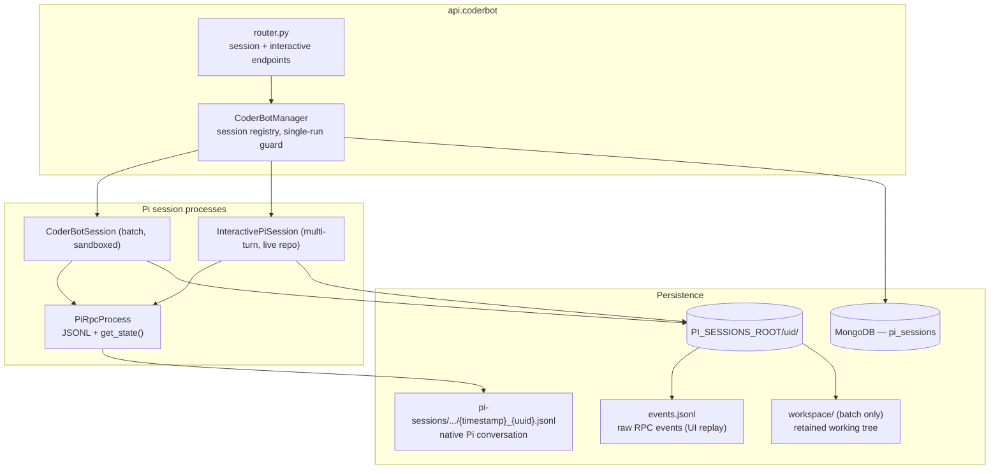
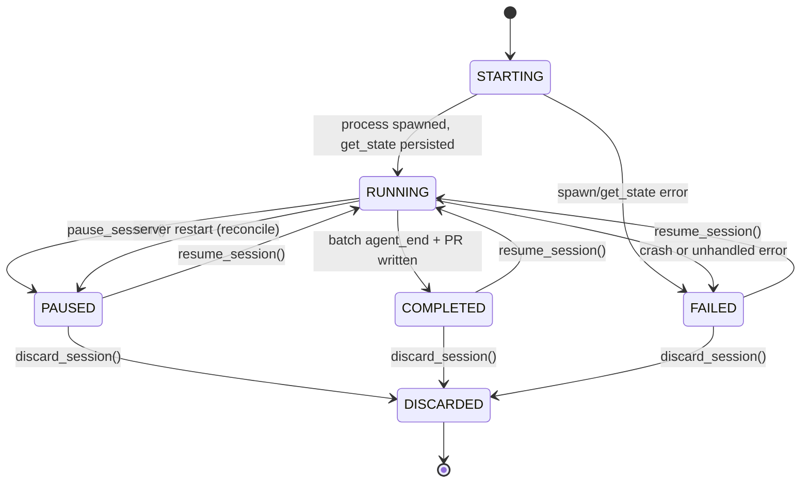
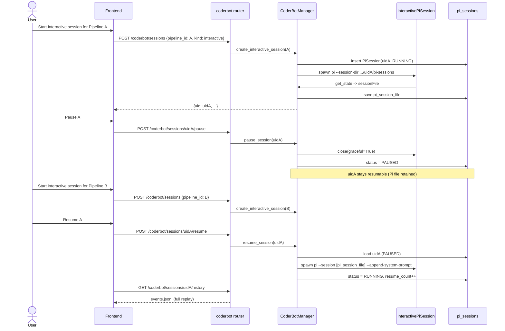
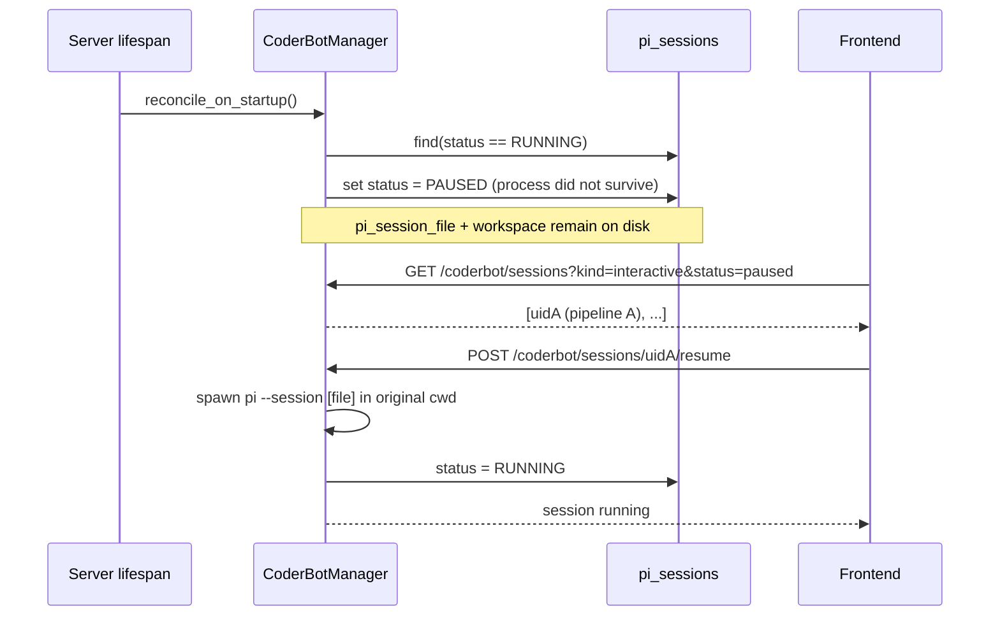

# Design Document: Persistent & Resumable Pi Sessions

## 1. Overview

The `CoderBotManager` currently owns a single in‑memory interactive
`InteractivePiSession` plus a sequential queue of batch `CoderBotSession`
instances (`backend/api/src/api/coderbot/manager.py`). Both spawn
`pi --mode rpc --no-session`, so **all agent state is lost when the process
stops or the backend restarts**:

* an interactive session that is "stopped" cannot be continued,
* a backend restart drops the session the user was working in, and
* a completed batch run that produced a pull request cannot be extended by the
  same agent with its original context.

Pi already supports persistent, resumable sessions natively (JSONL session
files, `--session-dir`, `--session`, and RPC commands such as `get_state`,
`switch_session`, `get_entries`). This document proposes a **session
persistence layer** on top of that native capability so the backend can
*pause*, *persist* and *resume* a Pi session, and then shows how the three
requested use cases are implemented on top of it.

The plan is deliberately additive: existing endpoints, websocket messages and
frontend services keep working (with a session UID added to payloads), and
persistence can be switched off with a config flag to fall back to today's
ephemeral `--no-session` behaviour.

---

## 2. Goals & Non‑Goals

### Goals

1. Give every Pi run a **stable backend session UID** and persist its metadata
   in MongoDB.
2. Persist the **Pi conversation** (native session JSONL) and the
   **streamed UI event log** under a controlled directory.
3. Persist/reconstruct the **workspace** required by a sandboxed batch run so
   the agent can continue editing the same tree.
4. Allow the manager to keep many **paused** sessions while enforcing that at
   most one Pi process runs at a time (the existing resource invariant).
5. Enable the three use cases:
   * pause interactive pipeline A → run interactive pipeline B → resume A;
   * survive a backend restart and resume the previous interactive session;
   * persist a completed batch session, attach its UID to the task, and resume
     it to iterate on the produced pull request (a new commit + PR).
6. Keep the frontend able to replay the full activity log after resume.

### Non‑Goals

* More concurrency than today: the manager keeps the existing
  one‑running‑process‑per‑lane guarantee (one batch + one interactive), it just
  adds many durable *paused* sessions.
* Multi‑tenant isolation beyond storing an optional `owner` on the session
  (the deployment is currently single‑user).
* Time‑travel/branching UI (`/tree`, `/fork`, `/clone`). The data model leaves
  room for it, but no UI is proposed here.
* Changing how PRs are accepted/merged.

---

## 3. Current State (As‑Is)

### 3.1 Components

| Component | File | Responsibility |
|-----------|------|----------------|
| `CoderBotManager` | `backend/api/src/api/coderbot/manager.py` | Owns the batch queue and the single interactive slot; broadcasts lifecycle events. |
| `CoderBotSession` | `backend/api/src/api/coderbot/session.py` | One batch task: sandbox clone → Pi prompt → verify → PR → **delete sandbox**. |
| `InteractivePiSession` | same file | Long‑lived multi‑turn chat that runs in the **live** pipeline repository. |
| `PiRpcProcess` | `backend/api/src/api/coderbot/pi_rpc_process.py` | Subprocess + JSONL framing + command/response correlation. Always adds `--no-session`. |
| `router.py` | `backend/api/src/api/coderbot/router.py` | `/coderbot/session`, `/trigger`, `/stop`, `/interactive/*`. |

### 3.2 What is persisted today

* **Batch**: raw RPC events are appended to
  `SANDBOX_ROOT/logs/<slug(task_id)>/coderbot_*.jsonl` by
  `CoderBotSession._log_event` / `read_session_history`. The sandbox itself is
  deleted at the end of `run()` (`self.helper.cleanup()`).
* **Interactive**: only in‑memory state. No events are written to disk; the
  stream exists solely as `INTERACTIVE_RPC_EVENT` websocket messages.
* **Manager**: `_active_session`, `_last_session` and `_interactive_session`
  are process‑local attributes with no durability.

### 3.3 Gaps

| Gap | Consequence |
|-----|-------------|
| `--no-session` on every spawn | Pi does not write a session file; no context to resume. |
| No session UID | A conversation cannot be referenced by task/PR or the UI. |
| Interactive events not logged | After a reload/restart the UI cannot replay the chat. |
| Batch sandbox deleted | Even with a Pi session file, the working tree is gone. |
| Single interactive slot only | "Pause A, run B, resume A" is impossible. |
| No startup reconciliation | After a restart the stale session is silently lost. |

---

## 4. Pi Native Session Capabilities (Research Summary)

From the Pi documentation (`/docs/sessions.md`, `/docs/session-format.md`,
`/docs/rpc.md`):

* Sessions auto‑save to `~/.pi/agent/sessions/--<cwd>--/<timestamp>_<uuid>.jsonl`
  unless `--no-session` is passed. Each file is a JSONL tree (`id`/`parentId`),
  version 3.
* `--session-dir <path>` overrides the storage root; sessions are still grouped
  by working directory below it.
* `--session <path|id>` loads a specific session file / partial session id;
  `--fork <path|id>` forks it; `--name/-n` sets a display name.
* RPC state: `get_state` returns `sessionFile`, `sessionId`, `sessionName`,
  `messageCount`; `get_messages` returns the final `AgentMessage[]`;
  `get_entries` returns append‑order entries with a `since` cursor (useful to
  page history); `get_session_stats` returns tokens/cost.
* RPC session control: `switch_session` (load another file in a running
  process), `new_session`, `fork`, `clone`, `compact`, `set_session_name`.
* Events: `agent_end` is one low‑level run; `agent_settled` is the signal that
  the agent will not continue automatically (already used by the interactive
  session).

**Key consequence:** resuming is mostly a matter of *not* passing
`--no-session`, controlling the session directory, and re‑launching with
`--session <file>`. The remaining work is backend bookkeeping, workspace
retention and UI replay.

> Note: a `pi` process has a fixed `cwd`. Because different pipelines live in
> different repositories, a single long‑lived host process cannot serve all
> sessions (`switch_session` alone does not change `cwd`). The design therefore
> uses **one process per resumed session**, spawned on demand.

---

## 5. Proposed Architecture (To‑Be)

### 5.1 Component Overview



### 5.2 Session Identity & Lifecycle

Every logical session gets a backend **UID** (UUID4 string) that survives
process restarts and is the primary key of the `pi_sessions` collection and of
the on‑disk directory.



* `PAUSED` and `COMPLETED` are **resumable**; the process is gone but the Pi
  session file (and, for batch, the workspace) are retained.
* `DISCARDED` releases the workspace and optionally the Pi session file.
* The manager may hold any number of `PAUSED`/`COMPLETED`/`FAILED` records, but
  only one record may be `RUNNING` (enforced with an `asyncio.Lock` +
  `current_running_uid`, mirroring the existing `_interactive_lock`).

### 5.3 Persistence Layout

A new configurable root `PI_SESSIONS_ROOT` (default
`SANDBOX_ROOT / "pi_sessions"`) holds one directory per session:

```
PI_SESSIONS_ROOT/
└── <session_uid>/
    ├── pi-sessions/                    # passed to pi as --session-dir
    │   └── --<cwd-slug>--/
    │       └── <timestamp>_<uuid>.jsonl   # native Pi conversation
    ├── events.jsonl                    # backend raw-RPC event log (UI replay)
    ├── meta.json                       # crash-recovery mirror of the DB record
    └── workspace/                      # batch sessions only (retained tree)
```

* `meta.json` is a best‑effort sidecar written on each state change so the
  backend can recover the Pi `sessionFile` even if MongoDB is temporarily
  unavailable. It is **not** the source of truth.
* Native session files and `events.jsonl` are both append‑only, so a crash
  loses at most the last event.

### 5.4 Data Model

New `PiSession` document in `backend/core/src/core/models/models.py`:

```python
class PiSessionKind(str, Enum):
    INTERACTIVE = "interactive"
    CODERBOT = "coderbot"      # batch task run


class PiSessionStatus(str, Enum):
    STARTING = "starting"
    RUNNING = "running"
    PAUSED = "paused"          # deliberately stopped, resumable
    COMPLETED = "completed"    # batch finished, resumable
    FAILED = "failed"          # resumable
    DISCARDED = "discarded"    # resources released


class PiSession(Document):
    uid: str                                   # UUID4, primary handle
    kind: PiSessionKind
    status: PiSessionStatus = PiSessionStatus.STARTING
    owner: Optional[str] = None                # username, for scoping
    label: Optional[str] = None                # human readable (Pi session name)

    # Relationships
    pipeline_id: Optional[str] = None
    task_id: Optional[str] = None
    pull_request_ids: List[str] = Field(default_factory=list)

    # Where Pi stores its conversation
    pi_session_id: Optional[str] = None        # from get_state
    pi_session_file: Optional[str] = None      # absolute path, from get_state
    session_dir: Optional[str] = None          # our --session-dir for this uid

    # Runtime / resume inputs
    cwd: Optional[str] = None
    workspace_path: Optional[str] = None       # retained batch sandbox
    model: Optional[str] = None
    skill_names: List[str] = Field(default_factory=list)
    bot_type: str = "interactive"              # websocket discriminator

    # Reconstruction / audit
    base_commit: Optional[str] = None
    branch_name: Optional[str] = None

    # Bookkeeping
    resume_count: int = 0
    last_error: Optional[str] = None
    created_at: datetime = Field(default_factory=lambda: datetime.now(UTC))
    updated_at: datetime = Field(default_factory=lambda: datetime.now(UTC))
    last_active_at: Optional[datetime] = None
    discarded_at: Optional[datetime] = None

    class Settings:
        name = "pi_sessions"
```

Additive fields:

```python
class Task(Document):
    ...
    pi_session_uid: Optional[str] = None    # original batch session for this task

class PullRequest(Document):
    ...
    pi_session_uid: Optional[str] = None    # session that produced this PR
```

These are optional, so existing documents remain valid; no migration is
required.

### 5.5 Manager Redesign

Replace the single interactive slot with a **registry** while keeping the
one‑running‑process invariant.

```python
class CoderBotManager:
    def __init__(self):
        self._sessions: dict[str, PiSessionHandle] = {}   # uid -> handle
        self._running_uid: Optional[str] = None
        self._run_lock = asyncio.Lock()

    # lifecycle
    async def create_interactive_session(self, pipeline, owner=None) -> PiSession
    async def resume_session(self, uid: str, *, pause_current: bool = True) -> PiSession
    async def pause_session(self, uid: str) -> bool
    async def discard_session(self, uid: str) -> bool
    async def reconcile_on_startup(self) -> None

    # queries (used by the router)
    async def list_sessions(self, *, kind=None, status=None,
                            pipeline_id=None, owner=None) -> list[PiSession]
    async def get_session(self, uid: str) -> Optional[PiSession]

    # existing APIs keep working
    async def get_interactive_session(self) -> Optional[dict]
    async def send_interactive_message(self, uid: str, text: str) -> None
```

`PiSessionHandle` wraps the DB record plus the live process state:

```python
@dataclass
class PiSessionHandle:
    record: PiSession
    session: Optional[PiRpcProcess] = None     # CoderBotSession | InteractivePiSession
    turn_task: Optional[asyncio.Task] = None
    monitor: Optional[asyncio.Task] = None
    def is_running(self) -> bool: ...
```

* `create_interactive_session` builds a `PiSession(uid=<uuid4>, ...)`, creates
  `PI_SESSIONS_ROOT/<uid>/pi-sessions`, spawns the process, captures
  `get_state`, saves the record and broadcasts `INTERACTIVE_STARTED` with the
  UID.
* `pause_session` gracefully closes the process (`close(graceful=True)`), marks
  the record `PAUSED` and keeps the workspace/Pi file.
* `resume_session` picks the stored `pi_session_file` and `cwd`, respawns the
  process, re‑appends the interactive system prompt (it is a CLI argument and
  therefore not part of the persisted conversation), captures `get_state`
  again, sets `RUNNING` and `resume_count += 1`.
* `reconcile_on_startup` flips every `RUNNING` record to `PAUSED` (the process
  did not survive the restart) and, if `PI_SESSION_AUTO_RESUME` is set, resumes
  the most recent interactive one.
* `get_interactive_session()` returns the most recent `RUNNING`/`PAUSED`
  interactive record for backward compatibility, now carrying `uid`.

### 5.6 Process Layer Changes

`backend/api/src/api/coderbot/pi_rpc_process.py`:

```python
def __init__(..., session_dir=None, session_name=None,
             resume_session_file=None, persist=True):
    ...

def build_command(self) -> list:
    cmd = ["pi", "--mode", "rpc"]
    if self.model:
        cmd += ["--model", self.model]
    if self.persist is False:
        cmd += ["--no-session"]
    else:
        if self.session_dir:
            cmd += ["--session-dir", str(self.session_dir)]
        if self.session_name:
            cmd += ["--name", self.session_name]
        if self.resume_session_file:
            cmd += ["--session", str(self.resume_session_file)]
    return cmd
```

New helper used right after `start()`:

```python
async def capture_session_identity(self) -> dict:
    """Call get_state and remember sessionId/sessionFile/sessionName."""
    response = await self.send_command("get_state")
    data = response.get("data", {}) if isinstance(response, dict) else {}
    self.session_id = data.get("sessionId")
    self.session_file = data.get("sessionFile")
    self.session_name = data.get("sessionName")
    return data
```

Both session classes gain:

* `session_uid`, `session_dir`, `session_file` attributes;
* an optional `event_log` used from `_handle_event` (see 5.8);
* `build_command()` overrides that supply `session_dir`/`session_name`/
  `resume_session_file`.

`InteractivePiSession.build_command()` already appends
`--append-system-prompt`; that stays and is re‑applied on resume.

### 5.7 Workspace Persistence

Interactive sessions need no snapshot — they run in the live pipeline repo.
Batch sessions run in a sandbox that is currently deleted. The design changes:

* `SandboxGitHelper` accepts an explicit `workspace_path` (default remains
  `SANDBOX_ROOT/<bot_type>/<task_id>` for backward compatibility) so the
  session can point it at `PI_SESSIONS_ROOT/<uid>/workspace`.
* `CoderBotSession.run()` stops calling `helper.cleanup()` when
  `PI_SESSION_RETAIN_BATCH_WORKSPACE` is enabled. Instead it records
  `base_commit` (HEAD before CoderBot's commit) on the `PiSession`.
* Resuming a batch session reuses the retained workspace **in place**, so the
  agent's files, branch and unstaged state match what it last saw. This
  guarantees continuity.
* `discard_session` deletes the workspace; a retention sweeper (run at startup
  and periodically) removes workspaces older than
  `PI_SESSION_WORKSPACE_TTL_DAYS` that are neither `RUNNING` nor `PAUSED`.

Reconstruction fallback (if a workspace is missing): clone the pipeline repo to
a fresh path, check out `base_commit`, apply the linked PR's `patch` with
`git apply --3way` (the same mechanism as `_apply_existing_patch`). The design
keeps `base_commit`/`branch_name`/PR patch exactly for this recovery path.

### 5.8 Event Log for UI Replay

Interactive sessions do not persist events today. Introduce a small shared
`SessionEventLog` helper (in `session.py` or a new `pi_session_store.py`) with
the same JSONL shape as the batch log:

```jsonc
{"timestamp": "...", "type": "pi_rpc_event", "event": { ... }}
```

* Path: `PI_SESSIONS_ROOT/<uid>/events.jsonl`.
* `_handle_event` appends and then broadcasts, for **both** session classes.
* `read_session_events(uid)` reads it back for the history endpoint.
* The existing `read_session_history(task_id)` is kept and delegates to the
  task's `pi_session_uid` when present, otherwise falls back to the legacy
  `SANDBOX_ROOT/logs/...` path. This keeps old tasks replayable.

### 5.9 Startup Reconciliation

In `backend/api/src/api/main.py` lifespan, after `init_db()`:

```python
from api.coderbot.manager import coderbot_manager
await coderbot_manager.reconcile_on_startup()
```

`reconcile_on_startup`:

1. `RUNNING` → `PAUSED`, set `last_error="server restarted"`.
2. Best‑effort rehydrate any record whose `pi_session_file` is missing from
   `meta.json` (disk recovery).
3. Sweep expired workspaces.
4. Optionally auto‑resume the newest interactive session.

### 5.10 Concurrency & Resource Guarantees

* Only one `RUNNING` Pi process globally, guarded by `_run_lock` and
  `_running_uid` (same spirit as today's `_interactive_lock`).
* `resume_session(pause_current=True)` pauses the currently running session
  first; this is what makes use case 1 ergonomic. A `pause_current=False`
  request returns `409` if another session is running.
* Batch queue processing uses the same lock, so a resumed interactive session
  can coexist with a *paused* batch but not with a running one. (Today a batch
  and one interactive run concurrently; to preserve that, the design can use
  two lanes — `batch` and `interactive` — each allowing one running process.
  This is left as a config choice, `PI_SESSION_MAX_RUNNING`, default `2` to
  match current behaviour.)

---

## 6. Use Cases

### 6.1 Pause/Resume Interactive Pipelines A and B



### 6.2 Resume After a Backend Restart



The frontend `InteractiveCodingService` persists the active UID in
`localStorage` (mirroring `CoderBotService`) and, on load, calls
`refreshSession()` then offers/auto‑performs resume of the last UID.

### 6.3 Batch → PR → Resume to Iterate

```mermaid
sequenceDiagram
    participant CB as CoderBotSession
    participant DB as pi_sessions / tasks / PRs
    participant M as CoderBotManager
    actor U as User

    CB->>DB: task T run, creates PR-1
    CB->>DB: insert PiSession(uidS, CODERBOT, status=COMPLETED)
    CB->>DB: taskT.pi_session_uid = uidS; PR-1.pi_session_uid = uidS
    Note over CB: workspace retained at PI_SESSIONS_ROOT/uidS/workspace

    U->>M: Resume uidS with review/iteration instruction
    M->>DB: load uidS + PR-1
    M->>CB: resume in retained workspace,<br/>pi --session uidS.file
    CB->>CB: prompt(user instruction)
    CB->>CB: agent edits retained tree
    CB->>DB: commit -> new patch -> PR-2
    CB->>DB: uidS.pull_request_ids += PR-2
    CB->>DB: uidS.status = COMPLETED
    U->>U: reviews PR-2
```

This reuses the existing iteration machinery (`get_iteration_prompt`,
`_apply_existing_patch`, PR update/create in `_handle_agent_end`) but seeds it
with the **retained workspace and Pi conversation** instead of a fresh clone
and a stateless prompt. The new PR is created (per the requirement "a new
commit and pull request is created") and linked to the same session UID.

> Known limitation: if the default branch advanced after PR-1 was created, the
> retained workspace is based on the old HEAD. The resumed run still produces a
> coherent patch, but an upstream rebase/conflict is possible. The design
> records `base_commit` so the backend can detect divergence and optionally
> re‑clone + `git apply --3way` the PR patch before resuming.

---

## 7. API Changes

`backend/api/src/api/coderbot/router.py` (new, with backward‑compatible
aliases):

| Method | Path | Purpose |
|--------|------|---------|
| `GET` | `/coderbot/sessions` | List sessions (`kind`, `status`, `pipeline_id`). |
| `POST` | `/coderbot/sessions` | Create a session (`pipeline_id`, `kind`, optional `label`). |
| `GET` | `/coderbot/sessions/{uid}` | Session detail (status, timestamps, `pi_session_id`, links). |
| `POST` | `/coderbot/sessions/{uid}/pause` | Persist and stop, keeping it resumable. |
| `POST` | `/coderbot/sessions/{uid}/resume` | Respawn Pi with the stored session file. |
| `POST` | `/coderbot/sessions/{uid}/message` | Send a prompt (interactive turn or batch instruction). |
| `POST` | `/coderbot/sessions/{uid}/discard` | Stop and release workspace/Pi file. |
| `GET` | `/coderbot/sessions/{uid}/history` | Raw RPC events for UI replay. |
| `GET` | `/coderbot/sessions/{uid}/messages` | Final `AgentMessage[]` via Pi `get_messages` (optional). |

Existing endpoints are retained and delegate to a UID internally:

| Existing | Behaviour after change |
|----------|------------------------|
| `GET /coderbot/session` | Returns the current/last **batch** session, now with `session_uid`. |
| `GET /coderbot/session/{task_id}/history` | Delegates to the task's `pi_session_uid`; falls back to legacy logs. |
| `POST /coderbot/interactive/start/{pipeline_id}` | Creates a new `PiSession`, returns `session_uid`. |
| `POST /coderbot/interactive/message` | Uses the running interactive UID (or an explicit one). |
| `POST /coderbot/interactive/stop` | Now means **pause** by default; `?discard=true` deletes. |
| `POST /pull_requests/{pr_id}/iterate` | Accepts an optional `session_uid` to resume the batch session instead of starting a fresh one. |

All websocket payloads (`INTERACTIVE_STARTED/STOPPED/RPC_EVENT/TURN_ENDED`,
`CODERBOT_*`) gain a `session_uid` field; the frontend filters on it when more
than one session can be paused.

---

## 8. Frontend Changes

* `frontend/src/core/clients/CoderBotClient.ts`: add the session CRUD/pause/
  resume/history methods and the `session_uid` fields.
* `frontend/src/core/InteractiveCodingService.ts`:
  * track the active `sessionUid`;
  * `pauseSession()` / `resumeSession(uid)` / `listSessions()`;
  * replay `events.jsonl` on resume (same reducer‑replay pattern as
    `CoderBotService.reconnect`, including the `suspendEmits()` optimisation);
  * persist the UID in `localStorage` and adopt the backend session on load.
* `frontend/src/core/CoderBotService.ts`: keep the batch path; add
  `sessionUid` to the session summary and `resumeSession(uid, message)`.
* `frontend/src/ui/components/InteractiveCodingView.ts`: split "Pause" from
  "Stop/Discard"; show a paused/resumable indicator.
* `frontend/src/ui/views/PipelineDetailView.ts`: render a compact list of the
  pipeline's paused sessions with a **Resume** button; use the existing
  `actionRegistry` (`start_interactive_session`, `toggle_interactive_view`, …).
* `frontend/src/ui/components/IteratePullRequestDialog.ts` /
  `PullRequestSection.ts`: when the task has a `pi_session_uid`, offer
  "Continue with the original CoderBot session" in addition to a fresh
  iteration.

The `PiSessionService` interface (`frontend/src/ui/components/PiView.ts`) does
not need to change; the new behaviour lives in the services behind it.

---

## 9. Configuration

New environment variables in `backend/core/src/core/config.py`:

| Variable | Default | Meaning |
|----------|---------|---------|
| `PI_SESSION_PERSISTENCE_ENABLED` | `true` | Master switch. When false, spawn with `--no-session` and behave as today. |
| `PI_SESSIONS_ROOT` | `SANDBOX_ROOT/pi_sessions` | Root of the per‑session directories. |
| `PI_SESSION_EVENT_LOG_ENABLED` | `true` | Write `events.jsonl` for UI replay. |
| `PI_SESSION_RETAIN_BATCH_WORKSPACE` | `true` | Keep the batch sandbox for resume. |
| `PI_SESSION_WORKSPACE_TTL_DAYS` | `14` | GC age for not‑running sessions. |
| `PI_SESSION_AUTO_RESUME` | `false` | Resume the newest interactive session at startup. |
| `PI_SESSION_MAX_RUNNING` | `2` | Running lanes (1 batch + 1 interactive) to match today. |
| `PI_SESSION_MAX_PAUSED` | `50` | Cap on retained paused sessions per user. |

---

## 10. Migration & Rollout

1. **Phase 1 – persistence primitives (no behaviour change):** add `PiSession`
   model, `PI_SESSIONS_ROOT`, `session_dir`/`get_state` capture, `events.jsonl`
   for both session types. Keep spawning with `--no-session` until
   `PI_SESSION_PERSISTENCE_ENABLED` is enabled.
2. **Phase 2 – session registry & lifecycle:** manager registry, pause/resume,
   new router endpoints, websocket `session_uid`. Keep the old endpoints as
   aliases.
3. **Phase 3 – workspace retention:** `SandboxGitHelper` path override, stop
   deleting the batch sandbox, retention sweeper, startup reconciliation.
4. **Phase 4 – frontend:** session list/resume, history replay, localStorage
   UID, PR "continue session" affordance.
5. **Phase 5 – polish:** `get_messages`/`get_entries` powered history, stats
   (`get_session_stats`), optional auto‑resume, per‑user scoping.

No data migration is required: `pi_session_uid` is nullable and old batch logs
remain readable through the legacy history fallback.

---

## 11. Testing Strategy

Backend (pytest, mirroring `backend/tests/bots/`):

* `test_pi_session_model.py`: serialization, defaults, status transitions.
* `test_pi_rpc_process.py` (extend): `build_command` includes `--session-dir`,
  `--session`, `--name`; omits `--no-session` when persisting; includes it when
  disabled; `capture_session_identity` parses `get_state`.
* `test_coderbot_manager.py` (extend): create/pause/resume/list/discard;
  single‑running invariant; `resume_session(pause_current=...)`; registry
  survives independent instances; `reconcile_on_startup` flips `RUNNING` →
  `PAUSED`.
* `test_interactive_pi_session.py` (extend): resume reuses the stored
  `pi_session_file` and re‑appends the system instruction.
* `test_pi_session_store.py`: `events.jsonl` append/read, `meta.json`
  recovery, TTL sweep.
* `test_coderbot_session_history.py` (extend): UID path + legacy fallback.
* Use‑case tests with a fake Pi subprocess and the Beanie test DB for all three
  flows (pause A / resume A, restart reconcile, batch resume → PR‑2).
* Router tests for the new endpoints (200/404/409).

Frontend (vitest):

* `InteractiveCodingService.test.ts`: pause/resume, UID persistence, history
  replay, backend reconciliation on load.
* `CoderBotService.test.ts`: `sessionUid` summary + `resumeSession`.
* `InteractiveCodingView.test.ts` / `PipelineDetailView.test.ts`: paused list
  and resume action.
* `IteratePullRequestDialog.test.ts`: "continue session" option when a UID is
  present.

Finally, run the documented monorepo suite: `cd backend && uv run pytest` and
`cd frontend && CI=true npm run test`, plus
`cd frontend && npm run build`.

---

## 12. Risks & Open Questions

| Risk / Question | Mitigation / Decision |
|-----------------|-----------------------|
| Disk growth from retained workspaces | TTL GC (`PI_SESSION_WORKSPACE_TTL_DAYS`), `PI_SESSION_MAX_PAUSED`, explicit discard. |
| Pi session file compatibility across Pi upgrades | Pi auto‑migrates to v3 on load; pin the Pi image version and record it on the session. |
| Resuming in a changed cwd | Always reuse the recorded `cwd`/workspace path; never rebuild unless recovering. |
| Interactive system prompt is a CLI arg, not persisted | Re‑apply `--append-system-prompt` on every spawn/resume. |
| Default branch moved since the batch run | Record `base_commit`; detect divergence and offer re‑clone + `--3way` apply. |
| Secrets/absolute paths leaking into event logs | `events.jsonl` already only contains Pi RPC events; no env/token is written. Keep `meta.json` free of tokens. |
| Multi‑user scoping | Store `owner` now, enforce filtering; full auth is out of scope. |
| Concurrent batch + interactive | `PI_SESSION_MAX_RUNNING=2` preserves today's behaviour; configurable. |

---

## 13. Summary of Proposed Changes

| Area | File(s) | Change |
|------|---------|--------|
| Model | `backend/core/src/core/models/models.py` | `PiSession` + enums; `Task.pi_session_uid`; `PullRequest.pi_session_uid`. |
| Config | `backend/core/src/core/config.py` | `PI_SESSION_*` variables. |
| Transport | `backend/api/src/api/coderbot/pi_rpc_process.py` | `session_dir`/`session`/`persist` in `build_command`; `capture_session_identity()`. |
| Sessions | `backend/api/src/api/coderbot/session.py` | session UID/dir/file, event log, resume support, retained batch workspace, no cleanup on persist. |
| Manager | `backend/api/src/api/coderbot/manager.py` | session registry, lifecycle (`pause`/`resume`/`discard`/`reconcile`), single‑run guard. |
| Store | `backend/api/src/api/coderbot/pi_session_store.py` (new) | `PI_SESSIONS_ROOT` layout, `events.jsonl`, `meta.json`, GC. |
| Sandbox | `backend/api/src/api/bot/git_helper.py` | explicit `workspace_path`; retention mode. |
| Router | `backend/api/src/api/coderbot/router.py` | `/coderbot/sessions/*` endpoints + legacy aliases. |
| Startup | `backend/api/src/api/main.py` | `reconcile_on_startup()`. |
| PR route | `backend/api/src/api/routes/pull_request.py` | optional `session_uid` on iterate. |
| Frontend | `CoderBotClient.ts`, `InteractiveCodingService.ts`, `CoderBotService.ts`, `InteractiveCodingView.ts`, `PipelineDetailView.ts`, `IteratePullRequestDialog.ts` | session UID, pause/resume, history replay, resume affordances. |
| Docs | `README.md`, `RELEASENOTES.md` | document the new env vars and feature. |

With this layer in place, the three requested use cases reduce to standard
`pause` / `resume` operations on a durable session record, and the frontend
replays the persisted event log so the user's view is continuous across
pauses, pipeline switches and backend restarts.
