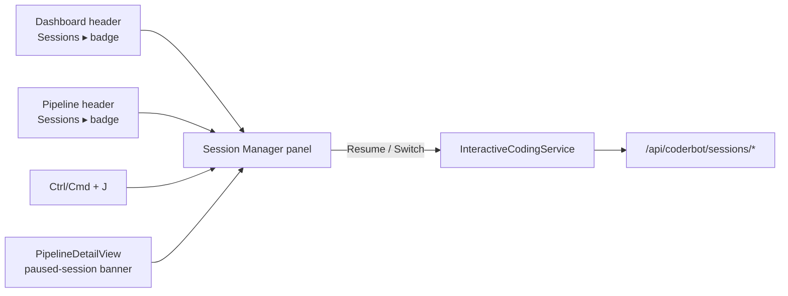
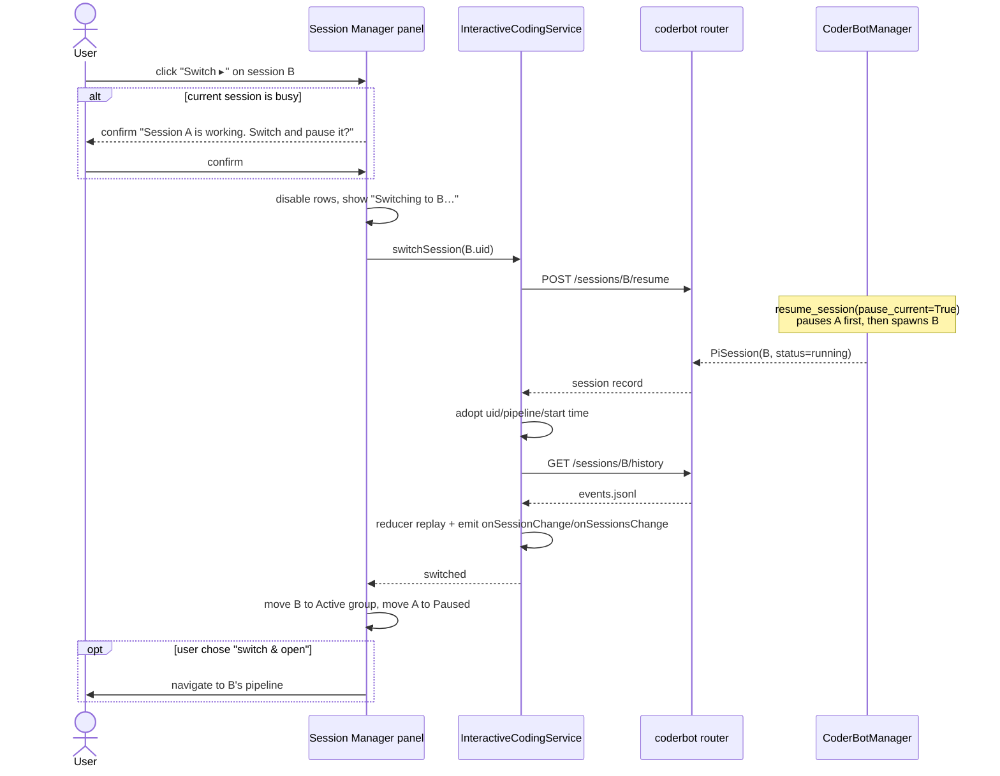
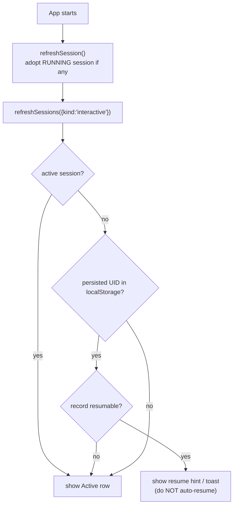

# Design: Interactive Session Manager UI

**Status:** Proposed
**Scope:** `frontend/src` (UI + service). Small optional backend addition for renaming.
**Related:** [`dd_pi_session_persistence.md`](../bots/dd_pi_session_persistence.md) (backend session layer that this UI builds on), [`dd_frontend_state.md`](./dd_frontend_state.md) (state ownership), [`dd_piview_improvements.md`](./dd_piview_improvements.md) (log view), [`dd_spa_architecture.md`](../dd_spa_architecture.md)

---

## 1. Problem

The last commit ("Implement coding agent session persistence",
`596da4d`) added a **Pause** button to the interactive coding view
([`InteractiveCodingView.ts`](../../frontend/src/ui/components/InteractiveCodingView.ts))
and a full durable-session backend (`/api/coderbot/sessions/*`,
[`router.py`](../../backend/api/src/api/coderbot/router.py)).

What is missing is the *other half* of the interaction:

* Once the user clicks **Pause**, the session disappears from the UI. There is
  no list and **no way to resume it** — the user's only recovery is a page
  reload or guessing the session UID.
* The backend can already hold **many paused sessions** but only **one running**
  session at a time (the global `_running_uid` guard in
  [`manager.py`](../../backend/api/src/api/coderbot/manager.py)). The frontend
  exposes none of that.
* [`InteractiveCodingService.ts`](../../frontend/src/core/InteractiveCodingService.ts)
  already has `pauseSession`, `resumeSession`, `listSessions`,
  `loadSessionHistory` and `localStorage` persistence, but there is **no
  session cache / subscription** and no component consumes `listSessions`.
  Only the `pauseSession` branch of the service is wired to UI.

The result is a one-way door: **Pause works, Resume is unreachable.**

This document defines a UI concept for managing interactive sessions with the
invariant **“one active session + N paused sessions”**, and proposes the
changes to make switching between sessions a first-class, pleasant action.

---

## 2. Goals & Non-Goals

### Goals

1. **Discoverability** — the user can always see the active session and how many
   sessions are paused.
2. **List** — every resumable session is listed with status, relevant dates and
   useful context (pipeline, label, turn count, model, links).
3. **Switch in one move** — selecting a paused session pauses the current one
   and resumes the selected one, without the user having to pause manually.
4. **Per-pipeline resume** — in a pipeline detail view, if that pipeline already
   has a paused session, the primary action becomes *Resume* instead of *Start*.
5. **Never lose work silently** — destructive actions are separated from
   pause/resume; busy sessions warn before being interrupted.
6. **Continuity across reloads/restarts** — the active session is restored, the
   last session is offered for resume, and the full event history is replayed.
7. **Great UX** — clear status colours, relative timestamps, keyboard access,
   loading/empty/error states, and zero dead-ends.

### Non-Goals

* A time-travel / fork / branch UI (`/tree`, `/fork`, `/clone`). The data model
  leaves room, but it is out of scope.
* Multi-user session sharing; the deployment is single-user and `owner` is
  stored but not surfaced.
* Managing **batch** (`coderbot`) sessions as a primary flow. They share the
  same running slot and should be *visible* (read-only) where relevant, but the
  interactive flow is the focus.
* Changes to the Pi event log / history format.

---

## 3. Current State (As-Is)

### 3.1 What already exists

| Layer | What | File |
|-------|------|------|
| Backend model | `PiSession` (`uid`, `kind`, `status`, `label`, `pipeline_id`, `task_id`, `pull_request_ids`, `model`, `resume_count`, `created_at`, `updated_at`, `last_active_at`, `last_error`, …) | [`models.py`](../../backend/core/src/core/models/models.py) |
| Backend API | `GET/POST /sessions`, `GET /sessions/{uid}`, `POST /sessions/{uid}/pause`, `/resume`, `/discard`, `/message`, `GET /sessions/{uid}/history` | [`router.py`](../../backend/api/src/api/coderbot/router.py) |
| Backend semantics | `resume_session(uid, pause_current=True)` **already pauses the current running session first**; only one `_running_uid` globally | [`manager.py`](../../backend/api/src/api/coderbot/manager.py) |
| Frontend client | `listSessions`, `createSession`, `getSessionDetail`, `pauseSession`, `resumeSession`, `discardSession`, `getSessionEvents`; `PiSessionSummary` type | [`CoderBotClient.ts`](../../frontend/src/core/clients/CoderBotClient.ts) |
| Frontend service | `pauseSession`, `resumeSession`, `listSessions`, `loadSessionHistory`, `persistSession`, `getPersistedSessionUid`, `onSessionChange` | [`InteractiveCodingService.ts`](../../frontend/src/core/InteractiveCodingService.ts) |
| Frontend UI | `Pause` button + `Stop Session`; `INTERACTIVE_STARTED/STOPPED` handling | [`InteractiveCodingView.ts`](../../frontend/src/ui/components/InteractiveCodingView.ts) |

### 3.2 What is missing

| Gap | Consequence |
|-----|-------------|
| No component calls `listSessions` | Paused sessions are invisible. |
| No way to invoke `resumeSession(uid)` from the UI | Paused sessions cannot be resumed. |
| `InteractiveCodingService` has no session cache / `onSessionsChange` | A list view could not stay live. |
| No global entry point for sessions | Switching requires being on the right pipeline page. |
| `PipelineDetailView` always shows **Start Interactive Session** | Starting a second session while one is paused is confusing; the paused one is orphaned. |
| `resumeSession` clears/races the replayed history | See §7.7. |
| No global running-invariant feedback | Switching while a batch run occupies the running slot is surprising. |

---

## 4. Mental Model & UX Principles

**The model the user should hold:**

> There is **the** running session — the one I'm talking to right now. Everything
> else is a saved conversation I can switch to at any time. Switching is safe:
> the current one is paused, not lost.

This is exactly the backend invariant, so the UI must make it obvious rather
than hide it.

Design principles:

1. **One obvious active session.** A global, always-visible affordance shows
   what is running (pipeline + live/busy indicator).
2. **Switch is one action, not two.** The user picks a paused session; the app
   pauses the current and resumes the chosen one (backend already supports this
   atomically). Never make the user pause first.
3. **Pause ≠ Stop.** Keep both, but label and style them so users understand
   *Pause* is reversible and *Stop/Discard* is destructive.
4. **Context before commitment.** Every row shows enough information (pipeline,
   last activity, turns, label) to pick the right session.
5. **No dead-ends.** Empty, loading, busy, failed-resume and discarded states all
   have a next action.
6. **Keyboard-first for power users.** A single shortcut opens the switcher;
   arrows + Enter switch.

---

## 5. Information Architecture & Entry Points

The natural home for a **global** concern like sessions is the application
shell, not a single pipeline page. Because the app currently renders a header
per view (dashboard and pipeline detail), the concept introduces a single
**Session Manager panel** (a right-hand drawer) that can be opened from:

1. **A global “Sessions” button** added to both the dashboard header and the
   pipeline header (`HeaderDialogButtons`). The button shows a small badge with
   the count of paused sessions and a dot when one is busy.
2. **A keyboard shortcut** `Ctrl/Cmd+J` registered globally in
   [`AppContext.setupGlobalShortcuts`](../../frontend/src/core/AppContext.ts).
3. **Contextually** from a pipeline: a *paused session* affordance in
   `PipelineDetailView` opens the same panel scoped to that pipeline.

The panel is a sibling overlay mounted once (proposed: in `AppContext` /
the `#content` root, alongside the existing `AssistantPanel`), so it survives
view navigation and needs no per-view lifecycle.



---

## 6. The Session Manager Panel

### 6.1 Panel wireframe

A right-side drawer, ~420 px wide, full height, with the existing app surface
styling (`bg-app-surface`, `border-app-border`). It does not block the main view
on desktop; on small screens it becomes a full-screen sheet.

```
┌──────────────────────────────────────────────────────────────┐
│  Sessions                                          ⌘J      ✕  │
│  ┌────────────────────────────────────────────────────────┐  │
│  │ 🔍 Search sessions…                                    │  │
│  └────────────────────────────────────────────────────────┘  │
├──────────────────────────────────────────────────────────────┤
│  ● ACTIVE                                                    │
│  ┌────────────────────────────────────────────────────────┐  │
│  │ ⚡ Pipeline A · interactive              [working…]     │  │
│  │    “Fix the flaky auth test”                            │  │
│  │    started 14:02 · 3 turns · claude-sonnet              │  │
│  │    [Pause]   [Open pipeline]                           │  │
│  └────────────────────────────────────────────────────────┘  │
│                                                              │
│  ⏸ PAUSED  (3)                                              │
│  ┌────────────────────────────────────────────────────────┐  │
│  │ Pipeline B · interactive            paused 2m ago      │  │
│  │ “Design the new pipeline view”                          │  │
│  │ created Oct 3 · 6 turns · gpt-5        [Switch ▸]      │  │
│  │                                       [⋯ Rename | Discard]│
│  └────────────────────────────────────────────────────────┘  │
│  ┌────────────────────────────────────────────────────────┐  │
│  │ Pipeline C · interactive            paused 1h ago       │  │
│  │ (untitled) · 1 turn                     [Switch ▸]      │  │
│  └────────────────────────────────────────────────────────┘  │
│  …                                                           │
│                                                              │
│  ✓ COMPLETED  (2)              ✕ FAILED  (1)                 │
│  …                                                           │
├──────────────────────────────────────────────────────────────┤
│  ⓘ Switching pauses the current session and keeps it safe.   │
└──────────────────────────────────────────────────────────────┘
```

A compact **inline variant** (no drawer) is reused inside `PipelineDetailView`
to list only that pipeline's sessions; see §7.4.

### 6.2 Session item anatomy

Each row shows, in scan order:

| Element | Source | Notes |
|---------|--------|-------|
| Status dot + badge | `status` | colour-coded, see §6.4 |
| Pipeline name | `pipeline_id` → lookup via `DataManager`/`PipelineClient` | primary identity; falls back to “Unknown pipeline” |
| Kind tag | `kind` | `interactive` / `coderbot` (batch shown read-only) |
| Label | `label` | falls back to first user prompt or “(untitled)” |
| Relative last activity | `last_active_at` (fallback `updated_at`, `created_at`) | “2m ago”, absolute timestamp in `title` |
| Created date | `created_at` | shown in secondary line |
| Turn / resume count | `resume_count` | “6 turns”, “resumed 2×” |
| Model | `model` | small mono chip |
| Links | `task_id`, `pull_request_ids` | clickable chips that open the task/PR |
| Error | `last_error` | red note + tooltip on `FAILED` rows |
| Actions | — | context-dependent, see §6.3 |

### 6.3 Actions per status

| Session | Primary | Secondary | Notes |
|---------|---------|-----------|-------|
| **RUNNING (this tab)** | `Pause` | `Open pipeline`, `Rename` | `Stop/Discard` is intentionally *not* here to avoid accidental loss; it lives under `⋯`. |
| **RUNNING (other tab)** | `Focus` / `Take over` | — | A second tab's running session is shown; switching adopts it. |
| **PAUSED / COMPLETED / FAILED** | **`Switch ▸`** (i.e. resume) | `Rename`, `Discard`, `Open pipeline` | `Switch` = resume + optionally navigate. |
| **STARTING** | spinner | `Cancel` | transient. |
| **DISCARDED** | *(hidden by default)* | `Show discarded` filter | resources are gone; not resumable. |

**Switch** is the primary, accent-coloured action on every resumable row. It is
disabled while another switch is in flight or while this row is the active
session.

### 6.4 Status semantics & badges

Reuse the palette already used across the app:

| Status | Label | Colour | Meaning |
|--------|-------|--------|---------|
| `running` | Active / Working… | green (`text-green-400`), amber pulse when `busy` | the single live session |
| `paused` | Paused | amber (`text-amber-400`) | resumable, process stopped |
| `completed` | Completed | blue (`text-blue-400`) | batch finished, resumable for iteration |
| `failed` | Failed | red (`text-red-400`) | resumable but last run errored |
| `starting` | Starting… | muted + spinner | transient |
| `discarded` | Discarded | muted, strikethrough | not resumable (hidden by default) |

### 6.5 Grouping, sorting and filtering

* **Groups:** Active (max 1) → Paused → Completed → Failed. Discarded only with
  the “Show discarded” toggle.
* **Within a group:** `last_active_at` (then `updated_at`, then `created_at`)
  descending — “most recently touched first”.
* **Default query:** `GET /api/coderbot/sessions?kind=interactive` to keep the
  interactive flow focused; a “Show CoderBot (batch) sessions” toggle widens it
  to all `kind`s (read-only, warns when switching would pause a batch run).
* **Search:** case-insensitive match over label, pipeline name, task id and PR
  id. Purely client-side over the cached list.
* **Filter chips:** `All · Paused · Completed · Failed`, plus “Show batch”.
* **Empty state:** “No sessions yet. Start an interactive session from any
  pipeline.” with an *Open dashboard* action.

---

## 7. Interaction Flows

### 7.1 Start a new interactive session

Unchanged entry point (pipeline detail → **Start Interactive Session**), except:

* If the pipeline already has a paused interactive session, the primary button
  becomes **Resume Session** and a secondary *Start new* link is offered
  (§7.4). Starting new while another session is running pauses the other session
  via the backend’s `resume_session(pause_current=True)` semantics; the UI shows
  the same busy confirmation as §7.2.
* On `INTERACTIVE_STARTED`, the service upserts the new record into the session
  cache and the panel pins it as Active.

### 7.2 Switch to a paused session (the core flow)



Key behaviours:

* **Atomicity.** The frontend issues a single `resume` call; the backend already
  pauses the current session. The service updates the local cache optimistically
  (A → paused, B → running) and reconciles with the response.
* **Busy guard.** If the current session `isBusy()`, the UI asks for
  confirmation because pausing cancels the in-flight turn (backend
  `pause_session` cancels `turn_task`/`monitor`). The default is
  **“Switch & interrupt”**, with a *Wait* alternative.
* **No navigation by default.** Switching keeps the user in place; a checkbox /
  context-menu item “Switch and open pipeline” navigates. This respects users
  who want to queue up context.
* **Progress feedback.** Rows are disabled and the selected row shows a spinner;
  a top-of-panel status line reads “Pausing A… / Resuming B…”.
* **Failure.** If resume fails (`400` not resumable, `409` busy, network), the
  panel shows an inline red error on the row and restores the previous cache
  state. The failed session stays resumable if the backend says so.

### 7.3 Pause the current session

* Same as today's button; additionally the service marks the record `paused`
  in the cache and the panel moves it to the Paused group immediately.
* If the user pauses and no other session is active, the panel opens
  automatically the first time to reveal where the session went (a one-shot
  onboarding hint: “Session paused — resume it any time from Sessions”).

### 7.4 Per-pipeline resume (pipeline detail integration)

In [`PipelineDetailView.renderPrepColumn`](../../frontend/src/ui/views/PipelineDetailView.ts)
the `#interactive-session-bar` currently has three mutually-hidden buttons
(Start / Switch / Stop). The concept replaces that with a small
session-aware control:

```
┌─ Interactive Coding ──────────────────────────────────────────┐
│ Active:  ⚡ Pipeline A — working…            [Switch] [Pause]  │
│ Paused:  ● Fix flaky auth test · 2m ago     [Resume ▸]         │
│          ● Refactor parser    · 1h ago      [Resume ▸]         │
│ [+ New session]                                                │
└────────────────────────────────────────────────────────────────┘
```

* If the pipeline has **no** session: `[⚡ Start Interactive Session]`.
* If the pipeline has a **paused** session and **no other** session is active:
  primary `[Resume Session ▸]` + secondary `[Start new]`.
* If **another** session is active: `[Start new]` warns that it will pause the
  active session; the paused rows remain individually resumable.
* The per-pipeline list is the same session-list component, filtered to
  `pipeline_id`, rendered inline (no drawer).

This fixes the orphan problem: the user never has to know the session UID and
never has to leave the pipeline to resume.

### 7.5 Discard

* Destructive; always behind a confirmation dialog
  ([`ConfirmationDialog`](../../frontend/src/ui/components/ConfirmationDialog.ts))
  that names the session and states “this deletes the retained workspace and Pi
  conversation”.
* Disabled/omitted for the currently running session in the main row; available
  under `⋯` with a stronger warning.

### 7.6 Rename

* Optional. There is **no** `PATCH /sessions/{uid}` endpoint today, so Phase 1
  omits rename; Phase 3 adds the endpoint (see §10) and an inline edit on the
  row label. Renaming sets `label` and re-renders from the server record.

### 7.7 Continuity: reload, backend restart, and the replay race

On app start (or panel mount) the client runs an **initialize** sequence:



* **Never auto-resume.** Resuming spawns a process and (for batch) consumes
  resources; the user should opt in. The panel shows a dismissible
  “Resume your last session: <label>” banner with one click, and a badge on the
  Sessions button.
* **Backend restart.** `reconcile_on_startup` flips `RUNNING` → `PAUSED`; the
  list simply reflects that. `last_error` may contain “server restarted”.
* **Replay race (bug to fix as part of this work).** `resumeSession` loads the
  event history, but the backend also broadcasts `INTERACTIVE_STARTED`, and
  `handleStarted` currently **clears** the log. If the `STARTED` message arrives
  after `loadSessionHistory`, the replayed history is wiped. The design adds a
  `pendingResumeUid` guard:

  ```ts
  // handleStarted():
  if (payload.session_uid && payload.session_uid === this.pendingResumeUid) {
    // resume of a known session: adopt state but do NOT clear the log
  } else {
    this.logReducer.clear(); // genuinely new session
  }
  ```

  and `resumeSession` clears `pendingResumeUid` only after the history replay
  completes (or times out). A unit test locks this down (§13).

---

## 8. State & Data Model (frontend)

### 8.1 Types

`PiSessionSummary` currently lives in `CoderBotClient.ts`. Export it from the
service (or a shared `session.ts`) so components depend on the service, not on
the transport client:

```ts
// core/clients/CoderBotClient.ts (re-exported by the service)
export interface PiSessionSummary {
  uid: string;
  kind: 'interactive' | 'coderbot';
  status: 'starting' | 'running' | 'paused' | 'completed' | 'failed' | 'discarded';
  owner?: string | null;
  label?: string | null;
  pipeline_id?: string | null;
  task_id?: string | null;
  pull_request_ids?: string[];
  model?: string | null;
  resume_count: number;
  last_error?: string | null;
  created_at?: string;
  updated_at?: string;
  last_active_at?: string | null;
  discarded_at?: string | null;
}
```

### 8.2 `InteractiveCodingService` additions

```ts
export interface InteractiveSessionInfo {   // existing, unchanged
  pipelineId: string | null;
  uid: string | null;
  active: boolean;
  busy: boolean;
}

type SessionsListener = (sessions: PiSessionSummary[]) => void;

class InteractiveCodingService {
  // --- new state ---
  private sessions = new Map<string, PiSessionSummary>();
  private sessionsLoading = false;
  private sessionsError: string | null = null;
  private switchingUid: string | null = null;
  private pendingResumeUid: string | null = null;

  // --- new API ---
  async initialize(): Promise<void>;                     // §7.7
  async refreshSessions(opts?: {
    kind?: string; status?: string; pipelineId?: string; includeDiscarded?: boolean;
  }): Promise<PiSessionSummary[]>;
  getSessions(): PiSessionSummary[];                     // cached, sorted
  getSession(uid: string): PiSessionSummary | undefined;
  isSessionsLoading(): boolean;
  getSessionsError(): string | null;
  isSwitching(): string | null;                          // uid or null
  onSessionsChange(listener: SessionsListener): () => void;

  async switchSession(uid: string): Promise<void>;       // pause current + resume uid
  async pauseSession(): Promise<void>;                    // existing, now updates cache
  async resumeSession(uid: string): Promise<void>;        // existing, now guards replay race
  async discardSession(uid: string): Promise<void>;
  async renameSession(uid: string, label: string): Promise<void>; // Phase 3 / backend §10
}
```

Implementation notes:

* `refreshSessions` is the only place that writes the cache from HTTP; it
  merges by `uid` and de-dupes concurrent calls (mirroring the in-flight promise
  pattern used elsewhere).
* `switchSession(uid)`:
  1. if `uid` is already active → no-op;
  2. set `switchingUid`, `pendingResumeUid = uid`;
  3. `await this.resumeSession(uid)` (the backend pauses the previous session);
  4. optimistically update the cache (`previousActive → paused`,
     `uid → running`);
  5. refresh the list from the server to reconcile;
  6. clear `switchingUid`.
* Websocket updates keep the cache live:
  * `INTERACTIVE_STARTED` → upsert (status `running`), set active uid.
  * `INTERACTIVE_STOPPED` → mark the matching `session_uid` `paused`.
  * `INTERACTIVE_ERROR` → set `last_error`.
  * A new `SESSION_UPDATED`/`SESSION_*` broadcast is **not** required; the
    existing interactive events plus HTTP refresh are sufficient for Phase 1.
    (A future backend broadcast would make the list live without polling; noted
    as optional.)

### 8.3 Persistence

Reuse the existing `ajapopaja:interactive:session` key but route it through
[`LocalStorageManager`](../../frontend/src/core/LocalStorageManager.ts)
namespace `interactive` (per
[`dd_frontend_state.md`](./dd_frontend_state.md) §7 which flags the raw
`localStorage` use). Store `{ uid, pipeline_id, updated_at }`; treat it as a
*hint* that is validated against the server record before it is shown.

---

## 9. Component & File Changes

### New components

| File | Responsibility |
|------|----------------|
| `frontend/src/ui/components/SessionManagerButton.ts` | Header button with paused-count badge + busy dot; executes `toggle_session_manager`. |
| `frontend/src/ui/components/SessionManagerPanel.ts` | The drawer: search, filters, groups, keyboard nav; subscribes to `onSessionsChange`. |
| `frontend/src/ui/components/SessionListItemView.ts` | Pure renderer for one session row (status, meta, actions). Reused inline by the pipeline view. |
| `frontend/src/ui/components/utils/relativeTime.ts` | `formatRelativeTime(iso)` + `formatAbsoluteTime(iso)` helpers with tests (sits next to the existing `duration.ts`, whose `formatMs` is reused for elapsed time). |

### Changed files

| File | Change |
|------|--------|
| `frontend/src/core/InteractiveCodingService.ts` | Session cache, `onSessionsChange`, `initialize`, `switchSession`, `discardSession`, `renameSession`, replay-race guard, `LocalStorageManager` persistence. |
| `frontend/src/core/clients/CoderBotClient.ts` | (Phase 3) `updateSessionLabel(uid, label)` → `PATCH /sessions/{uid}`; optional `resumeSession(uid, message?)`. |
| `frontend/src/core/AppContext.ts` | Register `toggle_session_manager` action + `Ctrl/Cmd+J` shortcut; mount the panel once; call `interactiveCodingService.initialize()`. |
| `frontend/src/ui/components/HeaderDialogButtons.ts` | Add the sessions button (badge) to the pipeline header. |
| `frontend/src/ui/views/DashboardView.ts` | Add the sessions button to the dashboard header. |
| `frontend/src/ui/views/PipelineDetailView.ts` | Replace the Start/Switch/Stop bar with the session-aware control + inline per-pipeline session list; primary action becomes Resume when a paused session exists. |
| `frontend/src/ui/components/InteractiveCodingView.ts` | Wire `onPause` to the service (already supported) and add a “Switch session” link that opens the panel. Keep Pause and Stop visually distinct. |

No change is required to the `PiSessionService` interface in
[`PiView.ts`](../../frontend/src/ui/components/PiView.ts); the new behaviour
lives behind the service.

---

## 10. Backend Dependencies

The design is buildable entirely on the existing API:

| Need | Endpoint | Status |
|------|----------|--------|
| List sessions with status/dates | `GET /coderbot/sessions?kind=&status=&pipeline_id=` | ✅ exists |
| Session detail | `GET /coderbot/sessions/{uid}` | ✅ exists |
| Pause | `POST /coderbot/sessions/{uid}/pause` | ✅ exists |
| Resume / switch (pauses current) | `POST /coderbot/sessions/{uid}/resume` | ✅ exists, `pause_current=True` |
| Discard | `POST /coderbot/sessions/{uid}/discard` | ✅ exists |
| History replay | `GET /coderbot/sessions/{uid}/history` | ✅ exists |

**Optional backend addition (Phase 3):**

* `PATCH /coderbot/sessions/{uid}` accepting `{ "label": "..." }` → updates the
  record, broadcasts a session update. Only needed for the rename affordance.
* Optional `SESSION_UPDATED` websocket broadcast so the list updates across
  tabs without polling. Both are additive and low-risk.

The global running invariant is already enforced server-side; the UI must not
assume only interactive sessions occupy it (a running batch run does too), which
is why the “Show batch” toggle and the busy-confirmation matter.

---

## 11. Edge Cases

| Case | Handling |
|------|----------|
| No active, no paused | Panel empty state with “Start a session” guidance. |
| Active session belongs to another pipeline | Panel shows it; `PipelineDetailView` doesn't claim it (`isInteractiveSessionMine()` already guards). |
| Switch while busy | Confirmation; backend cancels the in-flight turn. Default action interrupts. |
| Switch while a **batch** run is active | Batch row shown (if toggle on) with a warning that switching pauses it; otherwise a toast on `409`/unexpected pause. |
| Resume a `failed` session | Allowed; show `last_error` in the row and a “retry” tooltip. |
| Resume a `discarded` session | Button hidden; if the API returns `400`, show inline error and refresh. |
| Session record exists but Pi file missing | Backend returns error on resume; show inline error, offer Discard. |
| Two browser tabs | Both subscribe to WS + poll on open; switching in one tab broadcasts `INTERACTIVE_STARTED` and the other updates. A `storage` event on the persisted key can be used to sync the hint. |
| History replay race | `pendingResumeUid` guard (§7.7) + regression test. |
| Network failure during switch | Restore cache, keep rows enabled, show retry. |
| Long list | Virtualize only if > 50; paginate via existing `PaginationControl` is also acceptable. Cap enforced by backend `PI_SESSION_MAX_PAUSED`. |
| Time zones / invalid dates | `relativeTime` falls back to `—` on parse failure. |

---

## 12. Accessibility & Responsive Behaviour

* Panel is a labelled `role="dialog"` with focus trap while open, `Esc` closes,
  focus returns to the trigger.
* Rows are keyboard-navigable (`↑/↓`, `Home/End`); `Enter` = Switch,
  `Delete` = Discard (with confirmation). Visible focus rings.
* Status is announced via `aria-live="polite"` on the active-session line
  (“Session B resumed”).
* Colour is never the only signal — every status has a text label and icon
  (`play`, `pause`, `check`, `alert`).
* Desktop: side drawer; `< 768 px`: full-screen sheet with a sticky header.
* Respects `prefers-reduced-motion` (no drawer slide animation).

---

## 13. Testing Plan

### Unit / service (vitest)

* `InteractiveCodingService.test.ts` (extend):
  * `switchSession` calls `resumeSession` and updates the cache
    (`previous → paused`, `target → running`).
  * `refreshSessions` merges and de-dupes concurrent requests.
  * `discardSession` removes/marks the record and calls the client.
  * `onSessionsChange` fires on start/stop/switch; no spurious emits on no-op.
  * **Replay race:** a late `INTERACTIVE_STARTED` for `pendingResumeUid` does
    **not** clear the replayed history.
  * `initialize` adopts a running session, does **not** auto-resume, but exposes
    the persisted-uid hint.
* `relativeTime.test.ts`: seconds/minutes/hours/days, invalid input, absolute
  formatting.

### Component (vitest + jsdom)

* `SessionManagerPanel.test.ts`: renders groups/status/dates; search filters;
  filter chips; empty/loading/error states; busy confirmation; Switch calls the
  service; Discard asks for confirmation; keyboard navigation.
* `SessionListItemView.test.ts`: badge/colour per status, fallback label,
  action visibility per status.
* `PipelineDetailView.test.ts` (extend): shows **Resume** instead of **Start**
  when the pipeline has a paused session; inline list switches.
* `InteractiveCodingView.test.ts` (extend): Pause still calls the service;
  “Switch session” opens the panel.

### Manual checks

1. Start A → Pause → start B → panel shows A paused, B active → Switch to A →
   A active, B paused, history intact.
2. Reload: active session restored; paused list correct; no auto-spawn.
3. Backend restart: previously running session appears paused with a hint.
4. Switch while the agent is mid-turn: confirmation, then pause + resume.
5. Discard: confirmation, row leaves the list.

### Monorepo suite

`cd backend && uv run pytest`, `cd frontend && CI=true npm run test`,
`cd frontend && npm run build`.

---

## 14. Implementation Phases

1. **Phase 1 — Service foundation (no UI):** export `PiSessionSummary`, add the
   session cache, `onSessionsChange`, `initialize`, `switchSession`,
   `discardSession`, the `pendingResumeUid` race guard, and route persistence
   through `LocalStorageManager`. Unit tests.
2. **Phase 2 — Session Manager panel:** button + badge in both headers, drawer
   with list/search/filter/switch/discard, empty/loading/error states,
   `Ctrl/Cmd+J`, `SessionListItemView`. Component tests.
3. **Phase 3 — Pipeline integration:** per-pipeline inline list and
   Resume-instead-of-Start primary action; “Switch session” link in the
   interactive view. Tests.
4. **Phase 4 — Polish & optional backend:** rename (`PATCH` + broadcast),
   cross-tab sync, keyboard navigation refinements, accessibility pass,
   relative-time helper, docs (`README.md`, `RELEASENOTES.md`).

Each phase ends with the full backend + frontend suites green.

---

## 15. Open Questions

| Question | Proposed default |
|----------|------------------|
| Should switching navigate to the resumed pipeline? | No by default; provide “Switch and open”. |
| Should a paused session show a live preview of its last messages? | Nice-to-have; defer. The row shows the label/last activity. |
| Auto-resume the last session on load? | No — opt-in banner/toast. Spawning has cost and can surprise. |
| Show batch (`coderbot`) sessions in the panel? | Behind a “Show batch” toggle, read-only, with pause warnings. |
| Polling vs. websocket for the list? | Refresh on open/switch/start/stop; add a `SESSION_UPDATED` broadcast in Phase 4 if needed. |
| Rename endpoint necessity? | Defer to Phase 4; the list is useful without it. |

---

## 16. Summary of Proposed Changes

| Area | File(s) | Change |
|------|---------|--------|
| Service | `core/InteractiveCodingService.ts` | Session cache + subscription, `initialize`, `switchSession`, `discardSession`, replay-race guard, `LocalStorageManager` persistence. |
| Client | `core/clients/CoderBotClient.ts` | (Phase 3) `updateSessionLabel`; optional resume message param. |
| Shell | `core/AppContext.ts` | Mount panel once; `toggle_session_manager` action + `Ctrl/Cmd+J`; `initialize()`. |
| Headers | `ui/components/HeaderDialogButtons.ts`, `ui/views/DashboardView.ts` | “Sessions” button with paused-count badge + busy dot. |
| Panel | `ui/components/SessionManagerPanel.ts`, `ui/components/SessionListItemView.ts` (new) | Drawer listing sessions with status, dates, context; search/filter; switch/discard; keyboard + a11y. |
| Utilities | `ui/components/utils/relativeTime.ts` (new) | Relative/absolute time formatting (next to `duration.ts`). |
| Pipeline | `ui/views/PipelineDetailView.ts` | Inline per-pipeline session list; Resume primary action; warn when switching would pause another session. |
| Interactive view | `ui/components/InteractiveCodingView.ts` | Wire Pause to the service; add “Switch session”; keep Pause vs Stop distinct. |
| Backend (optional) | `api/src/api/coderbot/router.py` | `PATCH /sessions/{uid}` for rename; optional `SESSION_UPDATED` broadcast. |
| Docs | `README.md`, `RELEASENOTES.md` | Document the session manager. |

With this, **Pause becomes a pit stop, not a dead-end**: the user always sees
the active session, can browse all paused sessions with their status and
history context, and switches between them with a single, safe action while the
backend enforces the one-running-session invariant.
