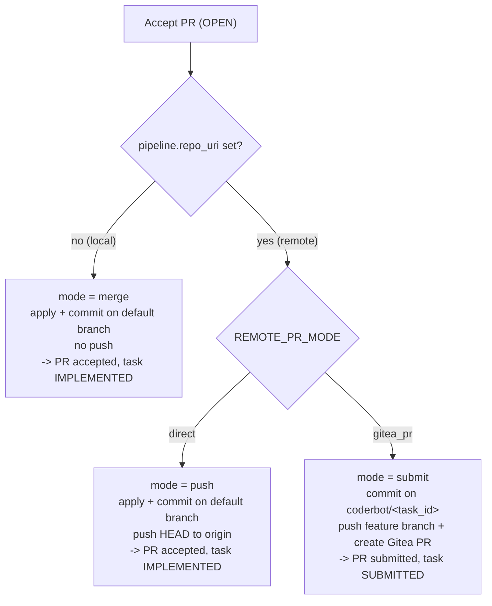
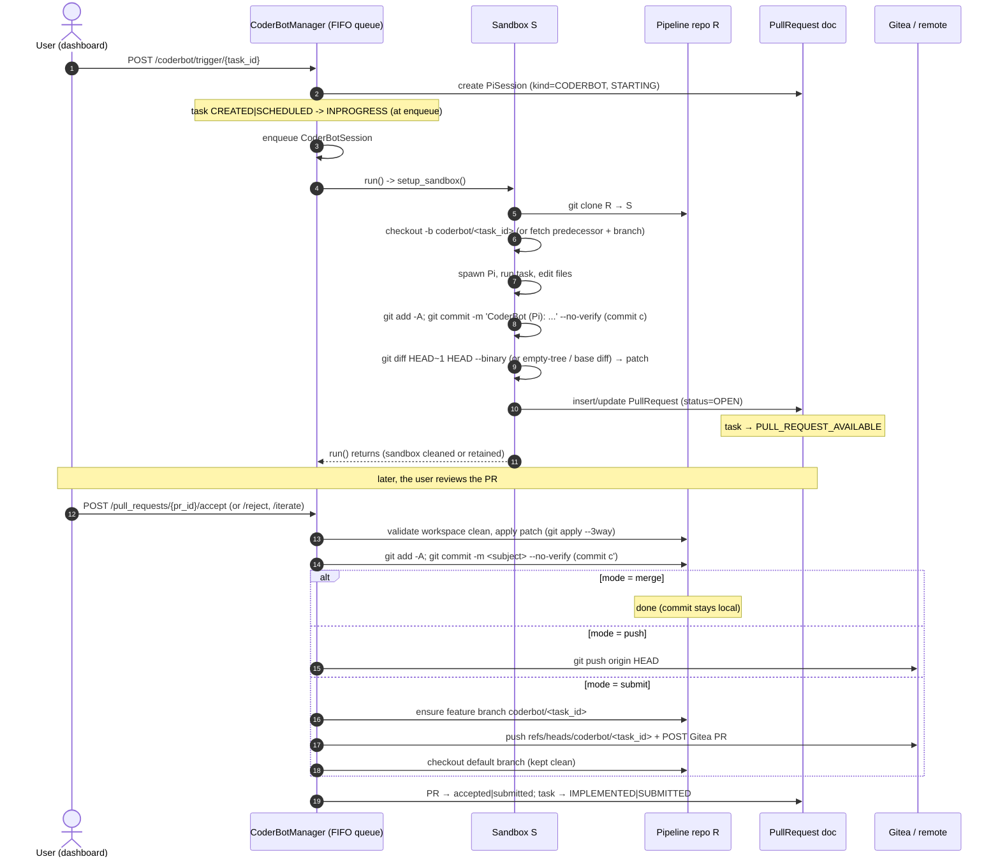
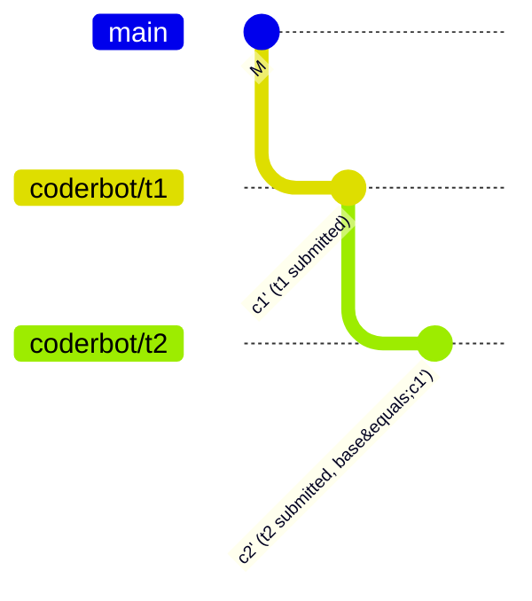

# Design Document: Branch, Commit and Pull-Request Process of a Batched CoderBot Session

**Related design documents:** [`design/bots/dd_coderbot.md`](../bots/dd_coderbot.md),
[`design/git/dd_git_hosting.md`](dd_git_hosting.md),
[`design/git/dd_git_authentication.md`](dd_git_authentication.md),
[`design/git/dd_task_chain_rejection_lifecycle.md`](dd_task_chain_rejection_lifecycle.md)

## 1. Purpose & Scope

This document describes the **git process** of a *batched* CoderBot session — the
end-to-end path a task takes from "triggered" through "code written by the Pi
coding agent" to "human accepts/rejects the resulting pull request", and how that
path differs depending on how the pipeline's repository is configured.

It answers, concretely:

- which **working repositories** a batch session touches and where/when each is
  created and destroyed;
- which **branches** are created in which directory, and when they are deleted
  (completion cleanup, §8.4) or retained (a deferred chained predecessor, the
  retained sandbox `S`);
- which **commits** are created on which repository;
- when the **`PullRequest` document** is created and updated; and
- when a remote PR is **submitted** vs. when a commit is **applied locally and
  pushed**.

The batch CoderBot flow is driven by `backend/api/src/api/coderbot/session.py`
(`CoderBotSession`), `backend/api/src/api/coderbot/manager.py`
(`CoderBotManager`), `backend/api/src/api/bot/git_helper.py`
(`SandboxGitHelper`) and `backend/api/src/api/routes/pull_request.py`
(`accept_pull_request`).

This document deliberately does **not** re-derive the ordered-branch-chaining
*rejection* analysis; that is covered in
[`dd_task_chain_rejection_lifecycle.md`](dd_task_chain_rejection_lifecycle.md),
which this document cross-references where the two topics meet.

---

## 2. Vocabulary and the repositories involved

### 2.1 Actors

| Name | Meaning | Defined / created at |
|------|---------|---------------------|
| `R` | The pipeline's **durable working repository**. For a *local* pipeline it is the host path under `WORKSPACES_ROOT`; for a *remote* pipeline it is a clone under `REMOTE_WORKSPACES_ROOT`. | pipeline creation (local) / startup bootstrap or lazy clone (remote) |
| `S` | The **sandbox** the batch session works in. A per-task clone of `R` (or a per-session retained clone). | `CoderBotSession.run()` → `SandboxGitHelper.setup_sandbox()` |
| `c` | The commit CoderBot creates **inside `S`** on `coderbot/<task_id>`. It exists only in the sandbox. | `_handle_agent_end()` |
| `c'` | The commit created in `R` when a PR is **accepted** (the patch is re-applied with `git apply --3way`). It has a **different hash** from `c`. In `submit` mode it lives on the feature branch, which is deleted locally and remotely when the Gitea PR completes (completion cleanup, §8.4). | `accept_pull_request()` |
| `PR` | The `PullRequest` MongoDB document (`status ∈ open / accepted / rejected / submitted`). Its `kind` is `implementation` (the default, also assumed for legacy documents without the field) or `documentation`. | `_handle_agent_end()` / `DocBotSession` (insert or update) |

#### `PullRequest.kind` and `PullRequest.commit_hash`

`kind` distinguishes implementation pull requests from DocBot documentation pull
requests and drives kind-aware acceptance, chaining, cleanup, and remote
reconciliation. `commit_hash` is optional: it is empty while an open PR has not
been applied, and records the commit produced when a PR is accepted/submitted
locally. For implementation PRs the accepted commit is also copied onto
`Task.commit_hash`; for documentation PRs the commit stays on the PR so the task's
implementation metadata is never overwritten.

### 2.2 Repositories and directories

| Directory | Purpose | Lifecycle |
|-----------|---------|-----------|
| Local `R` = `WORKSPACES_ROOT/<workspace_path>` | The user's real working repo for a **local** pipeline (`pipeline.repo_uri` is unset). | Persistent; never deleted by CoderBot. |
| Remote `R` = `REMOTE_WORKSPACES_ROOT/<repo_name>` | A clone of `pipeline.repo_uri` used as the durable working repo for a **remote** pipeline. `repo_name` is derived from the URI via `repo_name_from_uri`. | Cloned on first use (`ensure_repo_cloned` / `ensure_repo_present`, pre-warmed by `repo_bootstrap` at startup). Fetch + `pull --ff-only` on subsequent syncs. Persistent; completed `coderbot/<task_id>` feature branches are deleted by completion cleanup unless deferred for a chained descendant (§8.4). |
| Ephemeral sandbox `S` = `SANDBOX_ROOT/coderbot/<task_id>` | Per-task full clone of `R` where Pi actually runs. Used when the run has **no `session_uid`** or workspace retention is disabled. | `rmtree` in `SandboxGitHelper.cleanup()` after the run. |
| Retained sandbox `S` = `PI_SESSIONS_ROOT/<session_uid>/workspace` | Per-session full clone of `R`, kept so the session can be resumed / iterated in place. Used when the run has a `session_uid` **and** `PI_SESSION_RETAIN_BATCH_WORKSPACE` is enabled (default). | Kept after the run; swept by `sweep_expired_workspaces()` after `PI_SESSION_WORKSPACE_TTL_DAYS` (default 14) or deleted by `discard_session()`. |
| `PI_SESSIONS_ROOT/<session_uid>/pi-sessions/` | `--session-dir` passed to Pi (native Pi conversation files). | Persisted with the session. |
| `PI_SESSIONS_ROOT/<session_uid>/events.jsonl`, `meta.json` | Raw-RPC event log (UI replay) and crash-recovery sidecar. | Persisted with the session. |

> **Key fact:** the sandbox `S` is **always a local clone of `R`**
> (`git.Repo.clone_from(str(pipeline.workspace_abs_path), str(sandbox_path))`).
> For a remote pipeline that means it clones from the *local* clone under
> `REMOTE_WORKSPACES_ROOT`, never directly from `origin`.

### 2.3 Branch naming

`SandboxGitHelper.__init__` sets `branch_name = f"{bot_type}/{task_id}"`. For a
batch CoderBot run `bot_type == "coderbot"`, so every batch feature branch is
named:

```
coderbot/<task_id>
```

The same name is stored on the `PullRequest.branch_name` and re-used as the
feature branch name when a PR is later accepted in `gitea_pr` mode. Once the PR
reaches a terminal state, completion cleanup deletes that branch in `R` and on
Gitea (a pending chained descendant defers only the local branch/patch; see
§8.4).

---

## 3. The three apply/delivery modes

`resolve_apply_mode()` in `routes/pull_request.py` classifies how *accepting* a PR
delivers the change. It depends on `pipeline.repo_uri` and the global
`REMOTE_PR_MODE` setting (env `REMOTE_PR_MODE`, default `direct`).

| Mode | Condition | Behaviour at accept | Task ends in |
|------|-----------|---------------------|--------------|
| `merge` | local pipeline (`repo_uri` unset) | Apply patch, commit onto `R`'s default branch. **No push.** | `IMPLEMENTED` |
| `push` | remote pipeline + `REMOTE_PR_MODE=direct` | Apply patch, commit onto `R`'s default branch, `git push origin HEAD`. | `IMPLEMENTED` |
| `submit` | remote pipeline + `REMOTE_PR_MODE=gitea_pr` | Apply patch, commit onto a **feature branch** (`coderbot/<task_id>`), push that branch, create a **Gitea PR**. `R`'s default branch stays clean. | `SUBMITTED` (awaiting external review) |



The `apply_mode` is resolved at *read time* and returned on the PR documents so
the UI knows which path an accept will take.

---

## 4. Lifecycle of one batched CoderBot session



---

## 5. When, where and how the working repository is created

The batch session creates its working repository in `CoderBotSession.run()`:

1. Load `Task` and `Pipeline`; require `pipeline.workspace_abs_path`.
   - Local pipeline → `WORKSPACES_ROOT/<workspace_path>`.
   - Remote pipeline → `REMOTE_WORKSPACES_ROOT/<repo_name>` (the clone is
     pre-warmed by `repo_bootstrap` at startup and/or lazily by
     `ensure_repo_cloned`).
2. Resolve a **chaining base** (`_resolve_chain_base()`) unless this is an
   iteration or resume-in-place run. When a still-pending predecessor batch
   session exists, its retained workspace and branch become the base
   (`SandboxBase`).
3. Decide the sandbox path:
   - `retain_workspace = bool(session_uid) and PI_SESSION_RETAIN_BATCH_WORKSPACE`.
   - `workspace_path = PI_SESSIONS_ROOT/<session_uid>/workspace` when retained,
     otherwise `None` (→ `SANDBOX_ROOT/coderbot/<task_id>`).
4. Construct `SandboxGitHelper("coderbot", task_id, pipeline.workspace_abs_path,
   workspace_path=…, base=…)` and call:
   - `setup_sandbox()` for a fresh run — `git clone <R> <S>`, then create the
     branch `coderbot/<task_id>` either from `FETCH_HEAD` (chained base) or from
     the default branch; or
   - `reuse_existing()` for a resume-in-place run — no clone, reuse the retained
     tree/branch exactly as-is.

| Run kind | Sandbox created how | Branch base |
|----------|---------------------|-------------|
| Initial batch run (no chaining) | `git clone R → S` | default branch of `R` |
| Initial batch run (chained) | `git clone R → S` + `git fetch <predecessor S>` | predecessor's `coderbot/<task_id>` tip (`FETCH_HEAD`) |
| PR iteration | `git clone R → S`, then `git apply --3way <existing patch>` as unstaged changes (no commit) | default branch (iteration never chains) |
| Resume in place | `reuse_existing()` — no clone | existing retained branch/state |

After the run, `_handle_agent_end`'s `finally` either `cleanup()`s the sandbox
(`rmtree`) or retains it based on `_should_retain_workspace()`.

---

## 6. When the `PullRequest` document is created and updated

### 6.1 Creation (initial run)

At the end of `_handle_agent_end()`, once Pi has emitted `agent_end`:

1. `git add -A` + `git commit -m "CoderBot (Pi): <summary[:200]>" --no-verify`
   → commit `c` in `S` (commit may be skipped when there is nothing to commit).
2. `patch = git diff HEAD~1 HEAD --binary` (falls back to diffing against the
   empty tree for a first commit, or `SandboxGitHelper.get_patch()` against the
   base/default branch when no commit was made).
3. Optionally run the post-run verification suite in `S`
   (`CODERBOT_RUN_TESTS`, default on) and append its result to the summary.
4. **Insert** a new `PullRequest` document:

   ```
   pipeline_id, task_id, subject (= task.title),
   author (= GIT_USER_NAME), summary (incl. Verification section),
   branch_name (= coderbot/<task_id>), kind=IMPLEMENTATION, patch, status=OPEN,
   commit_hash (unset until acceptance), pi_session_uid, created_at/updated_at
   ```

5. Link `task.pi_session_uid`; update the `PiSession` record to `COMPLETED` with
   `base_commit`, `head_commit`, `branch_name`, `chained_from_session_uid` and
   `pull_request_ids`.
6. Transition the task `INPROGRESS → PULL_REQUEST_AVAILABLE`.
7. Broadcast `PULL_REQUEST_CREATED`.

### 6.2 Update (iteration run)

When `process_pr_iteration()` (or `resume_session()`) re-runs CoderBot against an
existing OPEN PR, `CoderBotSession` is constructed with `pr=<existing>` and
`iteration_mode=True`. At `agent_end` it **does not insert** a new document; it
writes back onto the **same** `PullRequest`:

```
summary, subject, author, branch_name, patch, updated_at, pi_session_uid
```

The PR keeps its `id` and status; only its content is refreshed. The task stays
`PULL_REQUEST_AVAILABLE`.

### 6.3 Status transitions on review

| Route | PR status change | Task status change |
|-------|-------------------|--------------------|
| `POST /pull_requests/{id}/accept` (merge/push) | `OPEN → ACCEPTED` | `PULL_REQUEST_AVAILABLE → IMPLEMENTED` (records `commit_hash`, `completion_info`) |
| `POST /pull_requests/{id}/accept` (submit) | `OPEN → SUBMITTED` (+ `remote_pr_url`) | `PULL_REQUEST_AVAILABLE → SUBMITTED` (records `commit_hash`, `completion_info`, `review_md`) |
| `POST /pull_requests/{id}/reject` | `OPEN → REJECTED` | `PULL_REQUEST_AVAILABLE → CREATED` (back to backlog) |
| `POST /pull_requests/{id}/iterate` | unchanged (`OPEN`) | unchanged (`PULL_REQUEST_AVAILABLE`) |
| Gitea webhook / poller reports **merged** | `SUBMITTED → ACCEPTED` | `SUBMITTED → IMPLEMENTED` (records the merge commit) |
| Gitea webhook / poller reports **closed without merge** (remote reject) | `SUBMITTED → REJECTED` | `SUBMITTED → CREATED` (back to backlog) |
| `POST /pull_requests/{id}/accept` (**documentation** PR) | `OPEN → ACCEPTED` (`merge`/`push`) or `OPEN → SUBMITTED` (`submit`); records the acceptance commit on the PR | Moves to the normal target status; task `commit_hash`, `completion_info`, and `review_md` are unchanged |
| `POST /pull_requests/{id}/reject` (**documentation** PR) | `OPEN → REJECTED` | Unchanged (no return to backlog, no metadata reset) |
| Gitea webhook / poller reports merged/closed for a **documentation** PR | `SUBMITTED → ACCEPTED` / `SUBMITTED → REJECTED` | Unchanged; implementation metadata stays intact |

Documentation PRs are orthogonal to the implementation chain. They are ignored
when resolving older pending PRs, chained start points, and rejected
predecessors; in `submit` mode they always branch from the clean default branch.
Their acceptance records the documentation commit on `PullRequest.commit_hash`,
never on the task, and their rejection/remote close only changes the PR status.

`ACCEPTED` and `REJECTED` are terminal and also trigger completion cleanup
(§8.4); `SUBMITTED` is not terminal and keeps its patch/branch until the Gitea
event or reconciliation completes the PR. The remote hook and the local
accept/reject routes all use the same shared cleanup helper, so the submit and
remote-reject rows release the local `coderbot/<task_id>` branch, the Gitea
branch and the `PullRequest.patch` (subject to the chained-descendant deferral).

---

## 7. When remote PRs are submitted vs. commits applied/pushed

Accepting is the only place CoderBot's change leaves the sandbox. All of it
happens in `accept_pull_request()`:

1. Validate PR is `OPEN`; enforce ordering (a chained PR must not be accepted
   while an older OPEN PR of the same pipeline exists, unless `force=true`).
2. Resolve `R` and require a clean working tree.
3. In `submit` mode only: branch off a feature branch first
   (`ensure_feature_branch(repo, pr.branch_name, start_point=…)`), where
   `start_point` is the predecessor's accepted feature branch for a chained PR,
   or the clean default branch otherwise.
4. `apply_patch` (`git apply --3way`) + `format_workspace` (ruff).
5. `commit_changes` → commit `c'` (message = explicit `commit_message` or
   `pr.subject`; `--no-verify`). Idempotent: if the patch was already committed
   by a previous failed attempt, it reuses the existing `HEAD`.
6. Rewrite the `Verified commit (HEAD)` hash in the summary to point at `c'`.
7. Deliver, per mode (see §3):

   - `merge`: nothing further.
   - `push`: `push_with_auth(repo, pipeline)` → `git push origin HEAD`.
   - `submit`: `_submit_as_gitea_pr()` → `ensure_feature_branch`,
     `push_branch_with_auth(repo, pipeline, pr.branch_name)`, then
     `create_pipeline_pull_request()` (push + `GiteaClient.create_pull_request`),
     then `checkout` the default branch again so `R` stays clean.

8. On failure with `failure_strategy=revert` (default): restore the default
   branch (if in `submit` mode), `git reset --hard HEAD`, `git clean -fd`.

The remote PR is only ever *created* — Ajapopaja never merges a Gitea PR. Merging
happens in the Gitea web UI (see `dd_git_hosting.md` for the resulting commit
history).

---

## 8. Branch lifecycle by mode

### 8.1 `merge` (local pipeline)

| Repo | Branch | Created | Deleted / left |
|------|--------|---------|----------------|
| `S` | `coderbot/<task_id>` | `setup_sandbox()` | Left in the retained sandbox (default), or removed when the ephemeral sandbox is cleaned up. |
| `R` | default branch (`main` etc.) | pre-existing | Never deleted; receives `c'` directly at accept. No feature branch exists, so completion cleanup only clears `PullRequest.patch`. |

`R` has **no feature branch** in this mode: the accepted patch is committed
straight onto `R`'s default branch.

### 8.2 `push` (remote pipeline, `REMOTE_PR_MODE=direct`)

| Repo | Branch | Created | Deleted / left |
|------|--------|---------|----------------|
| `S` | `coderbot/<task_id>` | `setup_sandbox()` | As §8.1. |
| `R` (clone) | default branch | pre-existing (clone) | Receives `c'` at accept, then `HEAD` is pushed to `origin`'s default branch. |
| Remote `origin` | default branch | pre-existing | Receives the pushed `c'`. |

Like `merge`, no feature branch is created in `R`; the commit is made on the
default branch and pushed as `HEAD`. Completion cleanup has no branch to delete
and only clears `PullRequest.patch`.

### 8.3 `submit` (remote pipeline, `REMOTE_PR_MODE=gitea_pr`)

| Repo | Branch | Created | Deleted / left |
|------|--------|---------|----------------|
| `S` | `coderbot/<task_id>` | `setup_sandbox()` | As §8.1 (the sandbox commit `c` is unrelated to the pushed branch). |
| `R` (clone) | `coderbot/<task_id>` (feature branch) | `ensure_feature_branch()` at accept | Deleted on completion (merged/closed), unless a pending chained descendant still needs it as its start point (§8.4). The default branch is checked out again and kept clean. |
| `R` (clone) | default branch | pre-existing (clone) | Kept clean at the predecessor tip (`M`); never receives `c'`. |
| Remote `origin` | `coderbot/<task_id>` | pushed by `push_branch_with_auth()` | Deleted on completion (best-effort), immediately even when the local branch/patch are deferred for a chained descendant. |

For a **chained** PR the feature branch is created at the predecessor's accepted
feature branch (`start_point`), so PR2's branch physically contains PR1's change.



### 8.4 Completion cleanup

A PR reaching a terminal state (`ACCEPTED` or `REJECTED`) releases its
completion artefacts through the shared, idempotent helper
`git_utils.cleanup_completed_pull_request(pipeline, pr)`:

1. Remove the dev-server worktree (`remove_pr_worktree`); it may hold the
   feature branch.
2. Delete the local feature branch `coderbot/<task_id>` in `R`
   (`delete_branch_if_exists`, never the currently checked-out branch).
3. Delete the remote Gitea branch (`GiteaClient.delete_branch`,
   `missing_ok=True`), when the PR was actually submitted and
   `GITEA_DELETE_BRANCH_ON_COMPLETE` is enabled. A 404 (already deleted, or
   Gitea's own "delete branch after merge" setting) is success; other failures
   are logged without raising.
4. Clear `PullRequest.patch` to `None` and save the document.

The same helper runs for every delivery mode. In `merge`/`push` mode there is no
feature branch in `R`, so the branch steps are harmless no-ops and only the
patch is cleared. The retained CoderBot sandbox `S`
(`PI_SESSIONS_ROOT/<session_uid>/workspace`) is **out of scope**: cleanup never
touches it, and it is released by the Pi-session TTL sweep / `discard_session`.

**Chained-PR deferral.** A completed PR keeps its **local** branch and its
`patch` while its session still has a pending chained descendant (transitively
over `PiSession.chained_from_session_uid`). A descendant is pending while its
session is `STARTING`/`RUNNING`/`PAUSED` or while it owns an `OPEN`/`SUBMITTED`
pull request. The predecessor's local branch is the `start_point` for the
descendant's accept, and the predecessor patches feed the dev-server patch
fallback. Deferral is recomputed from the database on every call; no flag is
stored on the PR. The **remote** Gitea branch has no such dependency (a
descendant's own head already contains the predecessor commits) and is deleted
at that PR's own completion.

Because deferral keys only on descendants, completion order does not matter.
`git_utils.sweep_completed_pull_requests(pipeline)` runs after every completion
and releases a completed chain prefix once no pending descendant remains. An
abandoned chain (a rejected predecessor followed by a still-open descendant)
stays deferred; forcing it to clean is deliberately out of scope for now.

---

## 9. Commit application by repository

| Commit | Repository | Branch | Created by | Fate |
|--------|------------|--------|------------|------|
| `c` | `S` (sandbox / retained workspace) | `coderbot/<task_id>` | `_handle_agent_end()` (`CoderBot (Pi): …`) | Exists only in `S`; never leaves it. Its diff becomes the PR `patch`. Deleted with `S`, or retained until TTL sweep / discard. |
| `c'` (merge/push) | `R` | default branch | `commit_changes()` at accept | Becomes the durable change; pushed to `origin` in `push` mode. |
| `c'` (submit) | `R` (clone) | `coderbot/<task_id>` | `commit_changes()` at accept | Pushed to `origin` as the Gitea PR head; default branch untouched. |
| Gitea merge/squash commit | remote `origin` | default branch | Gitea (external, on merge) | Created only when the user merges the PR in Gitea. |

The sandbox commit `c` and the acceptance commit `c'` always have **different
hashes**: `c` is produced inside `S`, while `c'` is produced by re-applying the
stored `patch` (`git apply --3way`) in `R`. The `Verified commit (HEAD)` line in
the PR summary is therefore rewritten at accept time to point at `c'`.

---

## 10. Rejection, iteration and resume (git side effects)

- **Reject** (`reject_pull_request`): flips the `PullRequest`/`Task` status and
  runs the shared completion cleanup (§8.4), so the dev-server worktree, the
  local/remote feature branch and `PullRequest.patch` do not linger (subject to
  the chained-PR deferral). It does not delete `S` and does not re-parent a
  descendant sandbox already chained onto `c`. See
  [`dd_task_chain_rejection_lifecycle.md`](dd_task_chain_rejection_lifecycle.md)
  for the consequences and open gaps.
- **Remote merge / remote reject** (Gitea webhook or
  `GITEA_PR_POLL_ENABLED` poller): `PrStateNotifier.on_pr_state` mirrors
  `SUBMITTED → ACCEPTED`/`REJECTED` and then runs the same completion cleanup
  (§8.4). A submit-mode PR therefore has its local `coderbot/<task_id>` branch,
  its Gitea branch and its patch deleted when the hook reports the outcome; the
  local branch/patch are retained only while a pending chained descendant still
  needs them, and the sweep releases them when the chain tip completes.
- **Iterate** (`iterate_pull_request` / `resume_session`): re-runs CoderBot on a
  fresh branch with the existing patch applied as **unstaged** changes; on
  `agent_end` it updates the existing PR (new sandbox commit `c`, new patch,
  same PR document).
- **Resume in place** (`resume_session` for a `CODERBOT` record): reuses the
  retained `S` without re-cloning; the agent continues from its previous
  branch/state and produces a new commit and PR.

---

## 11. Summary table

| Question | Answer |
|----------|--------|
| Where does Pi work? | In a per-task/per-session sandbox `S` (clone of `R`). |
| What branch does Pi commit to? | `coderbot/<task_id>` inside `S`. |
| What does the sandbox commit become? | The `patch` stored on a new `PullRequest` document (status `OPEN`). |
| When is a `PullRequest` created? | At `agent_end` (initial run inserts; iteration updates the same document). |
| When does the change leave the sandbox? | Only when the user accepts the PR. |
| Where does the accepted commit land? | `R`'s default branch (`merge`/`push`) or `R`'s feature branch `coderbot/<task_id>` (`submit`). |
| When is it pushed? | `push` mode pushes `HEAD` to the default branch; `submit` mode pushes the feature branch and opens a Gitea PR. |
| When are the PR branch and patch released? | On completion (`ACCEPTED`/`REJECTED`) via `cleanup_completed_pull_request`: local + remote feature branch deleted and `patch` cleared. A pending chained descendant defers the local branch and patch; the sweep releases them once the chain tip completes. `merge`/`push` have no branch and only clear the patch. |
| What happens to the sandbox? | Deleted after the run, or retained (default) for resume/iteration until TTL sweep or discard. Completion cleanup never touches it. |

---

## 12. Completion-cleanup configuration

| Setting | Env var | Default | Meaning |
|---------|---------|---------|---------|
| `GITEA_DELETE_BRANCH_ON_COMPLETE` | `GITEA_DELETE_BRANCH_ON_COMPLETE` | `true` | Delete the remote Gitea feature branch when a submitted PR reaches a terminal state. Best-effort: HTTP 404 is treated as success and other failures are logged without blocking cleanup. Set to `false` to retain remote branches. |
