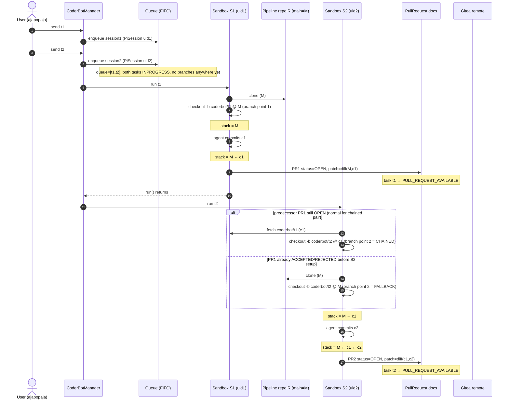
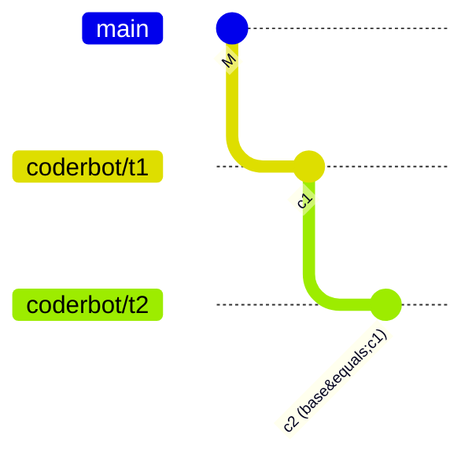
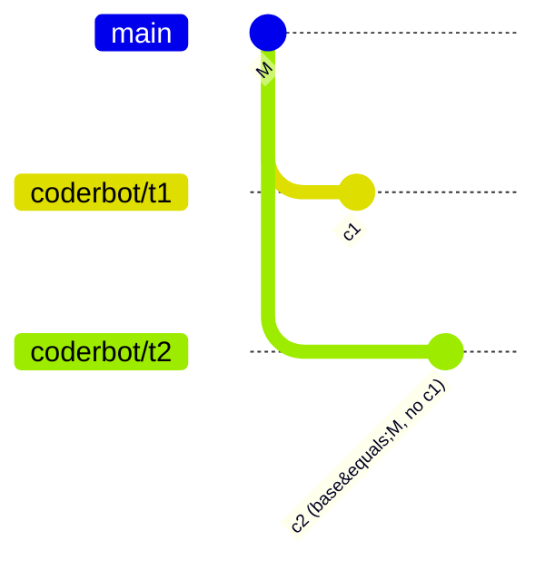
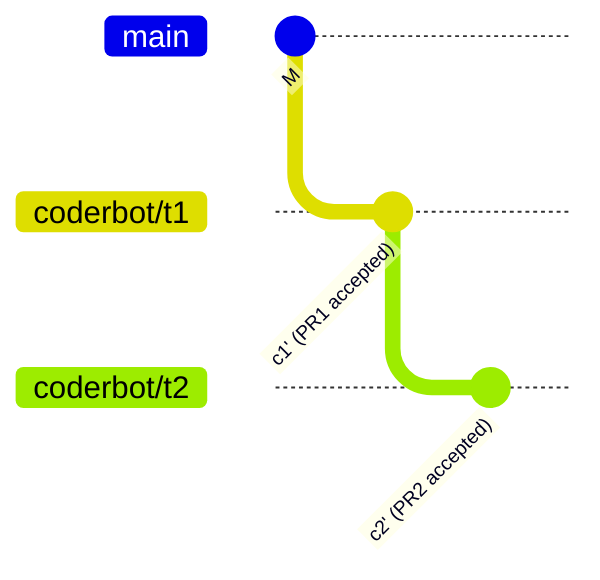
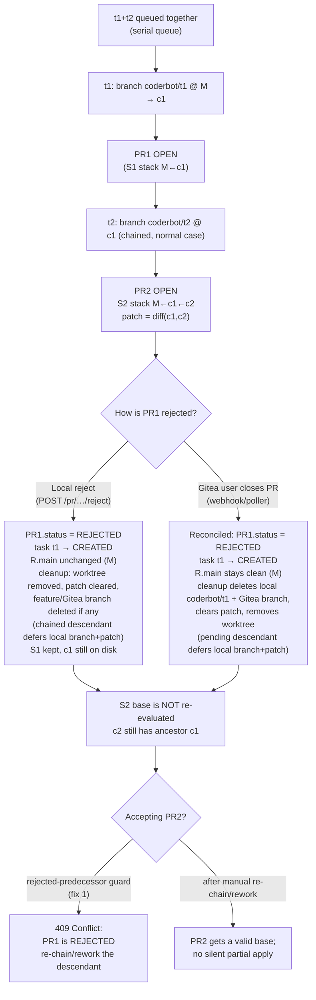

# Design Document: Task-Chain Lifecycle and Pull-Request Rejection

**Task ID:** 6ac6aa15bd8a2b256aff5496
**Status:** IMPLEMENTED (fixes 1–5 from §10 landed)
**Related design:** Task-chain problem design (version 18, "Solve the task chain problem when making PRs")

## 1. Goal

Specify and visualise the lifecycle of the ordered branch-chaining feature, with a
focus on the two ways a pending pull request can be **rejected**:

1. **Local reject** — the user clicks *Reject* in ajapopaja
   (`POST /pull_requests/{pr_id}/reject`).
2. **Remote reject** — the Gitea user closes the pull request that was submitted in
   `gitea_pr` mode.

The question this document answers is: *at which point are the branches taken, and
what commit stack do they carry from queueing to being stored as a PR in the remote
system?* The analysis also identifies two correctness gaps in the current chain
design around rejection.

## 2. Vocabulary

| Name | Meaning | Created at |
|------|---------|------------|
| `R` | Pipeline repository (`pipeline.workspace_abs_path`). The durable checkout that survives between tasks. | pipeline setup |
| `M` | Tip of `R`'s default branch when a sandbox is cloned. | — |
| `S1`, `S2` | Retained batch workspaces (`PI_SESSIONS_ROOT/<uid>/workspace`). Full clones of `R`; kept after the run when retention is on (default). | `CoderBotSession.run()` → `setup_sandbox()` |
| `c1`, `c2` | Commits CoderBot creates **inside** `S1` / `S2` on `coderbot/<task_id>`. They exist only in the sandboxes. | `_handle_agent_end()` |
| `c1'`, `c2'` | Commits created in `R` when a local PR is **accepted** (patch re-applied with `git apply --3way`). Different hashes from `c1`, `c2`. Land on `R`'s default branch in merge/push mode, and on the PR's feature branch in `gitea_pr` mode (where the default branch stays clean). | `accept_pull_request()` |
| `PR1`, `PR2` | Local `PullRequest` documents. `branch_name = coderbot/<task_id>`. | `_handle_agent_end()` |

The chain link is the predecessor's **retained workspace** `S1`: `S2` runs
`git fetch S1 refs/heads/coderbot/t1` and branches `coderbot/t2` at `c1`.

## 3. Branch points and commit stacks for a queued pair

The queue is strictly serial (`CoderBotManager._process_queue`). `t2` starts
immediately after `t1`'s `run()` returns, i.e. **after `PR1` is already created and
still `OPEN`**. That is exactly the window the chain rule keys on, so in the normal
"send both at once" case `t2` **always** chains onto `c1`.

Commit stacks produced by the two branch-point variants:

Each local PR carries the **task's own delta**, not a diff against `main`:

| PR | branch (sandbox) | patch |
|----|------------------|-------|
| PR1 | `coderbot/t1` in S1 | `diff(M, c1)` |
| PR2 chained | `coderbot/t2` in S2 | `diff(c1, c2)` — excludes `c1` |
| PR2 fallback | `coderbot/t2` in S2 | `diff(M, c2)` — independent of `c1` |

## 4. Acceptance

`accept_pull_request` re-applies the PR's patch to `R` and commits it. The two
apply modes now differ in **where** the commit lands:

* **merge / push** — the patch is applied and committed onto `R`'s default
  branch (unchanged from the original design). In `push` mode the commit is then
  pushed to the remote; in `merge` mode it stays local.

* **gitea_pr** — the default branch is deliberately kept clean. Before applying
  the patch, the feature branch is created at a chosen start point, the patch is
  applied and committed **on that feature branch**, and the branch is pushed as
  a Gitea pull request. The start point is the **predecessor's accepted feature
  branch** for a *chained* PR (so a delta patch relative to the predecessor's
  commit applies on top of the predecessor's work), or the **clean default
  branch** for a non-chained PR.

  This is fix 4 from §10: not committing `c1'` to `R.main` at accept time means
  a remote rejection can actually leave `R.main` untouched, and the default
  branch no longer accumulates rejected work for later CoderBot sessions to
  inherit.

In `gitea_pr` mode the remote feature branch for `t1` is `c1'` and the one for
`t2` is `c1' ← c2'`, so **PR2's remote branch physically contains PR1's change**.
The remote base branch remains at `M` until the remote user merges, and the local
default branch stays at `M` throughout (only the feature branches advance).

## 5. Rejection channel A — local reject in ajapopaja

`reject_pull_request()` sets `pr.status = PullRequestStatus.REJECTED` (no Gitea
call) and, when the task is `PULL_REQUEST_AVAILABLE`, transitions it back to
`CREATED` and broadcasts a `TASK_STATUS_UPDATED` WebSocket message so the UI
moves the card back to the backlog. It then runs the shared completion cleanup
(§8.4 of [`dd_batch_coderbot_git_process.md`](dd_batch_coderbot_git_process.md)):
the dev-server worktree is removed, `PullRequest.patch` is cleared, and a
feature branch is deleted if one exists (for example after a failed accept with
`failure_strategy=keep`). The Gitea branch is also deleted best-effort when the
PR had been submitted.

It does **not** touch `R`'s default branch (`main` stays at `M`), does **not**
delete `S1` (`c1` still exists on disk), and does **not** re-parent any sandbox
that already chained onto `c1`.

Because of the chained-PR deferral rule, if `PR1` still has a pending chained
descendant its local branch and patch are retained until that descendant
completes (the remote branch is released immediately). Base resolution for a
**new** task skips the rejected PR (only `OPEN`/`SUBMITTED` count as pending) and
falls back to `M`. But `S2`, already created, keeps `c1` as ancestor.

## 6. Rejection channel B — remote Gitea reject

> **Historical framing (before the webhook):** originally there was **no
> observer** for remote PR state — no webhook handler and no polling of
> `GiteaClient.get_pull_request` — so closing the PR in Gitea left local
> `PR1.status`/`task t1` at `SUBMITTED` and both `coderbot/t1` branches in
> place. That paragraph describes the old behaviour only.

Today the HMAC-protected webhook
(`POST /api/git_hosting/pipelines/{pipeline_id}/pr-state`) and the optional
`GITEA_PR_POLL_ENABLED` reconciler feed the same
`PrStateNotifier.on_pr_state`. When the Gitea user closes the PR without
merging:

* local `PR1.status` becomes `REJECTED` and `task t1` returns to `CREATED`
  (mirroring the local reject), with the usual `TASK_STATUS_UPDATED` broadcast;
* completion cleanup removes the dev-server worktree, deletes the local
  `coderbot/t1` branch, deletes the Gitea branch, and clears `PR1.patch`;
* `R`'s local default branch stays at `M` (fix 4 never committed `c1'` there).

The cleanup obeys the chained-descendant deferral rule: if a descendant is still
pending, the **local** `coderbot/t1` branch and `PR1.patch` are kept as that
descendant's `start_point`/patch fallback, while the **remote** branch is
deleted immediately. The sweep releases the local branch and patch once the
chain tip completes. A remote reject is therefore no longer invisible to the
chain logic, although an already-created descendant still carries `c1` in its
history (see §9, consequence 3).

## 7. Decision diagram: rejecting PR1 while PR2 is chained on c1

> In `gitea_pr` mode the “accepting PR2” leg differs slightly. For the
> **local-reject** case the predecessor feature branch `coderbot/t1` is normally
> never created (unless an earlier accept attempt created it), so a re-chain or
> rework starts from `M`. For the **remote-reject** case the Gitea branch is
> deleted immediately, while the local `coderbot/t1` survives only when a
> chained descendant is pending; a reworked descendant may use it as its start
> point until the chain tip completes. In both cases the accept route refuses a
> descendant of a rejected predecessor with `409` (fix 1) until it is re-chained
> or reworked. If a descendant had already been accepted/merged *before* the
> predecessor's remote rejection was reconciled, its branch history still
> carries the rejected `c1'` (consequence 3 in §9); completion cleanup cannot
> rewrite that content. Once the chain tip completes, the predecessor's local
> branch and patch are released by the sweep.

## 8. Content vs. ancestry: does a rejected middle commit block descendants?

The base selection for a sandbox is keyed on **commit hashes** (`c3`'s parent is
`c2` in the retained workspace). PR representation and acceptance, however, are
keyed on **content**:

| Layer | Keyed on | Detail |
|-------|----------|--------|
| Sandbox chain / base selection | commit hash | `S3` is fetched from `S2` and branched at `c2`; `c3`'s parent is `c2`. |
| PR representation | content | The local PR stores `patch = diff(c2, c3)`, a blob/context diff — no ancestry required. |
| Acceptance | content | `git apply --3way` only checks whether the patch's preimage/context matches the target tree; it never checks the commit graph. |

The `Parent commit (base): c2` line in the summary is audit metadata only and is
not consulted at accept time.

At the content layer, in a chain `c1 → c2 → c3` where the tasks edit **disjoint**
files (`f1`, `f2`, `f3`), `diff(c2,c3)` contains only `f3`'s hunk and
`f3@c2 == f3@M`, so the delta *could* apply without `c2` as an ancestor. That is
why the failure mode is content-dependent rather than automatic — and why the
accept route needs the explicit rejected-predecessor guard (fix 1) to refuse a
descendant of a rejected predecessor with `409` instead of relying on the patch
to fail. The content analysis still explains what happens if a descendant was
accepted/merged before its predecessor's rejection was reconciled:

| Case | Applies? | Why |
|------|----------|-----|
| `c3` edits `f3` only, `c2` edited `f2` | ✅ | different blobs; hunk context matches `M` |
| `c3` edits a *different region* of `f2` | ✅ usually | hunks are local; context does not include `c2`'s edits |
| `c3` edits lines/context that `c2` rewrote | ❌ | patch preimage is `f2@c2`, absent from `R` → mismatch |
| `c3` applies cleanly but calls something `c2` added | ⚠️ | merges textually; semantically broken |

`git apply --3way` can only perform its 3-way rescue when the patch's `index`
preimage blobs exist in `R`. Sandbox commits do not, so overlapping hunks
generally fail hard (`HTTP 500` + workspace reset) rather than merging.

This generalises to an N-deep chain: each PR carries only `diff(c_{n-1}, c_n)`, so
a rejected middle commit `ck` matters to a descendant where that descendant's
patch depends on `ck`'s content. `tree(cN) = tree(c1) + Δ2 + ... + ΔN`; a missing
`Δk` leaves the tree wrong wherever later diffs rely on it. Today fix 1 blocks
acceptance of such a descendant until it is re-chained/reworked; the table above
describes the content-level behaviour that motivates that guard (and that still
applies to work merged before the rejection was reconciled).

## 9. Gap analysis

| Situation | Design rule | Covered? |
|-----------|-------------|-----------|
| New task starts after PR rejected | eligibility only counts `OPEN`/`SUBMITTED` → skip rejected, branch from `M` | ✅ §3.2/§3.5 |
| Accept newer PR while older is still pending | `409` ordering guard over `OPEN`/`SUBMITTED` | ✅ §3.6 |
| Keep `R.main` clean in `gitea_pr` mode so rejected work does not leak into new branches | commit onto the feature branch, not the default branch | ✅ fix 4 (§10) |
| Stack a chained `gitea_pr` PR on its predecessor's accepted branch | `_resolve_chained_start_point` | ✅ fix 4 (§10) |
| Descendant already chained onto a later-rejected predecessor | accept is blocked with `409`; the descendant is not automatically re-parented | ✅ fix 1; re-chain/rework remains manual |
| Remote Gitea reject | webhook/poller mirrors `REJECTED` and runs completion cleanup (subject to chained-descendant deferral) | ✅ fix 3 + fix 5 |
| Accept a descendant whose ancestor was rejected | rejected-predecessor guard blocks it with `409` | ✅ fix 1 |
| Treat `SUBMITTED` as pending for chaining/ordering | eligibility/ordering query counts `OPEN`/`SUBMITTED` | ✅ fix 2 |
| Completed PR leaves local branch, Gitea branch or multi-MB patch behind | completion cleanup + sweep | ✅ fix 5 |

### Consequences

1. In the t1+t2-at-once scenario the chain is formed **before** the user can
   review, so rejecting `PR1` still does not make `PR2` fall back to `main`.
   What changed is that accepting `PR2` is now **blocked with `409`** by the
   rejected-predecessor guard (fix 1) instead of silently replaying
   `diff(c1,c2)` on `M`; re-chaining or reworking the descendant remains a
   manual action (open). The reject also runs completion cleanup, so `PR1`'s
   dev-server worktree and branches are released (local branch/patch only once
   no chained descendant is pending).
2. A remote reject is no longer silently ignored: the webhook/poller mirrors
   `REJECTED` onto the local PR/task and runs the same completion cleanup.
   Because `SUBMITTED` now counts as pending (fix 2), a normal `gitea_pr` chain
   keeps chaining while review is pending; when the remote close is reconciled
   the completed PR's Gitea branch is deleted immediately and its local
   branch/patch are released once no pending descendant remains. Accepting a
   descendant of that rejected predecessor is still blocked by fix 1 until it is
   re-chained/reworked.
3. Because `gitea_pr` accept stacks PR2's feature branch on PR1's accepted
   feature branch (rather than on `R.main`), a rejected PR1's change can still
   reach the remote through a descendant that was already chained and is later
   accepted/merged. What changed with completion cleanup is that the **completed
   PR's branches and patch are released** (the remote branch at its own
   completion, the local branch and patch by the sweep once the chain tip
   completes). What cleanup does **not** and cannot undo is the *content/history*
   property: a merged descendant still carries the predecessor's commit `c1'` in
   its branch history. Open issues remain: a rejected predecessor still blocks
   the descendant (manual re-chain/rework), and an abandoned chain (rejected
   predecessor followed by a still-pending descendant) stays deferred; forcing
   such a chain to clean up is an explicit escape hatch that is out of scope.

## 10. Proposed fixes and current status

The five fixes below were proposed in the original analysis; all have landed.

1. **Re-chain or invalidate descendants on reject.** When `PR1` is rejected,
   detect sessions/PRs already chained onto `c1` and either mark them stale or
   re-chain them from `M`. At minimum, block acceptance of a pending PR whose
   ancestor was rejected. — **Implemented** (the accept route now blocks a
   descendant whose chained predecessor PR is `REJECTED` with a `409` via
   ``find_rejected_predecessor_pr``, rather than a silent partial apply).
2. **Treat `SUBMITTED` as pending.** Extend the predecessor-eligibility query and
   the §3.6 ordering guard to consider `SUBMITTED` PRs, not only `OPEN` ones, so
   `gitea_pr` mode participates in chaining consistently. — **Implemented**
   (`_has_open_pull_request` and `find_older_open_pull_request` now treat
   `SUBMITTED` as pending).
3. **Reconcile remote status.** Add a webhook or polling step that mirrors the
   Gitea PR state (`merged` / `closed`) onto the local `PullRequest` and `Task`, so
   a remote reject flips the local state and stops the chain. — **Implemented**
   (the `POST /api/git_hosting/pipelines/{pipeline_id}/pr-state` webhook receiver
   and the optional `GITEA_PR_POLL_ENABLED` reconciler; see
   `design/git/dd_git_hosting.md` §5.4).
4. **Revisit the `gitea_pr` accept side effect.** Consider not committing `c1'` to
   `R.main` at accept time, so a remote rejection can actually undo the change
   locally and feature branches stop stacking. — **Implemented** (commits
   `2ce0d75` and `911eb0a`): the default branch is kept clean, the patch is
   committed on the feature branch, and a chained PR's feature branch is stacked
   on its predecessor's accepted feature branch. Note the chained feature
   branches still stack by design — each chained PR is a delta — so the
   “feature branches stop stacking” goal is only partially achieved (see §9,
   consequence 3).
5. **Completion cleanup.** A terminal (`ACCEPTED`/`REJECTED`) PR releases its
   dev-server worktree, its local and remote feature branches and its
   `PullRequest.patch` through the shared, idempotent
   `git_utils.cleanup_completed_pull_request`; a pending chained descendant
   defers the local branch/patch, and `sweep_completed_pull_requests` releases
   the completed prefix when the chain tip completes. It is invoked by the
   webhook/poller `on_pr_state` (log-only failures, never changing the HTTP
   response) and by the local accept/reject routes. — **Implemented** (see
   [`dd_batch_coderbot_git_process.md`](dd_batch_coderbot_git_process.md) §8.4
   and [`dd_git_hosting.md`](dd_git_hosting.md) §5.4).

## 11. Test strategy

Covered (fixes 1–5):

* Fix 4: accepting a chained Gitea PR stacks its feature branch on the
  predecessor's accepted branch and leaves the default branch clean
  (`test_accept_chained_pr_gitea.py`, `test_accept_pr_with_user_summary_gitea.py`).
* Fix 1: accepting a descendant of a rejected predecessor is blocked with `409`
  (rejected-predecessor guard tests).
* Fix 2: the eligibility/ordering queries treat `SUBMITTED` as pending.
* Fix 3: remote-reject/merge reconciliation flips the local PR/task and does not
  change webhook responses (`backend/tests/test_branch_notifier.py`,
  `backend/tests/routes/test_git_hosting_routes.py`).
* Fix 5: the chain timeline tests **T-A…T-I** in
  `backend/tests/test_completion_cleanup.py` exercise the shared helper and
  deferral/sweep semantics: T-A (own remote branch only), T-B (deferred branch
  remains a start point), T-C (tip releases the whole prefix), T-D (non-chained
  immediate cleanup), T-E (sibling does not defer), T-F (abandoned chain stays
  deferred), T-G (order independence), T-H (idempotency) and T-I (PR without a
  branch never raises). The hook path additionally covers remote merge/close
  cleanup, credential use, 404 tolerance, log-only cleanup failure and the
  branch-delete webhook no-op in `backend/tests/test_branch_notifier.py` and
  `backend/tests/routes/test_git_hosting_routes.py`.
