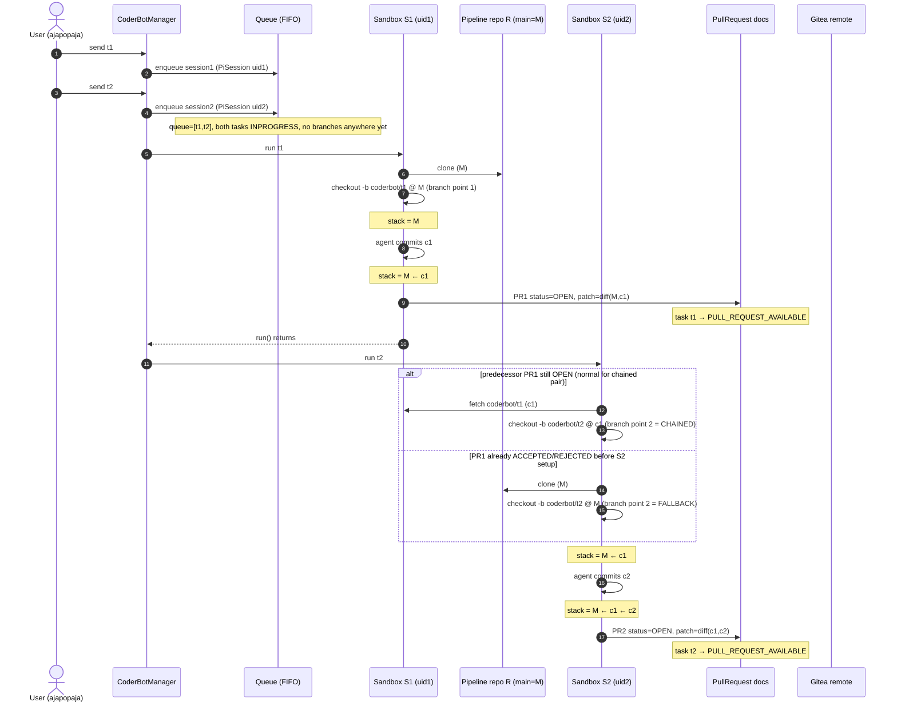
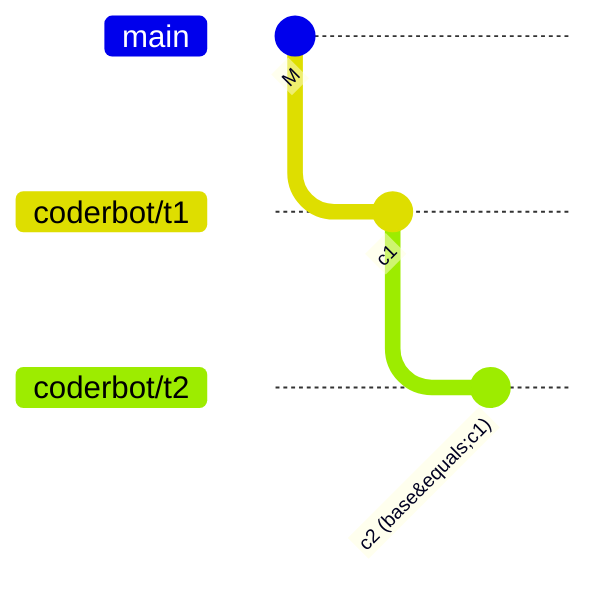
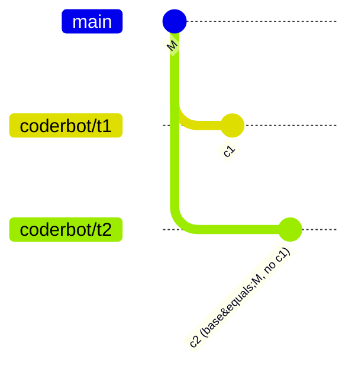
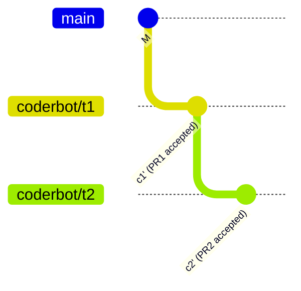
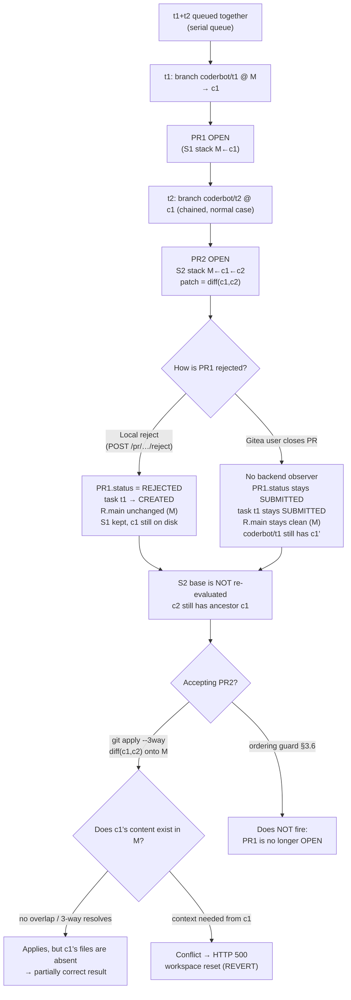

# Design Document: Task-Chain Lifecycle and Pull-Request Rejection

**Task ID:** 6ac6aa15bd8a2b256aff5496
**Status:** IMPLEMENTED (fixes 1–4 from §10 landed)
**Related design:** Task-chain problem design (version 18, "Solve the task chain problem when making PRs")

## 1. Goal

Specify and visualise the lifecycle of the ordered branch-chaining feature, with a
focus on the two ways a pending pull request can be **rejected**:

1. **Local reject** — the user clicks *Reject* in ajapopaja
   (`POST /pull_requests/{pr_id}/reject`).
2. **Remote reject** — the Gitea user closes the pull request that was submitted in
   `gitea_pr` mode.

The question this document answers is: *at which point are the branches taken, and
what commit stack do they carry from queueing to being stored as a PR in the remote
system?* The analysis also identifies two correctness gaps in the current chain
design around rejection.

## 2. Vocabulary

| Name | Meaning | Created at |
|------|---------|------------|
| `R` | Pipeline repository (`pipeline.workspace_abs_path`). The durable checkout that survives between tasks. | pipeline setup |
| `M` | Tip of `R`'s default branch when a sandbox is cloned. | — |
| `S1`, `S2` | Retained batch workspaces (`PI_SESSIONS_ROOT/<uid>/workspace`). Full clones of `R`; kept after the run when retention is on (default). | `CoderBotSession.run()` → `setup_sandbox()` |
| `c1`, `c2` | Commits CoderBot creates **inside** `S1` / `S2` on `coderbot/<task_id>`. They exist only in the sandboxes. | `_handle_agent_end()` |
| `c1'`, `c2'` | Commits created in `R` when a local PR is **accepted** (patch re-applied with `git apply --3way`). Different hashes from `c1`, `c2`. Land on `R`'s default branch in merge/push mode, and on the PR's feature branch in `gitea_pr` mode (where the default branch stays clean). | `accept_pull_request()` |
| `PR1`, `PR2` | Local `PullRequest` documents. `branch_name = coderbot/<task_id>`. | `_handle_agent_end()` |

The chain link is the predecessor's **retained workspace** `S1`: `S2` runs
`git fetch S1 refs/heads/coderbot/t1` and branches `coderbot/t2` at `c1`.

## 3. Branch points and commit stacks for a queued pair

The queue is strictly serial (`CoderBotManager._process_queue`). `t2` starts
immediately after `t1`'s `run()` returns, i.e. **after `PR1` is already created and
still `OPEN`**. That is exactly the window the chain rule keys on, so in the normal
"send both at once" case `t2` **always** chains onto `c1`.

Commit stacks produced by the two branch-point variants:

Each local PR carries the **task's own delta**, not a diff against `main`:

| PR | branch (sandbox) | patch |
|----|------------------|-------|
| PR1 | `coderbot/t1` in S1 | `diff(M, c1)` |
| PR2 chained | `coderbot/t2` in S2 | `diff(c1, c2)` — excludes `c1` |
| PR2 fallback | `coderbot/t2` in S2 | `diff(M, c2)` — independent of `c1` |

## 4. Acceptance

`accept_pull_request` re-applies the PR's patch to `R` and commits it. The two
apply modes now differ in **where** the commit lands:

* **merge / push** — the patch is applied and committed onto `R`'s default
  branch (unchanged from the original design). In `push` mode the commit is then
  pushed to the remote; in `merge` mode it stays local.

* **gitea_pr** — the default branch is deliberately kept clean. Before applying
  the patch, the feature branch is created at a chosen start point, the patch is
  applied and committed **on that feature branch**, and the branch is pushed as
  a Gitea pull request. The start point is the **predecessor's accepted feature
  branch** for a *chained* PR (so a delta patch relative to the predecessor's
  commit applies on top of the predecessor's work), or the **clean default
  branch** for a non-chained PR.

  This is fix 4 from §10: not committing `c1'` to `R.main` at accept time means
  a remote rejection can actually leave `R.main` untouched, and the default
  branch no longer accumulates rejected work for later CoderBot sessions to
  inherit.

In `gitea_pr` mode the remote feature branch for `t1` is `c1'` and the one for
`t2` is `c1' ← c2'`, so **PR2's remote branch physically contains PR1's change**.
The remote base branch remains at `M` until the remote user merges, and the local
default branch stays at `M` throughout (only the feature branches advance).

## 5. Rejection channel A — local reject in ajapopaja

`reject_pull_request()` sets `pr.status = PullRequestStatus.REJECTED` (no Gitea
call) and, when the task is `PULL_REQUEST_AVAILABLE`, transitions it back to
`CREATED` and broadcasts a `TASK_STATUS_UPDATED` WebSocket message so the UI
moves the card back to the backlog.

It does **not** touch `R` (`main` stays at `M`), does **not** delete `S1`
(`c1` still exists on disk), and does **not** re-parent any sandbox that already
chained onto `c1`.

Base resolution for a **new** task then skips the rejected PR (`status != OPEN`)
and falls back to `M`. But `S2`, already created, keeps `c1` as ancestor.

## 6. Rejection channel B — remote Gitea reject

There is **no observer** for remote PR state: no webhook handler and no polling of
`GiteaClient.get_pull_request` in the routes. When the Gitea user closes the PR,
nothing changes locally:

* local `PR1.status` stays `SUBMITTED`,
* `task t1` stays `SUBMITTED`,
* `remote_pr_url` and the pushed feature branch (`coderbot/t1`, still holding
  `c1'`) remain,
* `R`'s local default branch stays at `M` (fix 4 no longer commits it at accept
  time), but the local and remote `coderbot/t1` branch still contain `c1'`.

A remote reject is therefore still invisible both to the chain logic and to the
local repository — and, because a chained PR2's feature branch stacks on
`coderbot/t1`, the rejected `c1'` can still reach the remote through a merged
PR2 (see §9, consequence 3).

## 7. Decision diagram: rejecting PR1 while PR2 is chained on c1

> In `gitea_pr` mode the “accepting PR2” leg differs from the diagram above.
> For the **local-reject** case the predecessor feature branch `coderbot/t1` was
> never created, so `_resolve_chained_start_point` falls back to `M` and the
> `git apply --3way diff(c1,c2)` behaviour above applies. For the **remote-reject**
> case `coderbot/t1` still exists, so PR2's feature branch stacks on `coderbot/t1`
> (already containing `c1'`) and the delta applies cleanly — the rejected `c1'`
> then rides along into the remote PR2 (consequence 3 in §9).

## 8. Content vs. ancestry: does a rejected middle commit block descendants?

The base selection for a sandbox is keyed on **commit hashes** (`c3`'s parent is
`c2` in the retained workspace). PR representation and acceptance, however, are
keyed on **content**:

| Layer | Keyed on | Detail |
|-------|----------|--------|
| Sandbox chain / base selection | commit hash | `S3` is fetched from `S2` and branched at `c2`; `c3`'s parent is `c2`. |
| PR representation | content | The local PR stores `patch = diff(c2, c3)`, a blob/context diff — no ancestry required. |
| Acceptance | content | `git apply --3way` only checks whether the patch's preimage/context matches the target tree; it never checks the commit graph. |

The `Parent commit (base): c2` line in the summary is audit metadata only and is
not consulted at accept time.

Consequently, in a chain `c1 → c2 → c3` where the tasks edit **disjoint** files
(`f1`, `f2`, `f3`), rejecting `c2` and accepting `PR3` onto `main` still works:
`diff(c2,c3)` contains only `f3`'s hunk, and `f3@c2 == f3@M`, so it applies. `c2` is
not required as an ancestor. The failure is content-dependent, not automatic:

| Case | Applies? | Why |
|------|----------|-----|
| `c3` edits `f3` only, `c2` edited `f2` | ✅ | different blobs; hunk context matches `M` |
| `c3` edits a *different region* of `f2` | ✅ usually | hunks are local; context does not include `c2`'s edits |
| `c3` edits lines/context that `c2` rewrote | ❌ | patch preimage is `f2@c2`, absent from `R` → mismatch |
| `c3` applies cleanly but calls something `c2` added | ⚠️ | merges textually; semantically broken |

`git apply --3way` can only perform its 3-way rescue when the patch's `index`
preimage blobs exist in `R`. Sandbox commits do not, so overlapping hunks
generally fail hard (`HTTP 500` + workspace reset) rather than merging.

This generalises to an N-deep chain: each PR carries only `diff(c_{n-1}, c_n)`, so a
rejected middle commit `ck` blocks a descendant only where that descendant's patch
depends on `ck`'s content. `tree(cN) = tree(c1) + Δ2 + ... + ΔN`; a missing `Δk`
leaves the tree wrong wherever later diffs rely on it. Disjoint work is unaffected.

## 9. Gap analysis

| Situation | Design rule | Covered? |
|-----------|-------------|-----------|
| New task starts after PR rejected | eligibility requires `OPEN` → skip, branch from `M` | ✅ §3.2/§3.5 |
| Accept newer PR while older is still `OPEN` | `409` ordering guard | ✅ §3.6 |
| Keep `R.main` clean in `gitea_pr` mode so rejected work does not leak into new branches | commit onto the feature branch, not the default branch | ✅ fix 4 (§10) |
| Stack a chained `gitea_pr` PR on its predecessor's accepted branch | `_resolve_chained_start_point` | ✅ fix 4 (§10) |
| **Descendant already chained onto a later-rejected predecessor** | none — reject does not re-parent `S2` | ❌ |
| **Remote Gitea reject** | none — local status stays `SUBMITTED`; remote reject not observed | ❌ |
| Accept a descendant whose ancestor was rejected | ordering guard only looks at `OPEN` | ❌ (§3.6 misses it) |
| Treat `SUBMITTED` as pending for chaining/ordering | eligibility/ordering query only tests `OPEN` | ❌ (fix 2) |

### Consequences

1. In the t1+t2-at-once scenario the chain is formed **before** the user can
   review, so rejecting `PR1` does not make `PR2` fall back to `main`. Accepting
   `PR2` alone replays `diff(c1,c2)` on `M`, which can either fail or produce a
   partial result. Whether it is harmful depends on content overlap (see [§8](#8-content-vs-ancestry-does-a-rejected-middle-commit-block-descendants));
   either way the recorded base `c1` never exists in `main`. The ordering guard
   does not catch it because `PR1` is no longer `OPEN` after the reject. (In
   `gitea_pr` mode this is the **local-reject** fallback: `coderbot/t1` was never
   created, so PR2 branches from `M` and hits the same apply behaviour.)
2. A remote reject is still silently ignored (fix 3 not applied): the local
   PR/task remain `SUBMITTED`. Separately, `SUBMITTED` PRs are not treated as
   pending by the chaining eligibility query (only `OPEN` counts, fix 2 not
   applied), so in the normal `gitea_pr` flow the chain **breaks** as soon as
   PR1 is submitted for review: a subsequent task falls back to `M` instead of
   chaining onto `c1`, and the rejected `c1'` stays stranded on the
   `coderbot/t1` feature branch.
3. Because `gitea_pr` accept stacks PR2's feature branch on PR1's accepted
   feature branch (rather than on `R.main`), a rejected PR1's change can still
   reach the remote through a merged PR2: PR2's branch physically contains
   `c1'`, and no reconciliation ever removes it.

## 10. Proposed fixes and current status

The four fixes below were proposed in the original analysis. Only fix 4 has
landed so far; the rest remain open.

1. **Re-chain or invalidate descendants on reject.** When `PR1` is rejected,
   detect sessions/PRs already chained onto `c1` and either mark them stale or
   re-chain them from `M`. At minimum, block acceptance of a pending PR whose
   ancestor was rejected. — **Implemented** (the accept route now blocks a
   descendant whose chained predecessor PR is `REJECTED` with a `409` via
   ``find_rejected_predecessor_pr``, rather than a silent partial apply).
2. **Treat `SUBMITTED` as pending.** Extend the predecessor-eligibility query and
   the §3.6 ordering guard to consider `SUBMITTED` PRs, not only `OPEN` ones, so
   `gitea_pr` mode participates in chaining consistently. — **Implemented**
   (`_has_open_pull_request` and `find_older_open_pull_request` now treat
   `SUBMITTED` as pending).
3. **Reconcile remote status.** Add a webhook or polling step that mirrors the
   Gitea PR state (`merged` / `closed`) onto the local `PullRequest` and `Task`, so
   a remote reject flips the local state and stops the chain. — **Implemented**
   (the `POST /api/git_hosting/pipelines/{pipeline_id}/pr-state` webhook receiver
   and the optional `GITEA_PR_POLL_ENABLED` reconciler; see
   `design/git/dd_git_hosting.md` §5.4).
4. **Revisit the `gitea_pr` accept side effect.** Consider not committing `c1'` to
   `R.main` at accept time, so a remote rejection can actually undo the change
   locally and feature branches stop stacking. — **Implemented** (commits
   `2ce0d75` and `911eb0a`): the default branch is kept clean, the patch is
   committed on the feature branch, and a chained PR's feature branch is stacked
   on its predecessor's accepted feature branch. Note the chained feature
   branches still stack by design — each chained PR is a delta — so the
   “feature branches stop stacking” goal is only partially achieved (see §9,
   consequence 3).

## 11. Test strategy

Already covered (fix 4): accepting a chained Gitea PR stacks its feature branch
on the predecessor's accepted branch and leaves the default branch clean
(`test_accept_chained_pr_gitea.py`, `test_accept_pr_with_user_summary_gitea.py`).

The following are still aspirational, pending fixes 1–3:

* Unit: reject flips `PR.status`/task status; a chained descendant is flagged or
  blocked as specified by fix 1.
* Unit: eligibility query includes `SUBMITTED` as pending.
* Integration (temp repos): t1+t2 chained, reject PR1, accept PR2 → asserts the
  chosen behaviour (blocked/409 or re-chained from `M`), never a silent partial
  apply.
* Integration: remote-reject reconciliation flips local PR/task status.
