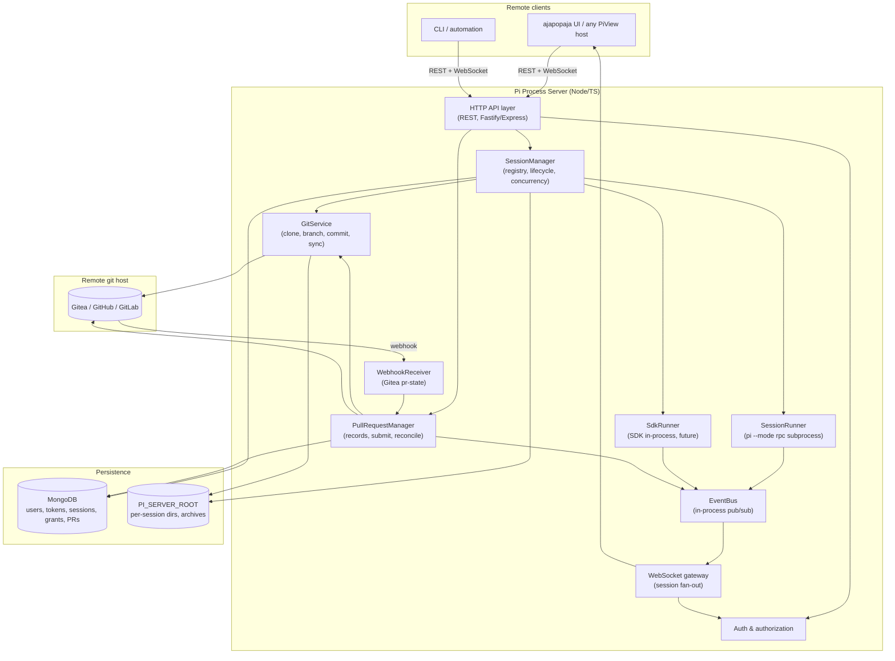
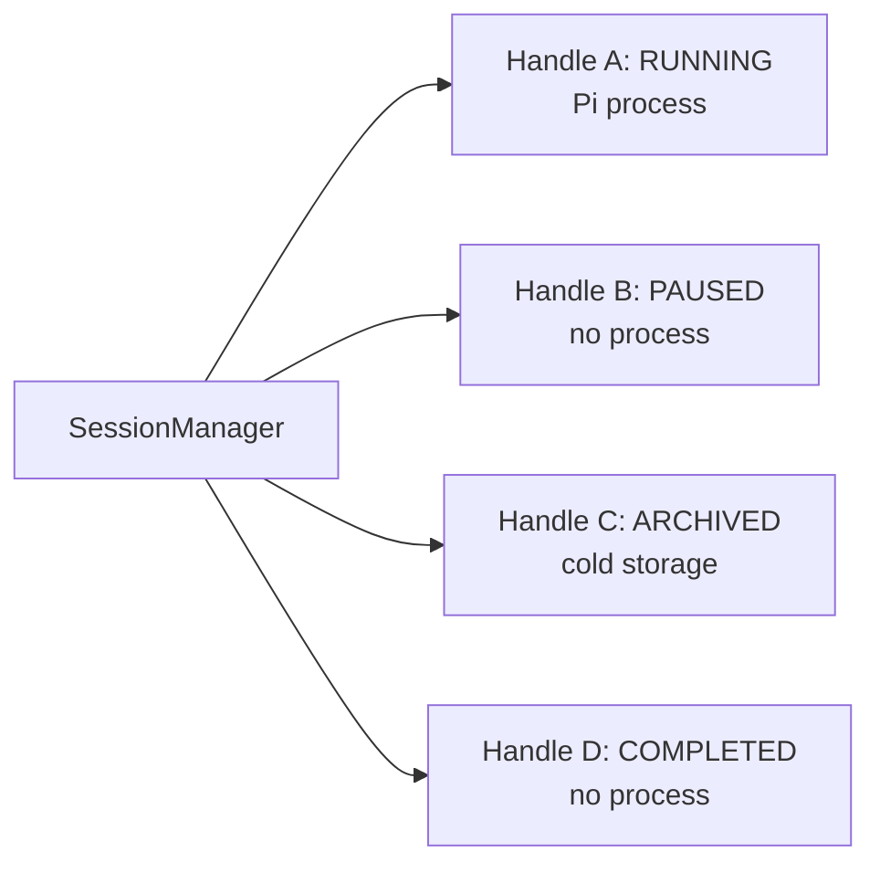
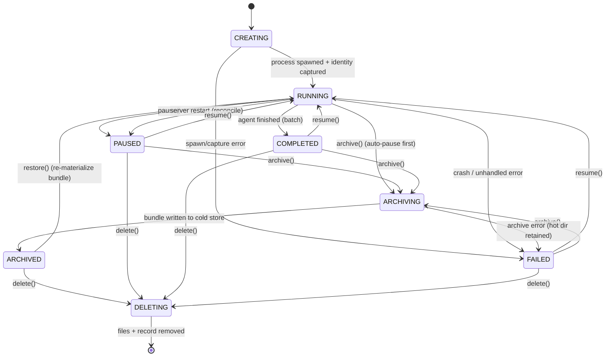

# Design Document: Pi Process Server Architecture & Session Lifecycle

## 1. Overview

Today the ajapopaja backend embeds Pi process management inside its own FastAPI
process: `CoderBotManager` owns a batch queue plus a single interactive slot, and
`CoderBotSession` / `InteractivePiSession` spawn `pi --mode rpc` subprocesses and
speak a JSONL RPC protocol over std-I/O. That works well but couples Pi session
management to the ajapopaja deployment, making it hard to evolve pause/resume/
archive independently and hard for other UIs to reuse.

This document proposes a **standalone Pi process server** ("the server") that:

- manages Pi processes and their durable sessions,
- gives each session a git workspace and turns its commits into pull requests,
- exposes the same lifecycle the `coderbot` router offers today, plus archiving,
- streams live Pi output to remote clients over WebSockets,
- stores sessions on a controlled filesystem and bookkeeping in MongoDB,
- authenticates users with tokens and controls per-session access.

Because the Pi SDK is built for Node.js, the server is a TypeScript application.
It drives Pi through subprocesses over std-I/O (`pi --mode rpc`), preserving the
process-isolation and multi-process model the Python backend uses today. The
SDK's in-process API remains a possible later escape hatch for SDK-only features.

## 2. Goals & Non-Goals

### Goals

1. Decouple Pi session management from ajapopaja so it can be deployed, scaled
   and versioned independently.
2. Support the full lifecycle: create, run, pause, resume, archive, restore,
   delete — plus transient and failure states.
3. Stream live Pi events to remote clients so a `PiView` (as in ajapopaja) can
   render the activity log unchanged.
4. Persist native Pi conversations and retained workspaces so a session can be
   resumed later (or after a server restart).
5. Give each session a git workspace: clone/init a repository, let the agent
   commit, and deliver those commits as pull requests to a remote host, keeping
   the repository until the session is deleted (no patch blob in the DB).
6. Provide token-based authentication and per-session access grants so more than
   one user (or service) can share the server safely.
7. Use MongoDB for bookkeeping (users, tokens, sessions, grants, pull requests)
   and the filesystem for bulk/append-only artifacts.

### Non-Goals

- Re-implementing ajapopaja's pipelines and tasks. Those are carried as opaque
  metadata on a session; pull requests and the git workspace, however, are
  first-class server concepts (see §8 and
  [dd_git_workflow.md](dd_git_workflow.md)).
- General-purpose job orchestration (retries, cron, fan-out). One Pi process per
  running session, bounded by a concurrency cap.
- Horizontal multi-node execution in the first cut (single writer per session
  directory; see §7).

## 3. Architecture

### 3.1 Component overview



### 3.2 Responsibilities

| Component | Responsibility |
|-----------|----------------|
| HTTP API layer | REST endpoints for the session lifecycle (§ REST doc), request validation, auth dependency. |
| WebSocket gateway | Authenticates the handshake, manages subscriptions, fans out events only to clients with access. |
| SessionManager | The analogue of `CoderBotManager`: a registry of `SessionHandle`s, the lifecycle state machine, the concurrency guard, startup reconciliation and archiving/GC. |
| SessionRunner | Spawns/owns one `pi --mode rpc` subprocess and translates Pi events into server events. Uses the SDK `RpcClient` (or a ported `PiRpcProcess`) over std-I/O by default. |
| SdkRunner | Optional future runner that drives Pi through the SDK in-process, for SDK-only features (fork/import, session introspection, custom loaders). |
| GitService | Owns the per-session workspace repo: clone/init, branch/commit, fetch/pull sync and status. |
| PullRequestManager | Owns `pull_requests` records, submission to the remote host, and reconciliation of remote PR state. |
| WebhookReceiver | HMAC-protected endpoint that receives host PR/push events and feeds the reconciler. |
| EventBus | In-process pub/sub that decouples runners, the PR manager, the WebSocket gateway and the event-log writer. |

The `SessionRunner` interface is the seam that keeps the subprocess path and an
in-process SDK path interchangeable:

```ts
interface SessionRunner {
  start(opts: StartOptions): Promise<void>;
  sendPrompt(text: string): Promise<void>;
  sendCommand(type: string, payload?: unknown): Promise<unknown>;
  captureIdentity(): Promise<SessionIdentity>; // sessionId, sessionFile, sessionName
  stop(): Promise<void>;
  close(graceful?: boolean): Promise<void>;
  wait(): Promise<number | null>;
  onEvent(cb: (event: PiEvent) => void): () => void;
}
```

### 3.3 Why one process per session

A Pi process has a fixed working directory (`cwd`). Different sessions run in
different repositories, and Pi resolves sessions relative to that cwd. We
therefore keep the invariant from the current backend: **one Pi process per
running session**, respawned on demand when a paused/archived session is resumed.
The manager enforces a configurable concurrency cap (`maxRunning`, default `2`
to preserve today's one-batch-plus-one-interactive behaviour).



## 4. Session Lifecycle

### 4.1 States



| State | Meaning | Resumable? |
|-------|---------|------------|
| `creating` | Record reserved, process being spawned / identity captured. | — |
| `running` | A live Pi process owns this session. | — |
| `paused` | Deliberately stopped; Pi session file + workspace retained. | yes |
| `completed` | Batch run finished (PR/artifacts written); process gone. | yes |
| `failed` | Error; process gone but artifacts retained for debugging/resume. | yes |
| `archiving` | Transient; hot directory being compressed into an archive bundle. | no |
| `archived` | Cold storage; hot directory released; bundle retained. | via restore |
| `deleting` | Transient; artifacts being removed. | no |

`paused`, `completed`, `failed` and `archived` are terminal-with-resume. Only one
record may be `running` (per configured lane) at a time; the manager guards this
with a per-lane lock + `runningSessionId` bookkeeping (mirroring
`_interactive_lock` / `_running_uid` today).

### 4.2 Operations

| Operation | Precondition | Effect |
|-----------|--------------|--------|
| `create` | valid repo/pipeline metadata | reserve `uid`, write record + dir, clone/init the git workspace, spawn Pi, capture identity, → `running`. |
| `pause` | `running` | graceful `close()`, cancel in-flight turn, → `paused`, `last_active_at=now`. |
| `resume` | `paused`/`completed`/`failed` | (optionally pause current) respawn Pi with stored session file + cwd, `resume_count++`, → `running`. |
| `archive` | not `archived`/`deleting` | pause if running, compress `pi-sessions` + `events.jsonl` + `workspace` into `archive/<uid>.tar.zst`, delete hot dir, → `archived`. |
| `restore` | `archived` | extract bundle back into `sessions/<uid>/`, → `paused` (resume to run). |
| `delete` | any non-`deleting` | stop process if any, remove record + hot dir (incl. the git repo) + archive + PR records, → gone. |

### 4.3 Startup reconciliation

On boot the manager mirrors `reconcile_on_startup()`:

1. Flip every `running` record to `paused` with `last_error = "server restarted"`.
2. Recover missing `sessionFile` from the `meta.json` sidecar.
3. Sweep expired retained workspaces (TTL).
4. Optionally auto-restore/resume the newest interactive session (config flag).

## 5. Filesystem Layout

```text
PI_SERVER_ROOT/                       # env PI_SERVER_ROOT (default ./data/pi-server)
├── sessions/                         # "hot" active/paused/completed sessions
│   └── <uid>/
│       ├── meta.json                 # crash-recovery mirror of the DB record (not source of truth)
│       ├── events.jsonl              # append-only raw Pi events for UI replay
│       ├── pi-sessions/              # passed to Pi as --session-dir (SDK sessionDir)
│       │   └── --<cwd-slug>--/
│       │       └── <timestamp>_<uuid>.jsonl
│       └── workspace/                # the session's git clone (working tree + .git)
├── archive/                          # cold storage bundles
│   └── <uid>.tar.zst                 # pi-sessions + events.jsonl + workspace + meta.json
└── tmp/                              # transient staging (archive/restore)
```

Rules:

- `sessions/<uid>` is the **hot** location and is what the SDK/session is pointed
  at while running. `meta.json` is a best-effort sidecar (never authoritative).
- `events.jsonl` and the native Pi session file are append-only; a crash loses at
  most the last event.
- Archiving produces a single compressed bundle under `archive/` and removes the
  hot directory, so disk cost is bounded and restorable later.
- Absolute paths are persisted in the record (cwd, sessionFile, workspace). The
  server must run with the same `PI_SERVER_ROOT` across restarts so those paths
  stay valid (same constraint the current backend documents).
- `workspace/` is a full git repository (working tree + `.git`). It is created by
  clone/init at `create`, retained through pause/archive, and removed only on
  `delete` (see [dd_git_workflow.md](dd_git_workflow.md)).

## 6. Event Model (server side)

Runners emit **server events** on the EventBus; the gateway serializes them to
the WebSocket protocol (§ WS doc) and a writer appends the raw Pi event to
`events.jsonl`.

```ts
type ServerEvent =
  | { type: "session.started"; session: SessionRecord }
  | { type: "session.stopped"; session: SessionRecord }
  | { type: "session.updated"; session: SessionRecord }
  | { type: "session.error"; session: SessionRecord; message: string }
  | { type: "rpc.event"; sessionId: string; event: PiEvent }      // raw, forwarded verbatim
  | { type: "message.delta"; sessionId: string; delta: string }   // derived assistant text
  | { type: "turn.ended"; sessionId: string }
  | { type: "verification.started"; sessionId: string }
  | { type: "verification.result"; sessionId: string; result: unknown }
  | { type: "pr.created"; sessionId: string; pr: PullRequestRecord }
  | { type: "pr.submitted"; sessionId: string; pr: PullRequestRecord }
  | { type: "pr.merged"; sessionId: string; pr: PullRequestRecord }
  | { type: "pr.rejected"; sessionId: string; pr: PullRequestRecord }
  | { type: "git.status"; sessionId: string; status: GitStatus };
```

The `rpc.event` carries the raw Pi SDK event unchanged so the client can render it
structurally without the server knowing every Pi event type — the same principle
as `CODERBOT_RPC_EVENT` / `INTERACTIVE_RPC_EVENT` today.

## 7. Concurrency & Reliability

- A per-lane `AsyncLock` (Node `async-mutex`) guards start/stop atomicity so two
  concurrent requests cannot spawn two processes for the same slot.
- `resume({ pauseCurrent: true })` pauses the currently running session first;
  `pauseCurrent: false` returns `409` when another session is running.
- Every state change persists to MongoDB first (source of truth), then writes
  `meta.json` best-effort, then broadcasts.
- Archive/delete are idempotent and safe to retry.

## 8. Git workspace & pull requests

Each session owns a self-contained git repository at its `workspace_path`. The
server clones (or inits) it at `create`, lets the agent commit on a `pi/<pr_id>`
feature branch, and turns those commits into `pull_requests` rows — **without**
storing a patch blob: the PR references `branch_name` + `head_commit`, and its
diff is re-derived with `git diff base_commit head_commit` whenever needed. The
repository is retained for the whole session lifetime (hot or archived) and
removed only on `delete`.

The dedicated components are `GitService` (clone/init, branch/commit, fetch/pull
sync, status), `PullRequestManager` (records, submission, reconciliation) and
`WebhookReceiver` (HMAC-protected Gitea `pr-state` hook). PRs move through
`open → submitted → merged | rejected` (plus `superseded` for iterations); a
remote merge/close is mirrored back by webhook or poller, and the workspace is
kept in sync with `origin` via fetch (always safe) + fast-forward pull (only when
idle).

The full workflow — repo creation, branches/commits, the `pull_requests` record,
submission, remote-state reconciliation, sync and authentication — is specified
in [dd_git_workflow.md](dd_git_workflow.md). The REST endpoints for PR and git
status/sync management are in [dd_rest_api.md](dd_rest_api.md), the data model
in [dd_data_model_auth.md](dd_data_model_auth.md), and the `pr.*` / `git.status`
events in [dd_websocket_protocol.md](dd_websocket_protocol.md).

## 9. Open Questions

| Question | Current lean |
|----------|--------------|
| In-process SDK vs subprocess | Default subprocess (`pi --mode rpc` via `RpcClient`/`PiRpcProcess`) for isolation and multi-process; SDK in-process as a future escape hatch. |
| Archive format | `tar.zst` (good compression + streaming); revisit if random-access needed. |
| Multi-node | Single writer per session dir for v1; a shared volume + DB lock is the likely first step if scale requires. |
| Compatibility with ajapopaja's existing WS types | Emit both namespaced `session.*`/`rpc.event` and legacy `INTERACTIVE_RPC_EVENT`-style aliases during migration (§ WS doc). |
| Git PR chaining / ordering | Not needed for v1; one PR branches from the default branch. Revisit ordered chaining (and its rejection semantics) only if ordered multi-PR sessions are required (§ git doc). |
