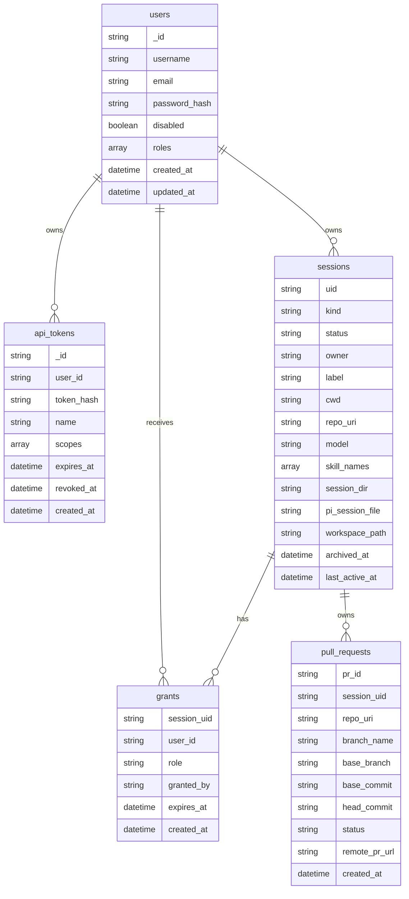
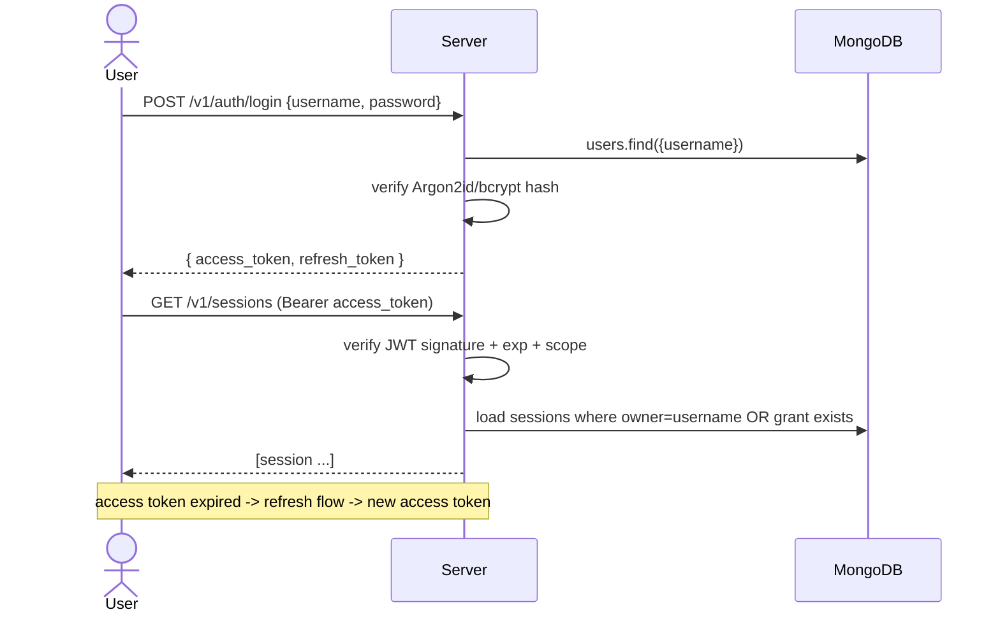

# Design Document: Pi Process Server — Data Model & Authentication

## 1. Overview

MongoDB stores bookkeeping and management data that must be queryable and
durable: users (with encrypted credentials), API tokens, sessions, and per-session
access grants. The filesystem stores bulk/append-only artifacts (native Pi
session files, event logs, workspaces, archives) as described in the architecture
document. MongoDB is the **source of truth** for state and access; the on-disk
`meta.json` is only a crash-recovery mirror.

All credentials are stored as salted hashes, never in plaintext.

## 2. Collections

### 2.1 `users`

| Field | Type | Notes |
|-------|------|-------|
| `_id` | ObjectId | |
| `username` | string | unique index. |
| `email` | string | optional, unique sparse index. |
| `password_hash` | string | Argon2id (preferred) or bcrypt. |
| `disabled` | bool | blocks all access. |
| `roles` | string[] | e.g. `["admin"]`, `["user"]`. |
| `created_at` / `updated_at` | datetime | |

The encrypted credential is the `password_hash`. We use **Argon2id** by default
(bcrypt is an acceptable fallback for compatibility with the current backend,
which uses bcrypt); never store or log the raw password.

### 2.2 `api_tokens` (personal access tokens / service tokens)

| Field | Type | Notes |
|-------|------|-------|
| `_id` | ObjectId | |
| `user_id` | ObjectId | owning user. |
| `token_hash` | string | SHA-256 of the random token; the raw token is shown once at creation. |
| `name` | string | human label. |
| `scopes` | string[] | e.g. `["sessions:read","sessions:write"]`. |
| `expires_at` | datetime | optional. |
| `revoked_at` | datetime | null until revoked. |
| `created_at` | datetime | |

Only the hash is stored, so a leaked database does not leak usable tokens. Token
format: `psrv_<32 random bytes, base64url>`, looked up by hashing the presented
value.

### 2.3 `sessions`

The `PiSession` document, generalized from the current backend model:

| Field | Type | Notes |
|-------|------|-------|
| `uid` | string | UUID v4, primary handle, unique index. |
| `kind` | string | `interactive` \| `batch` (aliases the old `coderbot`). |
| `status` | string | lifecycle state (§ architecture). |
| `owner` | string | username of the creating user. |
| `label` | string \| null | human-readable name. |
| `pipeline_id` / `task_id` | string \| null | opaque caller metadata. |
| `pull_request_ids` | string[] | optional caller metadata. |
| `pi_session_id` / `pi_session_file` / `session_dir` | string \| null | native Pi identity (from `get_state`). |
| `cwd` | string \| null | working directory the process runs in. |
| `repo_uri` | string \| null | the remote `origin` the workspace tracks (when cloned). |
| `workspace_path` | string \| null | the session's git clone (working tree + `.git`). |
| `model` | string \| null | model override. |
| `skill_names` | string[] | skills staged for the session. |
| `bot_type` | string | `interactive` (discriminator kept for WS compatibility). |
| `archive_path` | string \| null | path of the cold-storage bundle when `archived`. |
| `resume_count` | int | |
| `last_error` | string \| null | |
| `created_at` / `updated_at` / `last_active_at` / `archived_at` | datetime | |

### 2.4 `grants`

Per-session access grants (see §4):

| Field | Type | Notes |
|-------|------|-------|
| `session_uid` | string | target session. |
| `user_id` | ObjectId | grantee. |
| `role` | string | `viewer` \| `editor` \| `owner`. |
| `granted_by` | ObjectId | who created the grant. |
| `expires_at` | datetime \| null | optional expiry. |
| `created_at` | datetime | |

Unique compound index on `(session_uid, user_id)`.

### 2.5 `pull_requests`

One document per PR created from a session. **No patch blob** — the record
references the feature branch and commits in the session's workspace (see
[dd_git_workflow.md](dd_git_workflow.md)).

| Field | Type | Notes |
|-------|------|-------|
| `pr_id` | string | short unique id (base62), used in branch names + URLs; unique index. |
| `session_uid` | string | owning session; indexed. |
| `repo_uri` | string | the `origin` the PR targets. |
| `branch_name` | string | feature branch in `W` (default `pi/<pr_id>`). |
| `base_branch` | string | target branch on `origin` (default: its default branch). |
| `title` | string | PR subject. |
| `body` | string \| null | markdown summary/description. |
| `base_commit` | string | branch-point commit sha. |
| `head_commit` | string | feature-tip commit sha. |
| `status` | string | `open` \| `submitted` \| `merged` \| `rejected` \| `superseded`. |
| `remote_pr_url` | string \| null | set when `submitted`. |
| `remote_pr_number` | int \| null | set when `submitted`. |
| `superseded_by` | string \| null | `pr_id` of a later PR replacing this one. |
| `created_at` / `updated_at` | datetime | |
| `submitted_at` / `merged_at` / `rejected_at` | datetime \| null | |

## 3. Authentication (token based)

The server issues two kinds of credentials, both presented as
`Authorization: Bearer <token>`:

1. **JWT access + refresh tokens** for interactive UI sessions.
   - Access token: short-lived (e.g. 15–30 min), signed HS256/RS256, claims
     `sub` (user id), `username`, `roles`, `scopes`, `jti`, `exp`.
   - Refresh token: long-lived (e.g. 7 days), rotated on use, optionally stored
     hashed in `api_tokens` (or a dedicated `refresh_tokens` collection) to allow
     revocation.
2. **Opaque personal access tokens (PATs)** for CLI/automation/service-to-service
   access. Stored hashed in `api_tokens`; checked on every request by hashing the
   presented value and looking it up (not revoked, not expired).

Token-confusion guard (mirroring the current backend's `decode_token`): any
token carrying a non-session `scope` (e.g. a raw-file token in ajapopaja) must
never be accepted as a general access credential.

Configuration: `AUTH_JWT_SECRET` (or RS256 key), `AUTH_ACCESS_TTL`,
`AUTH_REFRESH_TTL`, `AUTH_PAT_PREFIX`. A shared development secret triggers a
startup warning (as today).

## 4. Access control & session grants

A session has an **owner** and an optional set of **grants** to other users.

| Role | Can |
|------|-----|
| `owner` | full control: read, prompt, pause/resume, archive/restore, delete, manage grants. |
| `editor` | read, prompt, pause/resume; cannot archive/delete or manage grants. |
| `viewer` | read-only: stream + history; cannot prompt or mutate. |

Resolution order for an incoming request targeting `session_uid`:

1. Authenticate token → resolve `user` (and `scopes`).
2. `admin` role or a global scope (`sessions:*`) grants access.
3. Otherwise, allow if `session.owner == user.username` (implicit `owner`).
4. Otherwise, allow per the matching `grants` row's `role` (subject to expiry).

Enforcement points:

- **REST**: a middleware checks the grant before the handler runs; returns `403`
  for insufficient role, `404` when the session does not exist.
- **WebSocket**: the `subscribe` request is authorized; the gateway caches the
  granted session ids per connection and filters every outgoing message.

The grant model is what makes the server multi-user and remotely usable by more
than just the ajapopaja backend — the current backend only stores an optional
`owner` and does not enforce scoping; this server makes it real.

## 5. Security notes

- Passwords: Argon2id (bcrypt fallback), salted, never logged.
- PATs: random 256-bit values, SHA-256 hashed at rest, shown once, revocable,
  optional expiry + scopes.
- JWTs: signed, short-lived, `jti` for revocation, algorithm pinned (reject `none`).
- Event logs / `meta.json` must never contain tokens or secrets (the current
  backend already documents this).
- Archive bundles are stored unencrypted by default; an optional encryption key
  (`ARCHIVE_KEY`) can be added if the repo content is sensitive.
- Git credentials (HTTPS PAT) are resolved per-session (`repo_username` /
  `repo_token`) → global (`GIT_PUSH_USERNAME` / `GIT_PUSH_TOKEN`) → none, and are
  injected per-op via `http.extraHeader`, never stored in `repo_uri` or logs (see
  [dd_git_workflow.md](dd_git_workflow.md) §11).
