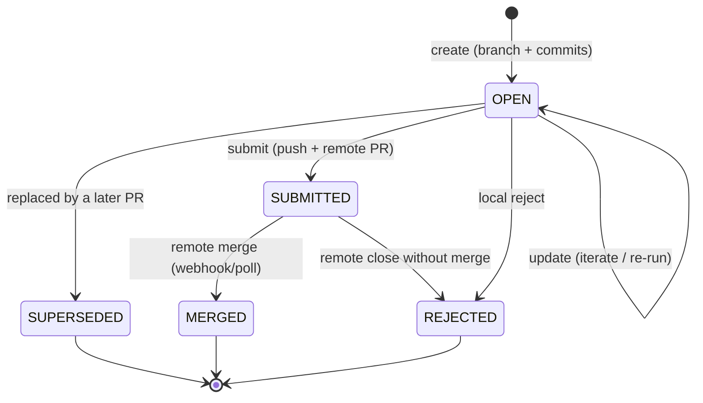

# Design Document: Pi Process Server — Git Workspace & Pull-Request Workflow

## 1. Purpose

This document specifies how the standalone Pi process server gives each session a
**git working repository**, and how the agent's commits in that repository become
**pull requests** delivered to a remote host (Gitea, GitHub, GitLab, …). It
covers, end to end:

- creating the workspace repository (clone or init),
- the branches and commits the agent produces,
- the `PullRequest` record — created in MongoDB **without a patch blob**,
- submitting a PR to the remote host,
- reconciling the remote outcome back (accepted/rejected) via a webhook (and an
  optional poller),
- keeping the workspace repo in sync with the remote.

It adapts the ajapopaja git design docs
(`design/git/dd_batch_coderbot_git_process.md`, `dd_git_hosting.md`,
`dd_git_authentication.md`, `dd_task_chain_rejection_lifecycle.md`) to the
session-centric standalone server, and is the git counterpart of
[`dd_architecture.md`](dd_architecture.md). The REST endpoints it references are
specified in [`dd_rest_api.md`](dd_rest_api.md), the data model in
[`dd_data_model_auth.md`](dd_data_model_auth.md), and the WebSocket events in
[`dd_websocket_protocol.md`](dd_websocket_protocol.md).

## 2. Core idea and the key difference from ajapopaja

Each session owns its workspace as a **self-contained git repository**. The agent
works inside that repository, producing commits on a feature branch. A
`PullRequest` record is a lightweight pointer at that branch's commits — it is
**not** a copy of the diff. The repository is retained for the whole lifetime of
the session (hot or archived) and only goes away when the session is deleted.

| Concern | Ajapopaja (today) | Pi process server (this doc) |
|---------|-------------------|------------------------------|
| Workspace | Durable pipeline repo `R` **plus** a per-task sandbox `S` (clone of `R`) | The session's own `workspace` clone; no separate `R`/`S` split |
| PR content | `patch` blob stored on the `PullRequest` document | No patch; the PR references `branch_name` + `head_commit` in the workspace |
| Repo lifetime | `R` persists per pipeline; `S` is swept by TTL | The workspace lives as long as the session (hot or archive); deleted with the session |
| Delivery | Apply patch + commit into `R`, optionally push / open Gitea PR | Push the feature branch and open a remote PR directly |
| Remote outcome | Not observed (in the original design) | Reconciled back via webhook + poller |

The "keep the repo as long as the session is not deleted" rule is the reason we
can drop the patch blob: the commit objects stay in the workspace, so the PR can
always re-derive its diff (`git diff <base_commit> <head_commit>`) instead of
storing one.

## 3. Repositories and branches

### 3.1 Repositories

| Name | Meaning | Location | Lifecycle |
|------|---------|----------|-----------|
| `origin` | The remote upstream the workspace tracks (e.g. `https://gitea/org/repo.git`). | remote | Exists independently of the server. |
| `W` | The session's working repository. | `sessions/<uid>/workspace` | Created at session `create`; retained until `delete`; bundled on `archive`. |

There is **no** separate durable pipeline repository. A session's `cwd` and
`workspace_path` are the same directory: the Pi process runs *in* the workspace
clone.

### 3.2 Branches

- **Default branch** — `origin`'s default (e.g. `main`). The workspace is kept in
  sync with it (fetch + fast-forward), and it is checked out whenever the session
  is idle.
- **Feature branch** — one per PR, named `pi/<pr_id>` (a `coderbot/<task_id>`
  name is accepted as an alias when the caller supplies `task_id` metadata). The
  agent's commits for that PR live here.
- **`origin` mirror refs** — `refs/remotes/origin/*`, updated by fetch; used for
  sync and reconciliation without touching the working tree.

The agent is free to use additional local branches while working; the server only
imposes the `pi/<pr_id>` convention for branches it will submit as PRs.

## 4. Commits

The agent edits files in `W`. Commits are produced in one of two ways:

1. **Agent-created** — the agent runs its own `bash`/git tools and commits
   directly (typical for interactive sessions).
2. **Server-created** — at the end of a batch run, the server stages and commits
   the working tree (`git add -A` + `git commit --no-verify`) on the feature
   branch, mirroring ajapopaja's `_handle_agent_end()`. This guarantees a commit
   exists even when the agent only edited files.

Every PR records two commit points:

- `base_commit` — the commit the feature branch was cut from (the default branch
  tip, or a predecessor PR's tip for chained work).
- `head_commit` — the feature branch tip when the PR is (re)created.

The PR's diff is always `git diff base_commit head_commit`; no diff is persisted.

## 5. The `PullRequest` record

Stored in a new `pull_requests` collection (see `dd_data_model_auth.md`). No
patch blob.

| Field | Type | Notes |
|-------|------|-------|
| `pr_id` | string | Short unique id (e.g. base62), used in branch names and URLs. |
| `session_uid` | string | Owning session. |
| `repo_uri` | string | The `origin` the PR targets. |
| `branch_name` | string | Feature branch in `W` (default `pi/<pr_id>`). |
| `base_branch` | string | Target branch on `origin` (default: its default branch). |
| `title` | string | PR subject. |
| `body` | string \| null | Markdown summary/description. |
| `base_commit` | string | Branch point commit sha. |
| `head_commit` | string | Feature tip commit sha. |
| `status` | string | `open` \| `submitted` \| `merged` \| `rejected` (see §6). |
| `remote_pr_url` | string \| null | Set when `submitted`. |
| `remote_pr_number` | int \| null | Set when `submitted`. |
| `superseded_by` | string \| null | `pr_id` of a later PR from the same session that replaces this one (iteration). |
| `created_at` / `updated_at` | datetime | |
| `submitted_at` / `merged_at` / `rejected_at` | datetime \| null | |

## 6. PR lifecycle



| Status | Meaning |
|--------|---------|
| `open` | A local PR exists (feature branch + commits in `W`); not yet delivered. |
| `submitted` | Feature branch pushed and a remote PR created; awaiting external review. |
| `merged` | The remote PR was merged (reconciled via webhook/poller). |
| `rejected` | Rejected locally, or the remote PR was closed without merge. |
| `superseded` | A later PR from the same session replaced this one (iteration). |

`open` is the only state the server mutates directly by creating work; `submitted`
is set by the submit action; `merged`/`rejected` are set by reconciliation or by
an explicit local reject. A session may hold **N PRs** across its lifetime
(typically one per completed unit of work), each with its own branch.

## 7. End-to-end flow

```mermaid
sequenceDiagram
    autonumber
    actor U as User / caller
    participant API as Pi server (HTTP)
    participant W as Workspace W
    participant DB as pull_requests
    participant G as Remote host (Gitea)

    U->>API: POST /v1/sessions { repo_uri, ... }
    API->>W: git clone origin → sessions/&lt;uid&gt;/workspace
    Note over W: default branch checked out, clean

    U->>API: POST /v1/sessions/&lt;uid&gt;/message (agent works)
    Note over W: agent edits files; commits c1 on pi/&lt;pr_id&gt;
    API->>W: (batch) git add -A + git commit (commit c1)
    API->>DB: POST /v1/pull_requests → status=open, head_commit=c1
    API-->>U: PR created (open)

    U->>API: POST /v1/pull_requests/&lt;pr_id&gt;/submit
    API->>W: push pi/&lt;pr_id&gt; → origin
    API->>G: POST /api/v1/repos/…/pulls (create remote PR)
    API->>DB: status=submitted, remote_pr_url, remote_pr_number
    API->>W: checkout default branch (kept clean)
    API-->>U: PR submitted

    G-->>API: webhook: pull_request merged / push to base
    API->>DB: status=merged (or rejected if closed unmerged)
    API->>W: fetch origin; pull --ff-only default branch (when idle)
```

## 8. Creating the workspace repository

At session `create`:

1. If `repo_uri` is set → `git clone <repo_uri> sessions/<uid>/workspace`, then
   `checkout` the remote's default branch.
2. If `repo_uri` is unset (local-only) → `git init` in
   `sessions/<uid>/workspace` (+ an optional initial commit), so the agent still
   has a repository and the PR flow still works locally.
3. Optional remote bootstrap: when the caller asks to *create* a fresh remote
   (`create_remote: true`), the server calls the host API (e.g. Gitea
   `POST /api/v1/user/repos`) first, then clones from the returned `repo_uri`.
   This is the "creation of a repo" step for pipelines that start empty rather
   than cloning an existing one.

Cloning is performed with the session's git credentials (§11). On `resume` and on
webhook receipt the workspace is re-synced (§10).

## 9. Submitting a PR

Submitting is the only action that leaves the workspace for the remote host:

1. Require `status ∈ {open}` and a clean default branch (feature branch may be
   dirty until the final commit is made).
2. Ensure the feature branch exists and is at `head_commit`.
3. Push the feature branch with auth: `git push origin pi/<pr_id>`.
4. Create the remote PR via the host API (`POST /api/v1/repos/{owner}/{repo}/pulls`
   on Gitea) with `head = pi/<pr_id>`, `base = base_branch`.
5. Persist `status=submitted`, `remote_pr_url`, `remote_pr_number`,
   `submitted_at`, then `checkout` the default branch locally so `W` stays clean.

The server never merges a remote PR; merging happens in the host's web UI (or by
another automation). Git push credentials and PR creation both use the same
resolved token (§11).

## 10. Keeping the repo in sync & reconciling remote state

### 10.1 Git status (read-only, always safe)

`GET /v1/sessions/{uid}/git/status` returns, without mutating the working tree:

- current branch and `HEAD` sha,
- default branch tip vs `origin/<default>` (ahead/behind),
- dirty/untracked file summary,
- recent commits and the list of local `pi/*` branches.

This is the debounced data the ajapopaja `PipelineDetailView` fetches today
(`design/git/dd_git_status_debounce.md`).

### 10.2 Sync operations

| Operation | Effect | Safe while running? |
|-----------|--------|---------------------|
| `git fetch origin` | Updates `refs/remotes/origin/*`; never touches the working tree or checked-out branch. | yes |
| `git pull --ff-only origin <default>` | Fast-forwards the default branch. | only when the session is idle |
| `git checkout <default>` | Leaves the workspace on the default branch. | only when idle |

Sync is triggered on demand (a `POST …/git/sync` endpoint) and by the webhook
reconciler. A pull is **deferred** while a session is running; the DB mirror is
always applied, and the client is offered a "pull now" action (mirroring
ajapopaja's deferred-pull behaviour in `dd_git_hosting.md` §5.4).

### 10.3 Webhook receiver

`POST /v1/hooks/gitea/pr-state` (no user JWT; HMAC-protected with a shared
`GITEA_WEBHOOK_SECRET`) accepts Gitea's native `push` or `pull_request` payloads,
or a minimal normalised body:

```jsonc
{ "repo": "owner/name", "branch": "main", "commit_hash": "<sha>",
  "state": "merged" | "closed" }
```

The receiver:

1. Verifies the HMAC signature.
2. Maps the event to a `pull_requests` row (by `remote_pr_number`/branch, or by
   the pushed base-branch ref).
3. Fetches `origin` and verifies any reported commit is present/reachable before
   mirroring, so a stale or forged payload cannot flip a PR.
4. Mirrors state: **merged** → `merged`, **closed-without-merge** → `rejected`,
   updating `merged_at`/`rejected_at`.
5. Applies the DB mirror and broadcasts a `pr.*` event immediately; gates the
   working-tree pull on the session being idle (deferred pull as in §10.2).

Non-actionable events return `202 {"status":"ignored"}`; mirrored events return
`200` (with `pull_deferred: true` when the pull was skipped).

### 10.4 Polling fallback

Set `GITEA_PR_POLL_ENABLED=true` to periodically read every `submitted` PR's
remote state via the host API and feed the same reconciler (interval
`GITEA_PR_POLL_INTERVAL`, default 60s). The webhook is the primary path; the
poller covers missed or unregistered webhooks.

## 11. Git authentication

Credentials are resolved the same way as ajapopaja's `dd_git_authentication.md`:

- **HTTPS + Personal Access Token** is the primary mechanism.
- Resolution order: **session-level `repo_username`/`repo_token` → global
  `GIT_PUSH_USERNAME`/`GIT_PUSH_TOKEN` → none** (public-repo read-only).
- The token is injected per-operation via git's `http.extraHeader`
  (`GIT_CONFIG_PARAMETERS` with an `Authorization: Basic` header), **never** into
  the stored `repo_uri`, the repo config, or logs.
- Read (clone/fetch) uses the same token for private repos; write (push/PR) always
  needs a token with **repo write** scope.

Secrets are never written into `events.jsonl` or `meta.json`.

## 12. Interaction with the session lifecycle

The repository's lifetime is pinned to the session:

| Session transition | Effect on the git workspace |
|--------------------|------------------------------|
| `create` | Clone/init `W` (§8). |
| `running` | Agent works in `W`; commits/PRs are created. |
| `pause` / `complete` / `fail` | `W` retained as-is: commits, branches and `pull_requests` rows persist. |
| `resume` | Re-sync `W` (fetch + fast-forward when idle); agent continues in place. |
| `archive` | `W` (including `.git`) is included in the bundle; PR records remain in MongoDB. |
| `restore` | `W` re-materialised from the bundle; `origin` refs re-fetched on next sync. |
| `delete` | `W` removed (the repo finally goes away), along with its PR records. |

This is the concrete meaning of "keep a given repo as long as the session is not
deleted."

## 13. API endpoints (summary)

See [`dd_rest_api.md`](dd_rest_api.md) for full request/response shapes.

| Method | Path | Purpose |
|--------|------|---------|
| `GET` | `/v1/sessions/{uid}/git/status` | Working-tree status, branch, ahead/behind, commits. |
| `POST` | `/v1/sessions/{uid}/git/sync` | Fetch (always) + fast-forward pull when idle. |
| `POST` | `/v1/sessions/{uid}/git/commit` | Stage + commit the working tree on the feature branch (batch fallback). |
| `GET` | `/v1/pull_requests` | List PRs (filter by `session_uid`, `status`, `repo_uri`). |
| `GET` | `/v1/pull_requests/{pr_id}` | PR detail (incl. re-derived diff). |
| `POST` | `/v1/pull_requests` | Create a PR from the session's current branch/commits. |
| `PATCH` | `/v1/pull_requests/{pr_id}` | Update title/body. |
| `POST` | `/v1/pull_requests/{pr_id}/submit` | Push branch + create remote PR → `submitted`. |
| `POST` | `/v1/pull_requests/{pr_id}/reject` | Local reject → `rejected`. |
| `GET` | `/v1/pull_requests/{pr_id}/diff` | Re-derived `git diff base_commit head_commit`. |
| `POST` | `/v1/hooks/gitea/pr-state` | Webhook receiver (HMAC); mirrors remote PR state. |

## 14. WebSocket events

The following `pr.*` events are emitted on the EventBus/WebSocket (full table in
`dd_websocket_protocol.md`):

| `type` | Purpose |
|--------|---------|
| `pr.created` | A PR record was created or updated. |
| `pr.submitted` | The remote PR was created. |
| `pr.merged` / `pr.rejected` | Remote outcome reconciled (or local reject). |
| `git.status` | A git-status refresh is available (debounced). |

## 15. Open questions

| Question | Current lean |
|----------|--------------|
| Chaining PRs | Not needed for v1; each PR branches from the default branch. Revisit ordered branch-chaining (and its rejection semantics from `dd_task_chain_rejection_lifecycle.md`) only if sessions need ordered multi-PR pipelines. |
| Remote PR creation scope | v1 targets Gitea; the host API is behind a small `GitHostClient` interface so GitHub/GitLab can be added. |
| `repo_uri` vs per-PR target | One `origin` per session for v1; a PR can override `base_branch` but not the host. |
| Diff endpoint | Re-derived on demand (`git diff`); add caching only if it becomes a hot path. |
| Branch naming collision | `pi/<pr_id>` is unique per PR; local branches are cleaned up only on session delete. |
