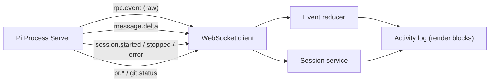

# Design Document: Pi Process Server — WebSocket Protocol

## 1. Overview

The WebSocket channel delivers live session status and Pi output to remote
clients so a log view can render the activity stream. Messages are organized
under a small set of namespaces — `session.*` for lifecycle, `rpc.event` for raw
Pi events, `message.delta` for streamed assistant text, `pr.*` for pull requests,
and `git.status` for git state — so a client can subscribe once and receive the
full live picture of a session.

The client does **not** drive the session over the WebSocket; lifecycle actions
stay on the REST API (single writer, idempotent, easily authenticated). The
WebSocket is the *read* stream, plus a small set of subscribe/ping controls.
Pull-request and git-status updates are streamed read-only the same way.

## 2. Transport & authentication

- Endpoint: `GET /v1/ws?token=<access-token>` (or `Sec-WebSocket-Protocol` bearer
  subprotocol). The token authenticates the connection and determines which
  sessions the client may subscribe to (§ data-model doc for grants).
- On an invalid/expired token the server closes the handshake with close code
  `1008` (policy violation). Clients should treat `1008` as a signal to
  re-authenticate (refresh the token) and reconnect.
- The server sends `{ type: "hello", ... }` immediately after accept and
  heartbeats (`ping`/`pong`) to detect dead connections.

## 3. Message envelope

Every message is a single JSON text frame:

```jsonc
{
  "type": "rpc.event",       // string, see table
  "id": "c0ffee…",           // optional correlation id (echoed on replies)
  "session_uid": "3f6c…",    // present on all session-scoped messages
  "payload": { /* … */ }     // type-specific
}
```

The `type`/`id`/`payload` shape is the single envelope for every message;
session-scoped messages additionally carry `session_uid` so a client can
multiplex many sessions over one connection.

## 4. Message types

### 4.1 Server → client

| `type` | `payload` | Purpose |
|--------|-----------|---------|
| `hello` | `{ serverVersion, clientId }` | Handshake ack + capabilities. |
| `session.started` | `{ session_uid, kind, bot_type, start_time, model }` | A session began running (also emitted on resume). |
| `session.stopped` | `{ session_uid, bot_type }` | A session stopped (pause/complete/crash). |
| `session.updated` | full session record | Any record mutation (rename, model change, status). |
| `session.error` | `{ session_uid, bot_type, message }` | Turn/session error. |
| `session.archived` | `{ session_uid }` | Archive completed. |
| `session.deleted` | `{ session_uid }` | Session deleted. |
| `rpc.event` | `{ session_uid, event }` | Raw Pi SDK event, forwarded verbatim. |
| `message.delta` | `{ session_uid, delta }` | Streamed assistant text/thinking chunk. |
| `turn.ended` | `{ session_uid }` | A user turn settled. |
| `turn.busy` | `{ session_uid, busy }` | Busy-state change (turn in flight). |
| `verification.started` | `{ session_uid }` | Post-run verification began. |
| `verification.result` | `{ session_uid, result }` | Verification outcome (commands, exit codes, durations). |
| `subscribed` | `{ session_uid }` | Subscription acknowledged. |
| `pr.created` | `{ session_uid, pr }` | A pull-request record was created or updated. |
| `pr.submitted` | `{ session_uid, pr }` | The remote PR was created (branch pushed). |
| `pr.merged` | `{ session_uid, pr }` | Remote PR merged (reconciled). |
| `pr.rejected` | `{ session_uid, pr }` | Remote PR closed unmerged, or local reject. |
| `git.status` | `{ session_uid, status }` | Git status refresh available (debounced). |
| `error` | `{ code, message }` | Protocol-level error. |

### 4.2 Client → server

| `type` | `payload` | Purpose |
|--------|-----------|---------|
| `subscribe` | `{ session_uid }` | Subscribe to a session's stream (must be granted). |
| `unsubscribe` | `{ session_uid }` | Stop receiving a session's stream. |
| `ping` | `{}` | Liveness; server replies `pong`. |

## 5. Rendering model (client side)

The server stays **UI-agnostic**: it emits raw Pi events and a few derived
deltas, and leaves presentation to the client. A client typically feeds the
stream into a reducer that turns it into render blocks (`text`, `thinking`,
`tool`, `bash`, `notice`, `error`, `divider`, `verification`), and a session
service that tracks lifecycle state (`isActive`, `busy`, `startTime`, `model`).



The reducer keys off `rpc.event.payload.event.type` to choose a render block:

| Pi event `type` | Rendered block |
|-----------------|----------------|
| `message_update` | streaming `text` / `thinking` / `tool` |
| `message_start` / `message_end` | close streaming blocks |
| `agent_start` / `agent_end` / `agent_settled` | `notice` |
| `bash_execution_update` | `bash` |
| `tool_execution_start/update/end` | `tool` |
| `queue_update` | `notice` |
| `compaction_*` | `notice` |
| `auto_retry_*`, `summarization_*` | `notice` |
| `extension_error` | `error` |

`verification.result` feeds a `verification` render block, and
`session.started`/`session.stopped`/`session.error`/`turn.ended` update the
session service's lifecycle state (`isActive`, `busy`, `startTime`, `model`).

## 6. Access filtering

The gateway fans out events only to connections that (a) hold a valid token and
(b) have an active grant on the session (`subscribe` succeeded or an
owner/editor/viewer grant exists). Filtering is per message so a client with
access to sessions A and B never receives C's stream. Filtering is keyed on
`session_uid`, per message.

## 7. Replay & reconnect

A client that (re)connects mid-session or after a pause calls
`GET /v1/sessions/{uid}/history` to replay `events.jsonl`, then subscribes for the
live stream. To avoid double-applying events during the handoff from replay to
live, the client buffers live events while replaying and flushes them once the
subscription is established, keeping reconciliation O(n) rather than O(n²).
