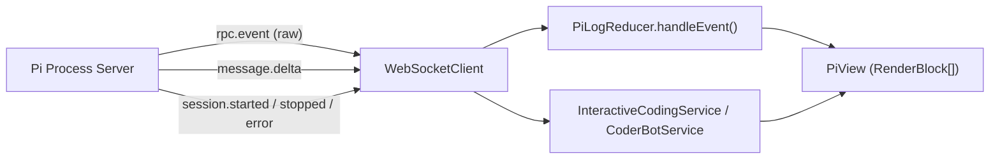

# Design Document: Pi Process Server — WebSocket Protocol

## 1. Overview

The WebSocket channel delivers live session status and Pi output to remote
clients so a `PiView` (as in ajapopaja) can render the activity log. The protocol
is a deliberate superset of the message types the ajapopaja backend broadcasts
today (`INTERACTIVE_STARTED/STOPPED/RPC_EVENT/TURN_ENDED/ERROR`,
`CODERBOT_STARTED/RPC_EVENT/VERIFICATION/…`, `SESSION_UPDATED`), reorganized
under a `session.*` / `rpc.event` namespace with legacy aliases for smooth
migration.

The client does **not** drive the session over the WebSocket; lifecycle actions
stay on the REST API (single writer, idempotent, easily authenticated). The
WebSocket is the *read* stream, plus a small set of subscribe/ping controls.

## 2. Transport & authentication

- Endpoint: `GET /v1/ws?token=<access-token>` (or `Sec-WebSocket-Protocol` bearer
  subprotocol). The token authenticates the connection and determines which
  sessions the client may subscribe to (§ data-model doc for grants).
- On an invalid/expired token the server closes the handshake with close code
  `1008` (policy violation), matching the current backend's behaviour so the
  client's reconnect/refresh logic works unchanged.
- The server sends `{ type: "hello", ... }` immediately after accept and
  heartbeats (`ping`/`pong`) to detect dead connections.

## 3. Message envelope

Every message is a single JSON text frame:

```jsonc
{
  "type": "rpc.event",       // string, see table
  "id": "c0ffee…",           // optional correlation id (echoed on replies)
  "session_uid": "3f6c…",    // present on all session-scoped messages
  "payload": { /* … */ }     // type-specific
}
```

This mirrors the ajapopaja `WSMessage(type, id, payload)` shape exactly, so the
existing `WebSocketClient`/`WSHandler` code ports over with minimal change.

## 4. Message types

### 4.1 Server → client

| `type` | `payload` | Purpose |
|--------|-----------|---------|
| `hello` | `{ serverVersion, clientId }` | Handshake ack + capabilities. |
| `session.started` | `{ session_uid, kind, bot_type, start_time, model }` | A session began running (also emitted on resume). |
| `session.stopped` | `{ session_uid, bot_type }` | A session stopped (pause/complete/crash). |
| `session.updated` | full session record | Any record mutation (rename, model change, status). |
| `session.error` | `{ session_uid, bot_type, message }` | Turn/session error. |
| `session.archived` | `{ session_uid }` | Archive completed. |
| `session.deleted` | `{ session_uid }` | Session deleted. |
| `rpc.event` | `{ session_uid, event }` | Raw Pi SDK event, forwarded verbatim. |
| `message.delta` | `{ session_uid, delta }` | Streamed assistant text/thinking chunk. |
| `turn.ended` | `{ session_uid }` | A user turn settled. |
| `turn.busy` | `{ session_uid, busy }` | Busy-state change (turn in flight). |
| `verification.started` | `{ session_uid }` | Post-run verification began. |
| `verification.result` | `{ session_uid, result }` | Verification outcome (commands, exit codes, durations). |
| `subscribed` | `{ session_uid }` | Subscription acknowledged. |
| `error` | `{ code, message }` | Protocol-level error. |

### 4.2 Client → server

| `type` | `payload` | Purpose |
|--------|-----------|---------|
| `subscribe` | `{ session_uid }` | Subscribe to a session's stream (must be granted). |
| `unsubscribe` | `{ session_uid }` | Stop receiving a session's stream. |
| `ping` | `{}` | Liveness; server replies `pong`. |

## 5. Mapping to PiView

The ajapopaja `PiView` consumes a `PiSessionService` whose output is a list of
`RenderBlock`s (kinds: `text`, `thinking`, `tool`, `bash`, `notice`, `error`,
`divider`, `verification`). The server does **not** emit `RenderBlock`s; it emits
raw Pi events and derived deltas, and the client's `PiLogReducer` reduces them to
blocks — exactly as `InteractiveCodingService`/`CoderBotService` do today.



Client-side reducer handling (already implemented in `PiLogReducer.handleEvent`)
is fed by `rpc.event.payload.event`, whose `type` field selects the block:

| Pi event `type` | Rendered block |
|-----------------|----------------|
| `message_update` | streaming `text` / `thinking` / `tool` |
| `message_start` / `message_end` | close streaming blocks |
| `agent_start` / `agent_end` / `agent_settled` | `notice` |
| `bash_execution_update` | `bash` |
| `tool_execution_start/update/end` | `tool` |
| `queue_update` | `notice` |
| `compaction_*` | `notice` |
| `auto_retry_*`, `summarization_*` | `notice` |
| `extension_error` | `error` |

`verification.result` maps to `PiLogReducer.addVerificationBlock(result)`, and
`session.started`/`session.stopped`/`session.error`/`turn.ended` map to the
`PiSessionService` lifecycle callbacks (`isActive`, `busy`, `startTime`, `model`).

## 6. Access filtering

The gateway fans out events only to connections that (a) hold a valid token and
(b) have an active grant on the session (`subscribe` succeeded or an
owner/editor/viewer grant exists). Filtering is per message so a client with
access to sessions A and B never receives C's stream. This is the remote
equivalent of the current backend's `pipeline_id`/`bot_type`/`session_uid`
filtering in `InteractiveCodingService.matches()`.

## 7. Legacy aliases (migration)

During migration from the embedded backend, the server may additionally emit the
old types so the existing ajapopaja UI keeps working without a coordinated
cutover:

| New | Legacy alias |
|-----|--------------|
| `session.started` (interactive) | `INTERACTIVE_STARTED` |
| `session.stopped` (interactive) | `INTERACTIVE_STOPPED` |
| `rpc.event` (interactive) | `INTERACTIVE_RPC_EVENT` |
| `rpc.event` (batch) | `CODERBOT_RPC_EVENT` |
| `message.delta` | `ASSISTANT_STREAM` |
| `turn.ended` | `INTERACTIVE_TURN_ENDED` |
| `session.error` | `INTERACTIVE_ERROR` |
| `session.updated` | `SESSION_UPDATED` |
| `verification.started` / `verification.result` | `CODERBOT_VERIFICATION_STARTED` / `CODERBOT_VERIFICATION` |

The aliases are opt-in via a server flag and are removed once clients move to
the new namespace.

## 8. Replay & reconnect

A client that (re)connects mid-session or after a pause calls
`GET /v1/sessions/{uid}/history` to replay `events.jsonl`, then subscribes for the
live stream — the same pattern `InteractiveCodingService.resumeSession` /
`CoderBotService.reconnect` use today, including the `suspendEmits()` batching to
avoid O(n²) reconciliation during replay.
