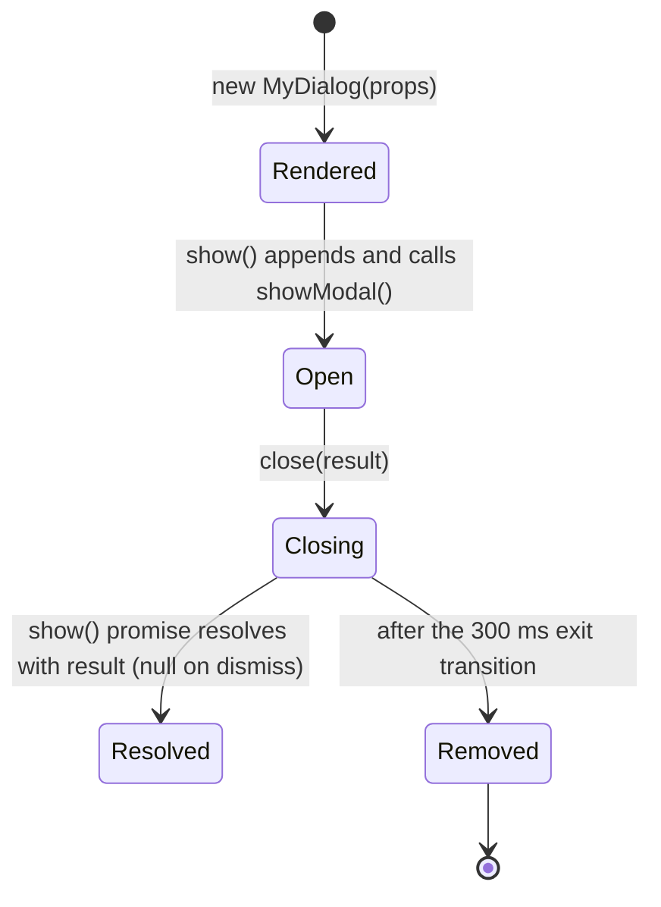
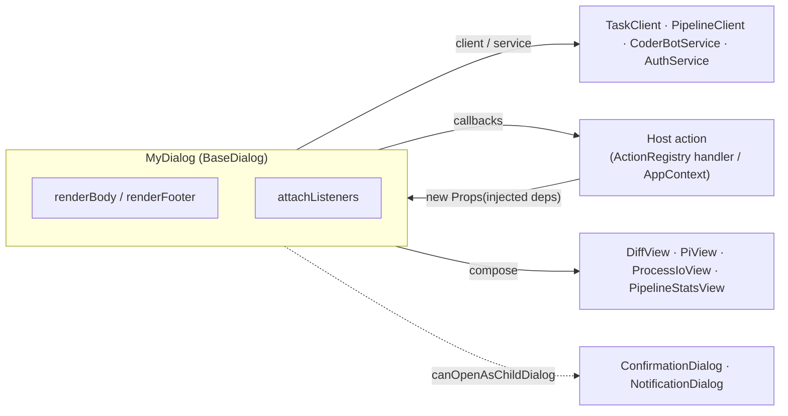
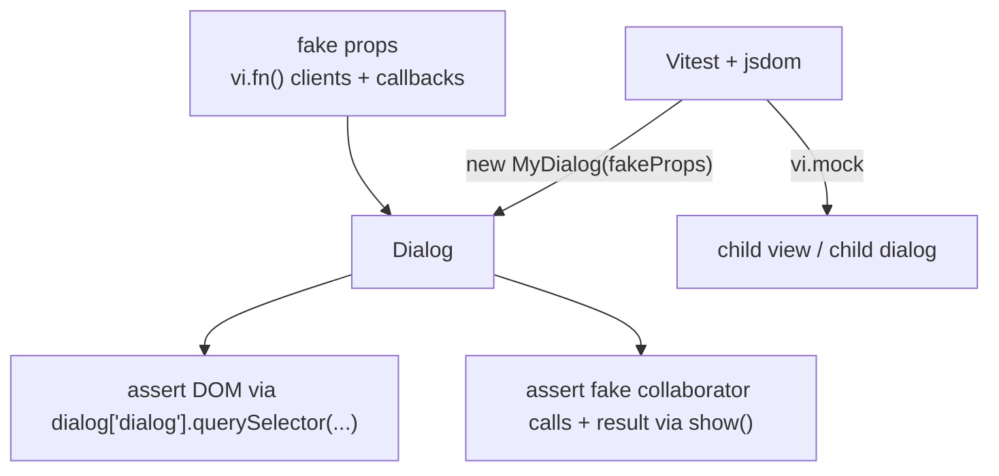

# Creating Dialogs

A practical manual for building dialogs in the **Ajapopaja Build** frontend.

Dialogs live in `frontend/src/ui/components/dialogs/`. Almost all of them extend
`BaseDialog<T>` from `dialog_common.ts`. This guide describes the base contract,
how to render content, how to inject collaborators so dialogs stay testable and
reusable, and how to test them.

> **Rule of thumb:** every new dialog must extend `BaseDialog<T>`.
> `DocBotDialog.ts` is a legacy outlier that renders its own overlay and does not
> extend `BaseDialog`; do not copy it.

---

## 1. The `BaseDialog<T>` contract

`BaseDialog<T>` owns the shell (backdrop, header, close button, body and footer
containers), the single-dialog stack, animations, dismissal and the promise that
resolves when the dialog closes. Subclasses only supply content and behaviour.

```ts
export interface DialogOptions {
  title: string;                 // header text
  maxWidth?: string;             // default 'max-w-md'   (Tailwind class)
  maxHeight?: string;            // default 'max-h-[80vh]'
  iconSvg?: string;              // optional header icon markup
  canOpenAsChildDialog?: boolean; // default false
}

export abstract class BaseDialog<T = void> {
  protected dialog: HTMLDialogElement;

  protected abstract renderBody(): string | HTMLElement;
  protected renderHeaderActions?(): string | HTMLElement; // optional
  protected renderFooter?(): string | HTMLElement;        // optional

  public async show(): Promise<T | null>;
  protected close(result?: T | null): void;
}
```

The base class exposes these stable DOM anchors. Always query them relative to
`this.dialog`, never against `document` (other dialogs may coexist):

| Anchor | Purpose |
| --- | --- |
| `#dialog-body-container` | Scrollable body. `renderBody()` is mounted here. |
| `#dialog-footer-container` | Footer. `renderFooter()` is mounted here; removed if `renderFooter` is not implemented. |
| `#dialog-header-actions` | Optional header actions from `renderHeaderActions()`. |
| `#dialog-close-btn` | Built-in close button (already wired to `close(null)`). |

### Lifecycle and result flow



Key behaviours guaranteed by the base class:

- **Promise-based result.** `show()` resolves with the value passed to
  `close(result)`, or `null` when the user dismisses the dialog (backdrop click,
  `Escape`, or the built-in close button).
- **Only one top-level dialog.** While a non-child dialog is open, calling
  `show()` on another dialog does **not** open it: the open dialog is shaken to
  signal "busy" and the new `show()` resolves immediately with `null`.
- **Child dialogs.** A dialog that may appear *on top of* another dialog (a
  confirmation, a notification, a small prompt) must pass
  `canOpenAsChildDialog: true`. Otherwise it can never open while the parent is
  visible.
- **Cleanup after transition.** After `close()`, the `<dialog>` is removed from
  the DOM ~300 ms later. Override `close()` only to release your own resources
  and always call `super.close(result)`.

### Child dialogs in practice

When an action opens a nested dialog, set the flag:

```ts
super({ title: 'Delete Review', canOpenAsChildDialog: true });
```

`ConfirmationDialog`, `NotificationDialog`, `IteratePullRequestDialog` and
`UpdateDesignDialog` are all child dialogs. They are short-lived by design: the
stack tracks only the *currently open* dialog, so a child close clears the
"current" slot even though the parent is still mounted. Keep child dialogs brief
and let the parent drive what happens next.

---

## 2. Quick start: a minimal dialog

A complete, testable example: a typed prompt that returns the entered string.

```ts
// frontend/src/ui/components/dialogs/RenameDialog.ts
import { BaseDialog } from './dialog_common.ts';
import { escapeHtml } from '../utils/html.ts';

export interface RenameDialogProps {
  initialName: string;
  /** Called when the user confirms. Injected by the host action. */
  onSubmit: (name: string) => Promise<void> | void;
}

export class RenameDialog extends BaseDialog<string> {
  private props: RenameDialogProps;

  constructor(props: RenameDialogProps) {
    super({ title: 'Rename', canOpenAsChildDialog: true });
    this.props = props;
    // BaseDialog rendered once from its constructor, before `props` existed.
    this.updateContent();
  }

  private updateContent(): void {
    const body = this.dialog.querySelector('#dialog-body-container') as HTMLElement;
    body.innerHTML = this.renderBody() as string;

    const footer = this.dialog.querySelector('#dialog-footer-container') as HTMLElement;
    footer.innerHTML = this.renderFooter() as string;

    this.attachListeners();
  }

  private attachListeners(): void {
    this.dialog.querySelector('#rename-cancel')?.addEventListener('click', () => this.close(null));
    this.dialog.querySelector('#rename-save')?.addEventListener('click', async () => {
      const input = this.dialog.querySelector('#rename-input') as HTMLInputElement;
      const name = input.value.trim();
      if (!name) return;
      await this.props.onSubmit(name);
      this.close(name);
    });
  }

  protected renderBody(): string {
    // Defensive: BaseDialog calls this once before `props` is assigned.
    if (!this.props) return '';
    return `
      <div class="p-6">
        <label for="rename-input" class="block text-xs font-bold uppercase tracking-widest text-app-muted mb-2">Name</label>
        <input id="rename-input" type="text" value="${escapeHtml(this.props.initialName)}"
               class="w-full bg-app-bg border border-app-border rounded-lg p-2 text-app-text outline-none focus:ring-1 focus:ring-app-accent-2" />
      </div>
    `;
  }

  protected renderFooter(): string {
    return `
      <div class="p-4 pt-0 flex justify-end gap-3">
        <button id="rename-cancel" class="px-4 py-2 text-app-muted hover:text-app-text font-medium cursor-pointer">Cancel</button>
        <button id="rename-save" class="px-6 py-2 bg-app-accent-1 hover:brightness-110 text-white rounded-lg font-bold shadow-lg cursor-pointer">Save</button>
      </div>
    `;
  }
}
```

The host action constructs it, injects the collaborator, and consumes the result:

```ts
const dialog = new RenameDialog({
  initialName: task.title,
  onSubmit: (name) =>
    ctx.context.taskClient.updateDetails(task.id!, task.version, { title: name }),
});

const name = await dialog.show(); // string | null
if (name) ctx.refresh.selectedTask();
```

---

## 3. Rendering best practices

### 3.1 The constructor ordering rule

`BaseDialog`'s constructor calls `renderBody()` and `renderFooter()` for you.
Because JavaScript does not allow `this.props`/`this.state` before `super(...)`,
those first calls run **before your fields are assigned**. There are two accepted
ways to handle this:

1. **Defensive render + re-render** (recommended, used by `PipelineEditDialog`,
   `PullRequestDialog`, `DesignDocDialog`): guard the first call and re-render
   after assigning state.

   ```ts
   protected renderBody(): string {
     if (!this.props) return '';       // first call from the base constructor
     return `...${this.props.title}...`;
   }
   ```

2. **Re-render helper** that replaces the body/footer and re-attaches listeners:

   ```ts
   private reRender(): void {
     const body = this.dialog.querySelector('#dialog-body-container') as HTMLElement;
     body.innerHTML = this.renderBody();

     const footer = this.dialog.querySelector('#dialog-footer-container') as HTMLElement;
     footer.innerHTML = this.renderFooter();

     this.attachInternalEventListeners();
   }
   ```

   Call it at the end of the constructor and after any async data load. See
   `PullRequestDialog.reRender()` and `PipelineEditDialog.reRender()`.

> `renderHeaderActions()` has the same constraint: it is called by the base
> constructor, so it must tolerate unset state or be re-rendered the same way.

### 3.2 State-driven rendering

Render from instance state, not from DOM reads. Keep a single source of truth and
re-render (or patch the relevant container) when it changes:

- Partial update: `SearchDialog.updateUI()` patches only the results and
  pagination containers, leaving the search input (and its focus) untouched.
- Simple async flow: `DiffDialog` tracks `loading` → `error` → data and calls
  `reRender()` in a `finally`.
- Loading states should be first-class: `PullRequestDialog` and `DiffDialog`
  render a spinner while loading and an explicit "not found"/error state
  afterwards.

Avoid re-rendering the whole dialog for small changes; prefer updating the
container that actually changed. Re-rendering the whole dialog would also destroy
focus and transient DOM state.

### 3.3 String templates vs. DOM nodes

`renderBody()`/`renderFooter()` may return either a string or an `HTMLElement`.
Use the right tool:

- **String templates** for static, declarative markup (most dialogs).
- **`HTMLElement`** when you build content programmatically or want to attach
  listeners before mounting (`NotificationDialog` builds nodes and calls
  `replaceChildren`; `SearchDialog` builds a container and attaches its
  delegated listeners before returning it).

When you render a string with `innerHTML`, **event listeners are wiped** on the
next render. That is why `reRender()` must re-call `attachInternalEventListeners()`.
Use event delegation on a stable container when the inner markup changes often
(see `SearchDialog.attachInternalListeners`).

### 3.4 Layout, scrolling and styling

- Use the shared theme tokens, not hard-coded colors:
  `bg-app-bg`, `bg-app-surface`, `border-app-border`, `text-app-text`,
  `text-app-muted`, `text-app-accent-1`, `text-app-accent-2`.
- Add `custom-scrollbar` to scrollable regions and `prose-theme` to rendered
  Markdown.
- The body container already scrolls (`overflow-y-auto`). If the dialog manages
  its own internal scroll regions (for example a fixed header + scrolling list),
  take over the container in the constructor:

  ```ts
  bodyContainer.classList.remove('overflow-y-auto');
  bodyContainer.classList.add('flex', 'flex-col', 'overflow-hidden', 'min-h-0');
  ```

  This is exactly what `SearchDialog` does.
- Give every interactive element a stable `id` or `data-*` hook. Use
  dialog-specific prefixes (`pr-accept-btn`, `rename-input`, …) so tests and the
  action registry can target them unambiguously.
- Keep the header/footer minimal. The built-in close button is already provided;
  only implement `renderFooter()` when you need actions.

### 3.5 Security

- **Always** escape user/backend-provided text interpolated into HTML with
  `escapeHtml()` from `../utils/html.ts`.
- Render Markdown with `renderMarkdown()` from `../utils/markdown.ts` — it runs
  the shared `marked` configuration and sanitizes with DOMPurify. Never call
  `marked.parse` + `innerHTML` directly in a dialog.
- Prefer `textContent` when building DOM nodes (as `NotificationDialog` does) to
  make escaping implicit.

---

## 4. Injecting collaborators (testability & reuse)

A dialog should not reach for global singletons, create its own clients, or
navigate the app. Everything it needs is **injected by the host** — typically the
`ActionRegistry` handler in a view or `AppContext`. This is the single most
important practice for testability.

### 4.1 Prefer the narrowest dependency

Pass only what the dialog actually uses:

- `StatsDialog(tasks, pipelineId, pipelineClient)` takes just the one client it
  needs, so it is trivially constructible in a test.
- `CoderBotDialog(coderBotService)` and `LogViewerDialog(streamUrl, authService)`
  accept a service/URL instead of the whole app context.
- When a dialog genuinely needs many services, pass a **props object** that
  carries `context: AppContext` (see `PullRequestDialog`, `ReviewDialog`,
  `DiffDialog`, `PipelineEditDialog`).

Import the app context **type-only** to avoid runtime coupling and keep the
dialog mockable by structural typing:

```ts
import type { AppContext } from '../../../core/AppContext.ts';

export interface DiffDialogProps {
  context: AppContext;
  pipelineId: string;
  commitHash: string;
  title?: string;
}
```

### 4.2 The props-object pattern

Define an explicit exported `...Props` interface for dialogs that take more than
one or two arguments. It documents the contract, supports optional values, and is
what tests import to build fakes:

```ts
export interface PullRequestDialogProps {
  taskId: string;
  pipelineId: string;
  prId?: string;
  context: AppContext;
  onAccept?: () => void;
  onReject?: () => void;
}
```

Because TypeScript is structurally typed, a test can pass a minimal object
literal (`{ pipelineClient: { getCommitDiff: vi.fn() } } as any`) that implements
only the methods actually called. This is why the props pattern keeps tests
small.

### 4.3 Report back through callbacks

Use injected callbacks to signal completion instead of mutating global state or
navigating inside the dialog:

- `PullRequestDialog` → `onAccept`, `onReject`
- `ReviewDialog` → `onDelete`
- `DocBotDialog` → `onSuccess`, `onClose`

The dialog stays reusable (it can be opened from anywhere), the host owns
refreshing/navigation, and tests can assert the callback fired. Prefer callbacks
over `alert()`/direct store access for control flow.

### 4.4 Do I/O outside `renderBody`

`renderBody()` must be synchronous and side-effect free. Perform network work in
`show()` or an async `load()` called from the constructor, then re-render:

- `StatsDialog` fetches daily stats in `show()` and calls `refreshBody()`.
- `PullRequestDialog` / `DiffDialog` call `load()` and re-render in `finally`.
- `PipelineEditDialog` loads dev-server status and model options
  asynchronously so the dialog opens instantly.

### 4.5 Compose views, don't reimplement them

Embed reusable views into a mount point in the body, and destroy them on close:

```ts
// CoderBotDialog
const mount = bodyContainer.querySelector('#coderbot-piview-mount') as HTMLElement;
this.piView = new PiView(this.coderBotService, mount);
this.piView.render();
```

`CoderBotDialog` → `PiView`, `DevServerDialog` → `ProcessIoView`,
`PullRequestDialog`/`DiffDialog` → `DiffView`, `StatsDialog` →
`PipelineStatsView`. This keeps rendering logic in one place and makes dialogs
thin.

### 4.6 Where dialogs fit



### 4.7 Nested dialogs

For a confirmation inside a dialog, you have two options:

- **Use the shared `ConfirmationDialog`** and mock it in tests
  (`vi.mock('./ConfirmationDialog.ts', …)`) — simple, used by `SearchDialog`.
- **Inject a confirm function/factory** through props when you want to unit-test
  the dialog's logic without any child DOM. This is the most testable option and
  is preferred for logic-heavy flows.

Either way, never construct a *non-child* dialog from within an open dialog — it
will be rejected and the parent will shake.

---

## 5. Cleanup and resource ownership

Override `close()` to release resources **before** calling `super.close()`:

```ts
protected close(result: void | null = null) {
  this.piView?.destroy();
  this.piView = null;
  super.close(result);
}
```

Real examples:

- `CoderBotDialog` / `DevServerDialog`: destroy the composed view (and its
  subscriptions).
- `LogViewerDialog`: `abortController.abort()` and `reader.cancel()` to stop
  streaming.
- `DiffDialog`: destroy a previously created `DiffView` before creating a new
  one on re-render, so collapse listeners do not leak.

Rules:

- DOM event listeners attached to elements you replaced during a re-render are
  garbage-collected with the nodes; **service subscriptions and in-flight
  requests are not** — always tear them down.
- The base class removes the `<dialog>` from the DOM after the exit transition;
  do not hold references to a closed dialog.
- A dialog is single-use. If you need it again, construct a new instance.

---

## 6. Testing

Dialogs are designed to be tested in isolation with **Vitest + jsdom** (configured
in `frontend/vite.config.ts`). Tests live next to the dialog as
`MyDialog.test.ts`.

### 6.1 Harness setup

jsdom does not implement the native `<dialog>` API, so stub it once per test:

```ts
beforeEach(() => {
  document.body.innerHTML = '';
  HTMLDialogElement.prototype.showModal = vi.fn(function (this: HTMLDialogElement) {
    this.open = true;
  });
  HTMLDialogElement.prototype.close = vi.fn(function (this: HTMLDialogElement) {
    this.open = false;
  });
});
```

The constructor renders synchronously, so you can assert on the DOM immediately
after `new MyDialog(...)` — without calling `show()`. Call `show()` when you need
the element in `document.body` or want the result promise.

### 6.2 Accessing the protected element

`dialog` is `protected`; tests read it with bracket notation:

```ts
const el = dialog['dialog'];
expect(el.querySelector('h3')?.textContent).toContain('Rename');
```

### 6.3 Inject fakes, assert interactions

Pass minimal fake collaborators and assert calls. This is the payoff of the
injection rules above.

```ts
import { describe, it, expect, vi, beforeEach } from 'vitest';
import { RenameDialog } from './RenameDialog.ts';

describe('RenameDialog', () => {
  beforeEach(() => {
    document.body.innerHTML = '';
    HTMLDialogElement.prototype.showModal = vi.fn(function (this: HTMLDialogElement) {
      this.open = true;
    });
    HTMLDialogElement.prototype.close = vi.fn(function (this: HTMLDialogElement) {
      this.open = false;
    });
  });

  it('submits the trimmed name and resolves with it', async () => {
    const onSubmit = vi.fn().mockResolvedValue(undefined);
    const dialog = new RenameDialog({ initialName: 'Old', onSubmit });

    const shown = dialog.show();
    const input = document.querySelector('#rename-input') as HTMLInputElement;
    input.value = '  New Name  ';
    document.querySelector('#rename-save')!.dispatchEvent(new MouseEvent('click'));

    await expect(shown).resolves.toBe('New Name');
    expect(onSubmit).toHaveBeenCalledWith('New Name');
  });

  it('resolves with null when cancelled', async () => {
    const dialog = new RenameDialog({ initialName: 'Old', onSubmit: vi.fn() });
    const shown = dialog.show();
    document.querySelector('#rename-cancel')!.dispatchEvent(new MouseEvent('click'));
    await expect(shown).resolves.toBeNull();
  });
});
```

### 6.4 Testing async loads and re-renders

Use `vi.waitFor` (or flush a macrotask) after triggering async work:

```ts
const dialog = new DesignDocDiffDialog(mockContext, mockTask);
await vi.waitFor(() => {
  expect(dialog['dialog'].innerHTML).toContain('Historical v1');
});
expect(mockContext.taskClient.getHistory).toHaveBeenCalledWith('task-1');
```

### 6.5 Testing composed views

Mock the child view and assert it received the collaborator, mount point and that
it is destroyed on close. See `CoderBotDialog.test.ts` and
`DevServerDialog.test.ts`:

```ts
vi.mock('../session/PiView.ts', () => ({
  PiView: vi.fn(function (this: any, service, mount) {
    this.service = service;
    this.mount = mount;
    this.render = vi.fn();
    this.destroy = vi.fn();
  }),
}));

// ...
const dialog = new CoderBotDialog(mockService);
const piView = (PiView as any).mock.instances[0];
expect(piView.service).toBe(mockService);
expect(piView.mount.id).toBe('coderbot-piview-mount');
(dialog as any).close();
expect(piView.destroy).toHaveBeenCalledTimes(1);
```

### 6.6 Timers, globals and edge cases

- **Debounce / exit transition:** use `vi.useFakeTimers()` and advance time.
  The base class removes the dialog 300 ms after `close()`; advance ~350 ms to
  assert removal (`dialog_common.test.ts`).
- **Single-dialog guard:** open two dialogs and assert the second is not appended
  and that the first gets the `animate-dialog-shake` class.
- **Globals:** stub `alert`, `confirm` and `navigator.clipboard` with
  `vi.stubGlobal` when the dialog uses them.
- **Child dialogs:** either `vi.mock` them or drive the real nested DOM, e.g.
  click `#dialog-confirm` (`ReviewDialog.test.ts`).



### 6.7 Test checklist

- [ ] Renders title and body with default/empty state.
- [ ] Each interactive control triggers the injected collaborator exactly once.
- [ ] `show()` resolves with the expected value; dismissal resolves `null`.
- [ ] Async load success **and** failure paths re-render correctly.
- [ ] Composed view is constructed with the right mount + destroyed on close.
- [ ] Nested confirmation flow is covered.

---

## 7. Review checklist for a new dialog

- [ ] Extends `BaseDialog<T>` with a meaningful result type (`void` if none).
- [ ] Child dialogs set `canOpenAsChildDialog: true`.
- [ ] `renderBody` guards against the pre-`super()` call; state is re-rendered
  after it is assigned.
- [ ] All user/backend text is escaped; Markdown goes through `renderMarkdown()`.
- [ ] Collaborators are injected (narrowest interface or a typed props object),
  not constructed inside the dialog.
- [ ] Completion is reported via callbacks; no navigation/global state mutation.
- [ ] I/O happens in `show()`/`load()`, never in `renderBody()`.
- [ ] `close()` destroys composed views, aborts requests and unsubscribes.
- [ ] `MyDialog.test.ts` covers render, interaction, result and cleanup.
- [ ] Styling uses the `app-*` theme tokens and `custom-scrollbar`/`prose-theme`.

---

## 8. Reference: existing dialogs

| Dialog | Result `T` | Injected dependencies | Notable pattern |
| --- | --- | --- | --- |
| `ConfirmationDialog` | `boolean` | — | Child dialog; re-renders labels; coerces `null` → `false`. |
| `NotificationDialog` | `NotificationAction \| null` | `AppNotification` | Builds DOM nodes; child dialog. |
| `IteratePullRequestDialog` | `string \| null` | — | Trimmed textarea prompt; returns `null` for empty. |
| `UpdateDesignDialog` | `string \| null` | — | Same prompt pattern for ArchBot. |
| `DesignDocDialog` | `void` | `title`, `content` | Markdown via `marked` + DOMPurify; re-renders after `super`. |
| `SearchDialog` | `void` | `AppContext`, optional `pipelineId` | Debounce, own scroll regions, delegated events, child `ConfirmationDialog`. |
| `PullRequestDialog` | `void` | props: ids, `context`, `onAccept`, `onReject` | Async load + `reRender`, composes `DiffView`, failure-strategy select. |
| `DiffDialog` | `void` | props: `context`, `pipelineId`, `commitHash`, `title` | Loading/error state; destroys previous `DiffView`. |
| `DesignDocDiffDialog` | `void` | `context`, `task` | History selector; side-by-side/unified diff; async load. |
| `ReviewDialog` | `void` | props: `task`, `pipelineId`, `context`, `onDelete` | Markdown, quick prompts, child confirmation for delete. |
| `StatsDialog` | `void` | `tasks`, `pipelineId`, `pipelineClient` | I/O in `show()`, composes `PipelineStatsView`. |
| `CoderBotDialog` | `void` | `coderBotService` | Composes `PiView`; destroys it on close. |
| `DevServerDialog` | `void` | `context`, `pipelineId` | Composes `ProcessIoView`; destroys it on close. |
| `LogViewerDialog` | `void` | `streamUrl`, `authService` | Streams logs; aborts stream on close. |
| `PipelineEditDialog` | `void` | props: `mode`, `context`, `pipeline?`, `pipelineId?` | Tabs, async model options/dev-server status, create vs. edit modes. |
| `DocBotDialog` | — | props incl. `context`, `onSuccess`, `onClose` | **Legacy:** does not extend `BaseDialog`; do not copy. |

---

## 9. See also

- `frontend/src/ui/components/dialogs/dialog_common.ts` — the base contract.
- `frontend/src/ui/components/dialogs/dialog_common.test.ts` — base behaviour
  tests (stack, shake, timers).
- `design/frontend/dd_dialog_common.md` — original design rationale.
- `frontend/src/ui/components/utils/html.ts` and `.../markdown.ts` — escaping and
  safe Markdown rendering.
